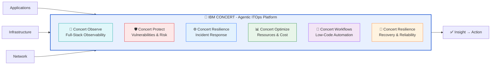
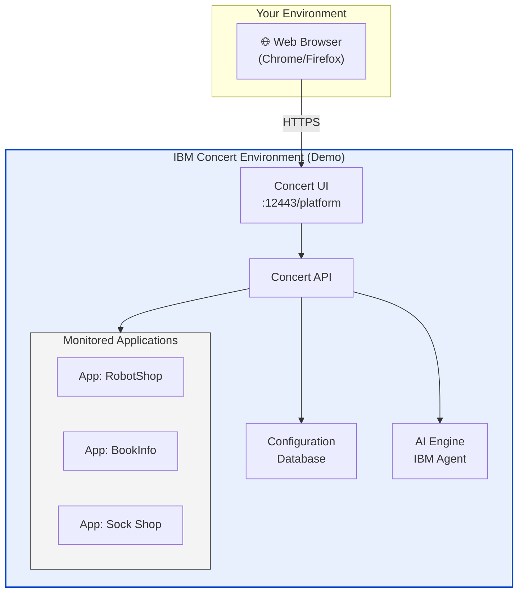

# IBM Concert Workshop

  
IBM Client Engineering

  
IBM Concert Workshop

  
Agentic ITOps · Observability · Resilience · Optimization

  

    🛡️ Concert Protect
    🔭 Concert Observe
    ⚡ Concert Resilience
    📊 Concert Optimize
    🔄 Concert Workflows
  

!!! info "Welcome to the IBM Concert Workshop"
    This hands-on workshop will guide you through the key features of **IBM Concert**, the agentic ITOps platform that unifies observability, protection, operations and optimization in a single intelligent system.

    **Platform URL**: `https://concert.tec.spgi.ibm.com:12443`  
    **Username**: `ibmconcert`  
    **Estimated duration**: 4–5 hours

---

## What is IBM Concert?

IBM Concert is an agentic ITOps platform that creates a unified, adaptive operational layer across your entire environment. It connects signals, generates shared context, and coordinates actions between teams and tools so the whole system operates as one.

---

## Workshop Modules

| Lab | Module | Description | Duration |
|-----|--------|-------------|----------|
| 🚀 **Lab 0** | Prerequisites | Environment check and access to Concert | 10 min |
| 🏠 **Lab 1** | Introduction | Navigation and main Concert dashboard | 15 min |
| 🛡️ **Lab 2** | Concert Protect | CVE vulnerability management and SBOM | 25 min |
| 🔭 **Lab 3** | Concert Observe | Full-stack observability with IBM Instana | 20 min |
| ⚙️ **Lab 4** | Concert Resilience | Incident management and response | 20 min |
| 📊 **Lab 5** | Concert Optimize | Resource optimization with IBM Turbonomic | 15 min |
| 🔄 **Lab 6** | Concert Workflows | Workflow automation | 15 min |

---

## Environment Architecture

---

## Prerequisites

!!! warning "Before you begin"
    Make sure you have the following available:

- [x] Access to a modern browser (Chrome 90+ or Firefox 88+)
- [x] Access to the Concert environment URL
- [x] Credentials provided by the instructor
- [x] Connection to the lab network

---

## Workshop Security Policy

!!! danger "Security Notice"
    The credentials provided are **exclusively for use in this workshop**. Do not share them outside the lab environment. The environment will be reset at the end of the session.

---

## Workshop Support

If you encounter any issues during the labs:

1. Check the **"Troubleshooting"** section at the end of each lab
2. Ask the instructor for help
3. Review the Concert platform logs at `Settings > Logs`
