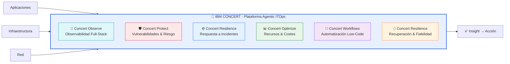
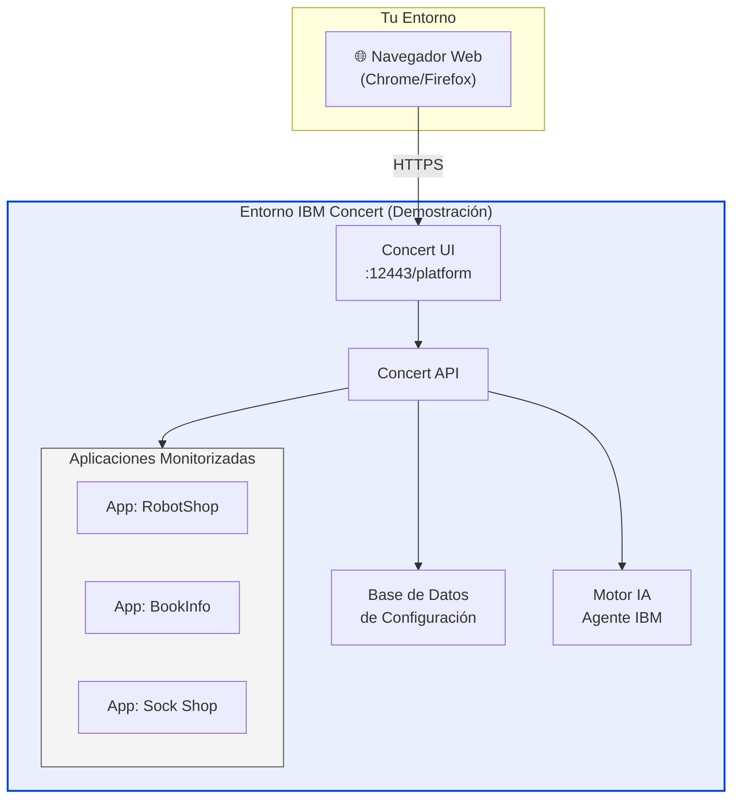

# IBM Concert Workshop

  
IBM Client Engineering

  
IBM Concert Workshop

  
Agentic ITOps · Observabilidad · Resiliencia · Optimización

  

    🛡️ Concert Protect
    🔭 Concert Observe
    ⚡ Concert Resilience
    📊 Concert Optimize
    🔄 Concert Workflows
  

!!! info "Bienvenido/a al Workshop de IBM Concert"
    Este workshop práctico te guiará por las principales funcionalidades de **IBM Concert**, la plataforma agentic de ITOps que unifica observabilidad, protección, operaciones y optimización en un único sistema inteligente.

    **URL de la plataforma**: `https://concert.tec.spgi.ibm.com:12443`  
    **Usuario**: `ibmconcert`  
    **Duración estimada**: 4–5 horas

---

## ¿Qué es IBM Concert?

IBM Concert es una plataforma agentic de ITOps que crea una capa operacional unificada y adaptable en todo tu entorno. Conecta señales, genera contexto compartido y coordina acciones entre equipos y herramientas para que todo el sistema funcione como uno.

---

## Módulos del Workshop

| Lab | Módulo | Descripción | Duración |
|-----|--------|-------------|----------|
| 🚀 **Lab 0** | Prerequisitos | Verificación de entorno y acceso a Concert | 10 min |
| 🏠 **Lab 1** | Introducción | Navegación y dashboard principal de Concert | 15 min |
| 🛡️ **Lab 2** | Concert Protect | Gestión de vulnerabilidades CVE y SBOM | 25 min |
| 🔭 **Lab 3** | Concert Observe | Observabilidad full-stack con IBM Instana | 20 min |
| ⚙️ **Lab 4** | Concert Resilience | Gestión de incidentes y respuesta | 20 min |
| 📊 **Lab 5** | Concert Optimize | Optimización de recursos con IBM Turbonomic | 15 min |
| 🔄 **Lab 6** | Concert Workflows | Automatización de flujos de trabajo | 15 min |

---

## Arquitectura del Entorno

---

## Prerequisitos

!!! warning "Antes de comenzar"
    Asegúrate de tener lo siguiente disponible:

- [x] Acceso a un navegador moderno (Chrome 90+ o Firefox 88+)
- [x] Acceso a la URL del entorno Concert
- [x] Credenciales facilitadas por el instructor
- [x] Conexión a la red del laboratorio

---

## Política de seguridad del workshop

!!! danger "Aviso de seguridad"
    Las credenciales proporcionadas son **exclusivamente para uso en este workshop**. No compartir fuera del entorno de laboratorio. El entorno se reseteará al finalizar la sesión.

---

## Soporte durante el workshop

Si encuentras algún problema durante los laboratorios:

1. Consulta la sección **"Solución de problemas"** al final de cada lab
2. Pide ayuda al instructor
3. Revisa los logs de la plataforma Concert en `Configuración > Logs`
