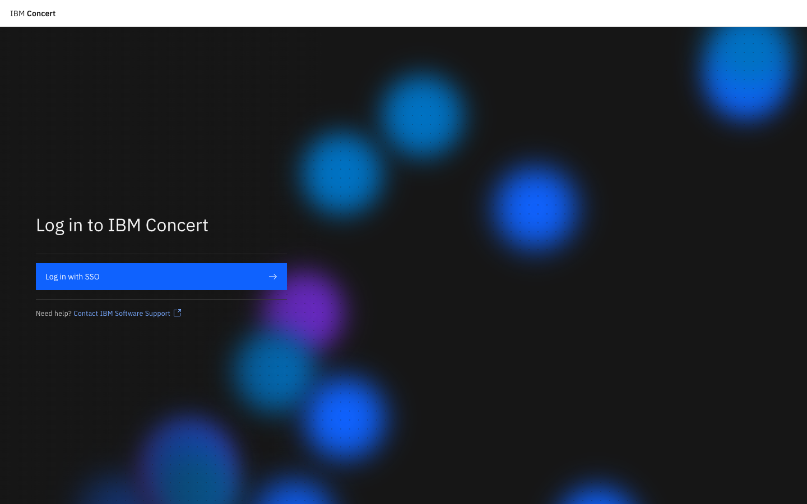
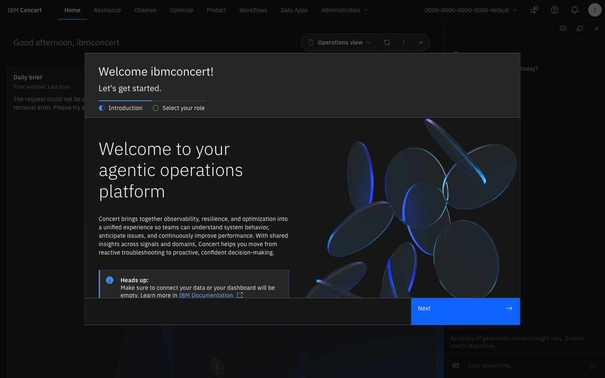

# Lab 0 — Prerequisitos y Verificación de Entorno

<div class="lab-badge lab-badge-blue">Lab 0</div>
<div class="lab-badge lab-badge-green">Prerequisitos</div>
<div class="lab-badge lab-badge-teal">10 min</div>

---

## Objetivos del laboratorio

Al finalizar este laboratorio serás capaz de:

- [x] Verificar el acceso a la plataforma IBM Concert
- [x] Navegar a la URL del entorno de demostración
- [x] Autenticarte correctamente en la plataforma
- [x] Confirmar que la vista principal carga correctamente

---

## 1. Acceso al Entorno

### 1.1 URL de la Plataforma

Abre tu navegador (Chrome o Firefox) y navega a la siguiente URL:

```
https://concert.tec.spgi.ibm.com:12443/platform/views/AtG0fxALg1It-Cwf6nsel#
```

!!! warning "Certificado SSL"
    El entorno de demostración usa un certificado autofirmado. Cuando el navegador muestre una advertencia de seguridad:
    
    1. Haz clic en **"Avanzado"** (Chrome) o **"Opciones avanzadas"** (Firefox)
    2. Selecciona **"Acceder a [URL] (no es seguro)"** o **"Aceptar el riesgo y continuar"**
    
    Este comportamiento es normal en entornos de laboratorio.

---

### 1.2 Pantalla de Login

Al acceder, verás la pantalla de inicio de sesión de IBM Concert:

<div class="screenshot-container" markdown="1">



<div class="screenshot-caption" markdown="1">
📸 Figura 1 — Pantalla de autenticación de IBM Concert
</div>
</div>

!!! tip "Imagen de referencia"
    La pantalla de login de IBM Concert muestra el logo de IBM en la parte superior, 
    con un formulario centrado que contiene los campos **Usuario** y **Contraseña**, 
    y el botón azul **"Iniciar sesión"**.

**Introduce las siguientes credenciales:**

| Campo | Valor |
|-------|-------|
| **Usuario** | `ibmconcert` |
| **Contraseña** | `Passw0rd!` |

1. Escribe `ibmconcert` en el campo **Username**
2. Escribe `Passw0rd!` en el campo **Password**
3. Haz clic en el botón **"Log in"** o presiona `Enter`

---

### 1.3 Primer Acceso — Dashboard Principal

Tras autenticarte correctamente, serás dirigido/a al **Dashboard principal de IBM Concert**:

<div class="screenshot-container" markdown="1">



<div class="screenshot-caption" markdown="1">
📸 Figura 2 — Vista principal de IBM Concert tras el login
</div>
</div>

!!! success "Acceso correcto"
    Si ves el dashboard con las tarjetas de los módulos (**Protect**, **Observe**, **Operate**, **Optimize**, **Workflows**), el acceso fue exitoso.

---

## 2. Familiarización con la Interfaz

### 2.1 Estructura de la Pantalla Principal

IBM Concert presenta una interfaz unificada con los siguientes elementos:

```
┌─────────────────────────────────────────────────────────┐
│  IBM Concert          🔔 Alertas    👤 ibmconcert   ⚙️  │
├──────────────┬──────────────────────────────────────────┤
│              │                                          │
│  🏠 Home     │         ÁREA DE TRABAJO PRINCIPAL        │
│  🔭 Observe  │                                          │
│  🛡️ Protect  │   ┌──────────┐  ┌──────────┐           │
│  ⚙️ Operate  │   │ Protect  │  │ Observe  │           │
│  📊 Optimize │   │  CVEs    │  │  APM     │           │
│  🔄 Workflows│   └──────────┘  └──────────┘           │
│  📋 Inventory│                                          │
│              │   ┌──────────┐  ┌──────────┐           │
│              │   │ Operate  │  │ Optimize │           │
│              │   │Incidents │  │Resources │           │
│              │   └──────────┘  └──────────┘           │
└──────────────┴──────────────────────────────────────────┘
```

### 2.2 Elementos de Navegación Principal

| Elemento | Descripción |
|----------|-------------|
| **Barra de navegación superior** | Módulos principales: Home, Resilience, Observe, Optimize, Protect, Workflows, Data Apps |
| **Iconos de la barra superior (derecha)** | Notificaciones, IA Assistant, perfil de usuario y configuración |
| **Área central** | Vista activa del módulo seleccionado |
| **Panel de resumen** | KPIs y métricas globales del entorno |

---

## 3. Verificación del Entorno

Confirma que los siguientes elementos son visibles en el dashboard:

=== "Checklist de verificación"

    - [ ] La barra de navegación lateral muestra todos los módulos
    - [ ] El encabezado muestra el usuario `ibmconcert`
    - [ ] Al menos una aplicación aparece en el inventario
    - [ ] Los módulos Protect y Observe muestran datos de ejemplo
    - [ ] No hay mensajes de error en la pantalla principal

=== "Solución de problemas"

    **Problema**: La página no carga / Error de conexión
    
    → Verifica que estás conectado/a a la red del laboratorio
    
    → Comprueba que la URL incluye `https://` al inicio
    
    **Problema**: Credenciales incorrectas
    
    → Asegúrate de que la contraseña es exactamente `Passw0rd!` (con mayúscula P y el `0` es cero)
    
    **Problema**: Pantalla en blanco tras login
    
    → Recarga la página con `Ctrl+F5` (Windows) o `Cmd+Shift+R` (Mac)

---

## Resumen

!!! success "Lab 0 completado ✅"
    Has verificado exitosamente:
    
    - ✅ Acceso a la URL de IBM Concert
    - ✅ Autenticación con las credenciales del workshop
    - ✅ Carga del dashboard principal
    - ✅ Estructura de la interfaz de Concert
    
    **Siguiente paso**: [Lab 1 — Introducción a Concert →](../lab1/index.md)
