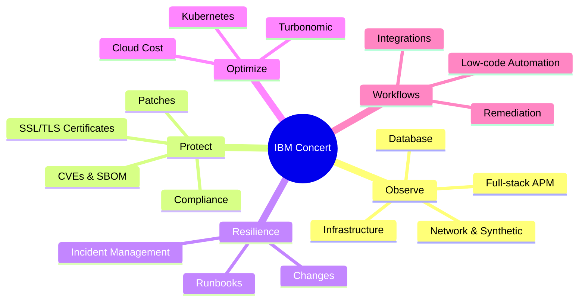
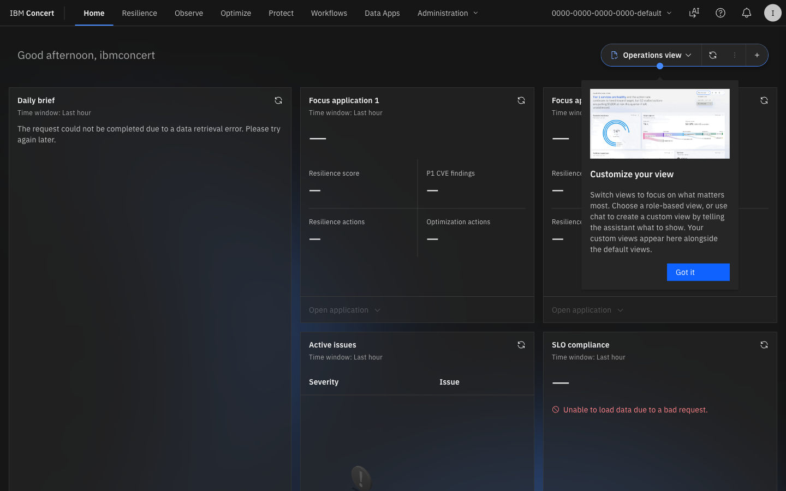
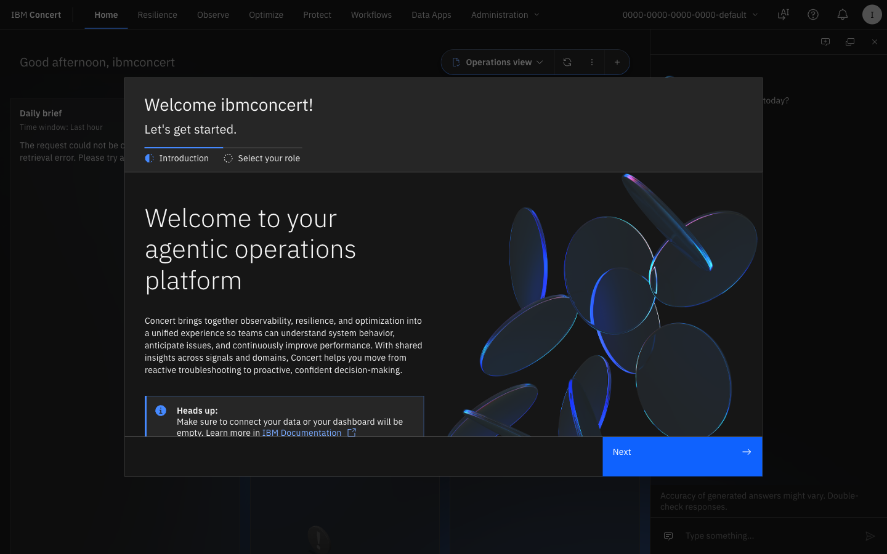
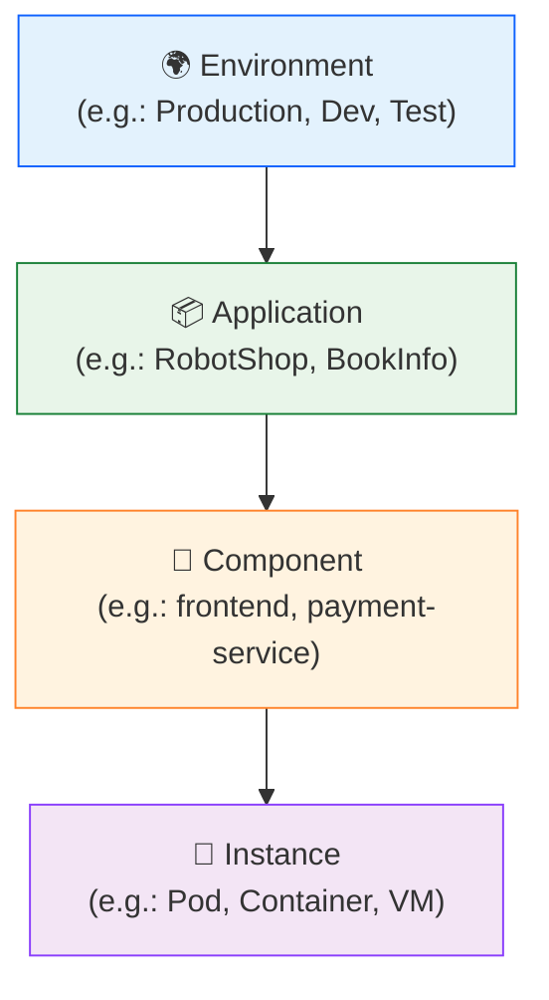
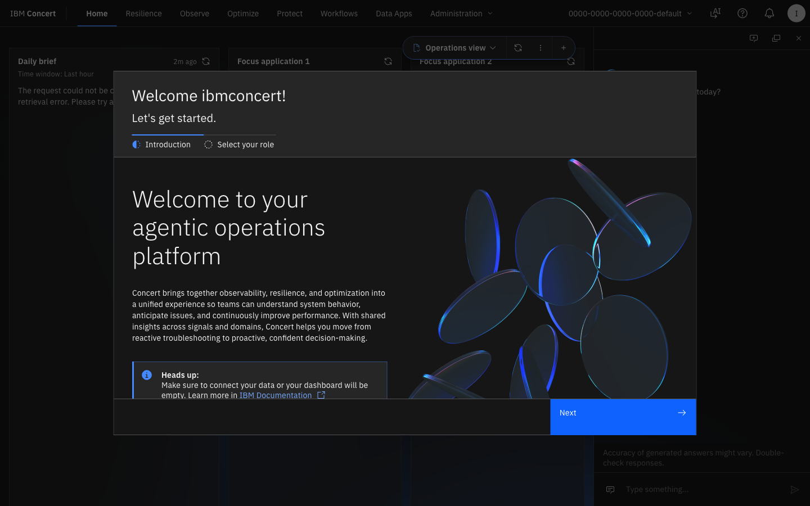
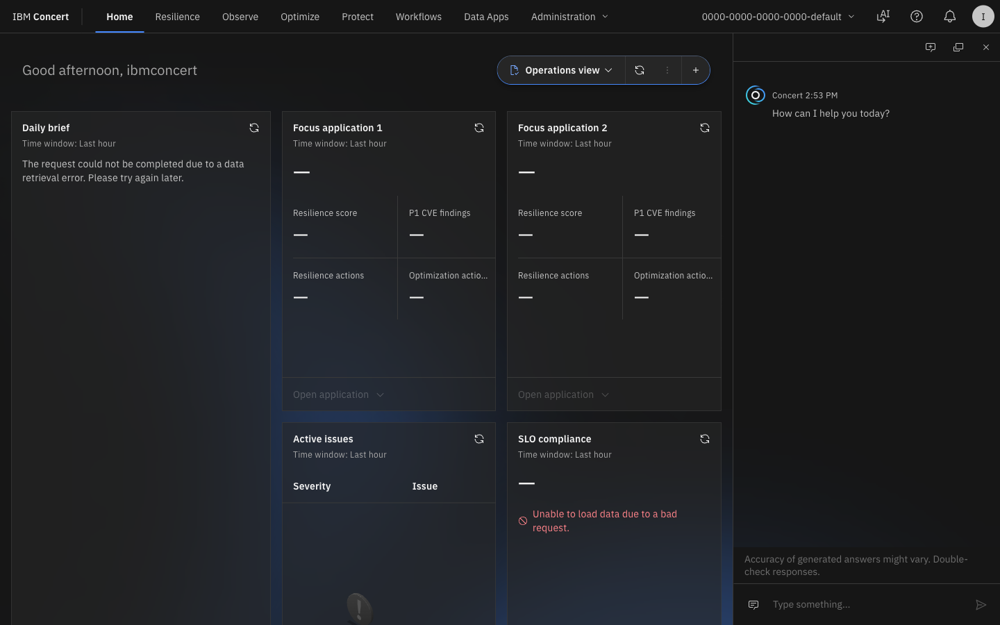
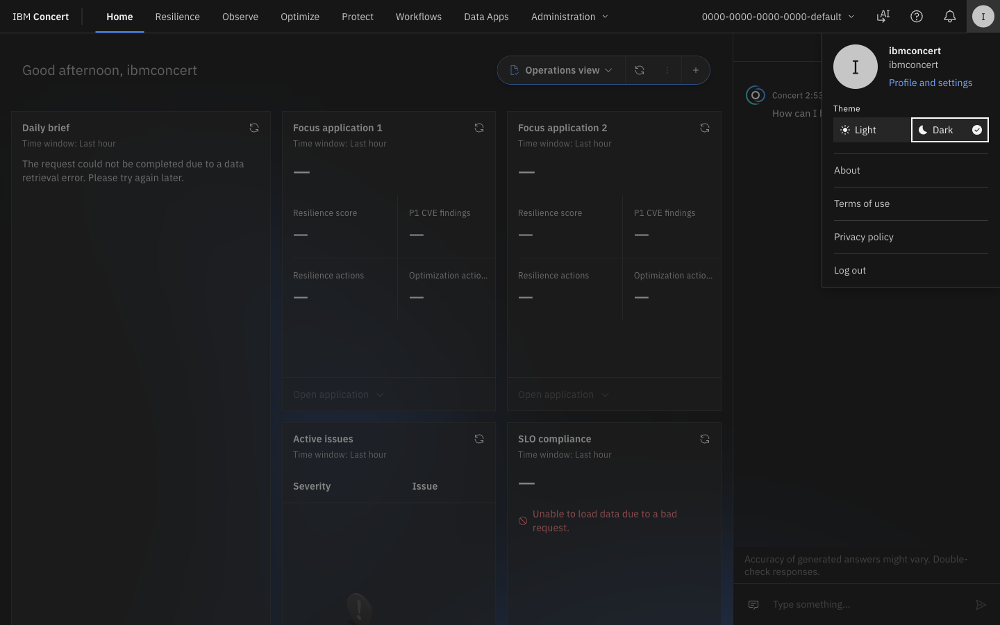

# Lab 1 — Introduction and Navigation in IBM Concert

Lab 1

Introduction

15 min

---

## Lab Objectives

By the end of this lab you will be able to:

- [x] Navigate through the different IBM Concert modules
- [x] Identify the inventory of managed applications
- [x] Explore the Global Risk Panel (Risk Arena)
- [x] Understand Concert's data structure (Environments, Applications, Components)
- [x] Configure and customise the dashboard view

---

## What is IBM Concert?

IBM Concert is an **agentic ITOps platform** that unifies:

---

## 1. The Main Dashboard — Overview

### 1.1 Navigating to the Dashboard

When you log in to Concert, the main screen shows an executive summary of the health status of your entire infrastructure.

📸 Figure 1 — IBM Concert main dashboard with modules and global KPIs

!!! info "Concert main view"
    The Concert interface is organised in **module cards** in the central panel, 
    with the top navigation bar to access each area. At the top you will see 
    the total number of applications, active vulnerabilities and alerts.

### 1.2 Main Panel KPIs

The dashboard shows key metrics for the entire environment:

| KPI | Description |
|-----|-------------|
| **Applications** | Total applications registered in Concert |
| **Active Alerts** | Real-time active alerts |
| **Critical CVEs** | Critical unresolved vulnerabilities |
| **Certificates expiring** | Certificates about to expire |
| **Compliance violations** | Policy non-compliance |

---

## 2. The Application Inventory

### 2.1 Accessing the Inventory

In the **top navigation bar** select any module (Resilience, Observe, Optimize, Protect, Workflows) to explore the monitored applications.

📸 Figure 2 — Application inventory view in IBM Concert

### 2.2 Concert Inventory Structure

Concert organises resources in a 3-level hierarchy:

### 2.3 Exploring an Application

1. In the inventory, look for the application **"RobotShop"** (or whichever is available in your environment)
2. Click on the application name to see its details

📸 Figure 3 — Application detail view showing components and health status

**In the application detail view you will find:**

- **Overview**: Health status summary
- **Components**: List of microservices/components
- **Vulnerabilities**: CVEs associated with this application
- **Certificates**: Managed TLS certificates
- **Topology**: Real-time dependency map

---

## 3. The Risk Arena — Global Risk View

### 3.1 What is the Risk Arena?

The **Risk Arena** is Concert's central view that correlates security, operational and business risk on a single screen.

To access it: Top navigation → **"Home"** or look for **"Risk Arena"**

📸 Figure 4 — Risk Arena view showing applications positioned by risk level

!!! tip "Interpreting the Risk Arena"
    Each bubble represents an application. The **size** indicates the number of issues, 
    the **vertical position** the risk level and the **colour** the severity:
    
    - 🔴 **Red**: Critical risk
    - 🟠 **Orange**: High risk  
    - 🟡 **Yellow**: Medium risk
    - 🟢 **Green**: Low risk

### 3.2 Interacting with the Risk Arena

1. **Click** on a bubble to see the application detail
2. **Hover** over it to see a quick summary (tooltip)
3. Use the **filters** at the top to filter by module (Protect, Observe, etc.)

---

## 4. Environment Configuration

### 4.1 Accessing Settings

Click on the **⚙️ Settings** icon in the top-right bar.

📸 Figure 5 — IBM Concert settings panel

### 4.2 Settings Sections

| Section | Description |
|---------|-------------|
| **Integrations** | Connections with external tools (Jira, ServiceNow, GitHub) |
| **Notifications** | Alert and channel configuration (email, Slack, webhook) |
| **Users & Roles** | User management and RBAC permissions |
| **Data Sources** | Connected data sources (Instana, AWS, Kubernetes) |
| **Policies** | Compliance policy definitions |

---

## 5. Navigation Menu Exploration

### 5.1 All available modules

Explore each element of the top navigation bar:

=== "🔭 Observe"
    **Full-stack observability**
    
    - Applications Performance Monitoring (APM)
    - Infrastructure monitoring
    - Network observability
    - Database performance
    
    [Go to Lab 3 - Concert Observe →](../lab3/index.md)

=== "🛡️ Protect"
    **Protection and risk management**
    
    - Vulnerability management (CVE/NVD)
    - Software Bill of Materials (SBOM)
    - Certificate lifecycle management
    - Compliance & policies
    
    [Go to Lab 2 - Concert Protect →](../lab2/index.md)

=== "⚙️ Resilience"
    **Operations and incident response**
    
    - Incident management
    - Runbook automation
    - Change management
    - Problem management
    
    [Go to Lab 4 - Concert Resilience →](../lab4/index.md)

=== "📊 Optimize"
    **Resource optimisation (Turbonomic)**
    
    - Resource right-sizing
    - Cloud cost optimization
    - Kubernetes optimization
    - Workload placement
    
    [Go to Lab 5 - Concert Optimize →](../lab5/index.md)

=== "🔄 Workflows"
    **Workflow automation**
    
    - Low-code workflow builder
    - Pre-built automations
    - Integration connectors
    - Governed execution
    
    [Go to Lab 6 - Concert Workflows →](../lab6/index.md)

---

## 6. Notifications Panel

### 6.1 Alerts Centre

Click on the 🔔 icon in the top bar to see active notifications.

📸 Figure 6 — Concert notifications and alerts centre

Notifications in Concert are classified by:

- 🔴 **Critical** — Immediate action required
- 🟠 **High** — Priority attention
- 🔵 **Info** — System information

---

## Summary

!!! success "Lab 1 completed ✅"
    You have successfully explored:
    
    - ✅ The IBM Concert main dashboard
    - ✅ The application inventory and its hierarchical structure
    - ✅ The Risk Arena and global risk visualisation
    - ✅ The main modules available in Concert
    - ✅ The settings and notifications panel
    
    **Next step**: [Lab 2 — Concert Protect: Vulnerabilities →](../lab2/index.md)
