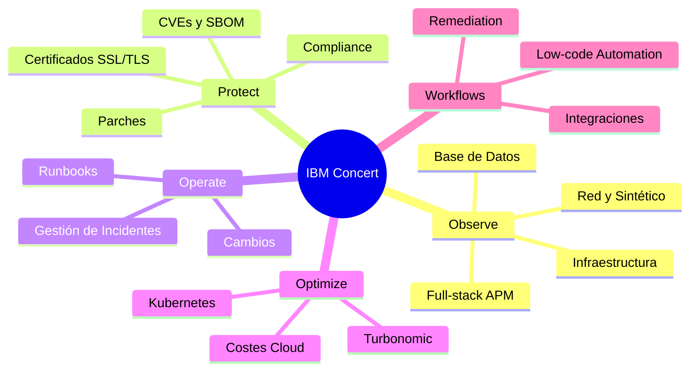
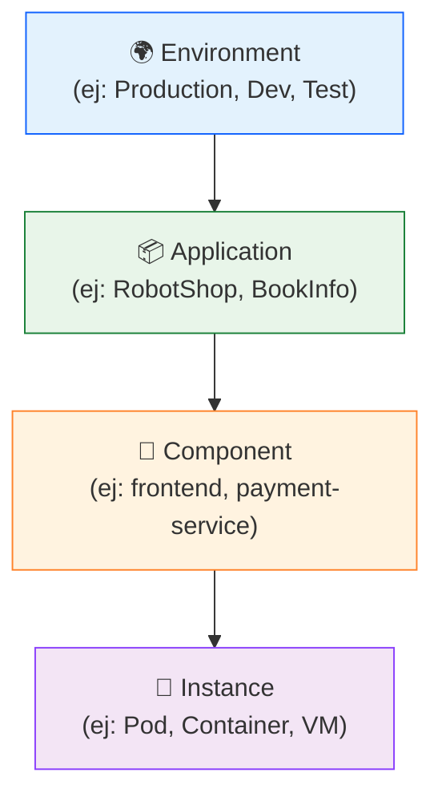

# Lab 1 — Introducción y Navegación en IBM Concert

Lab 1

Introducción

15 min

---

## Objetivos del laboratorio

Al finalizar este laboratorio serás capaz de:

- [x] Navegar por los diferentes módulos de IBM Concert
- [x] Identificar el inventario de aplicaciones gestionadas
- [x] Explorar el Panel de Riesgo Global (Risk Arena)
- [x] Comprender la estructura de datos de Concert (Environments, Applications, Components)
- [x] Configurar y personalizar la vista del dashboard

---

## ¿Qué es IBM Concert?

IBM Concert es una **plataforma agentic de ITOps** que unifica:

---

## 1. El Dashboard Principal — Vista General

### 1.1 Navegación al Dashboard

Al hacer login en Concert, la pantalla principal muestra un resumen ejecutivo del estado de salud de toda la infraestructura.

📸 Figura 1 — Dashboard principal de IBM Concert con módulos y KPIs globales

!!! info "Vista principal de Concert"
    La interfaz de Concert está organizada en **tarjetas de módulo** en el panel central, 
    con la navegación lateral izquierda para acceder a cada área. En la parte superior 
    verás el número total de aplicaciones, vulnerabilidades activas y alertas.

### 1.2 KPIs del Panel Principal

El dashboard muestra métricas clave de todo el entorno:

| KPI | Descripción |
|-----|-------------|
| **Applications** | Total de aplicaciones registradas en Concert |
| **Active Alerts** | Alertas activas en tiempo real |
| **Critical CVEs** | Vulnerabilidades críticas sin remediar |
| **Certificates expiring** | Certificados próximos a expirar |
| **Compliance violations** | Incumplimientos de políticas |

---

## 2. El Inventario de Aplicaciones

### 2.1 Acceder al Inventario

En la **barra de navegación superior** selecciona cualquier módulo (Resilience, Observe, Optimize, Protect, Workflows) para explorar las aplicaciones monitorizadas.

📸 Figura 2 — Vista del inventario de aplicaciones en IBM Concert

### 2.2 Estructura del Inventario Concert

Concert organiza los recursos en una jerarquía de 3 niveles:

### 2.3 Explorar una Aplicación

1. En el inventario, busca la aplicación **"RobotShop"** (o la que esté disponible en tu entorno)
2. Haz clic sobre el nombre de la aplicación para ver sus detalles

📸 Figura 3 — Vista de detalle de una aplicación mostrando componentes y estado de salud

**En la vista de detalle de aplicación encontrarás:**

- **Overview**: Resumen del estado de salud
- **Components**: Lista de microservicios/componentes
- **Vulnerabilities**: CVEs asociados a esta aplicación
- **Certificates**: Certificados TLS gestionados
- **Topology**: Mapa de dependencias en tiempo real

---

## 3. El Risk Arena — Vista de Riesgo Global

### 3.1 ¿Qué es el Risk Arena?

El **Risk Arena** es la vista central de Concert que correlaciona riesgo de seguridad, operacional y de negocio en una sola pantalla.

Para acceder: Menú lateral → **"Risk Arena"** o **"Home"**

📸 Figura 4 — Vista del Risk Arena mostrando aplicaciones posicionadas por nivel de riesgo

!!! tip "Interpretación del Risk Arena"
    Cada burbuja representa una aplicación. El **tamaño** indica el número de issues, 
    la **posición vertical** el nivel de riesgo y el **color** la severidad:
    
    - 🔴 **Rojo**: Riesgo crítico
    - 🟠 **Naranja**: Riesgo alto  
    - 🟡 **Amarillo**: Riesgo medio
    - 🟢 **Verde**: Riesgo bajo

### 3.2 Interactuar con el Risk Arena

1. **Haz clic** sobre una burbuja para ver el detalle de la aplicación
2. **Pasa el ratón** sobre ella para ver un resumen rápido (tooltip)
3. Usa los **filtros** en la parte superior para filtrar por módulo (Protect, Observe, etc.)

---

## 4. Configuración del Entorno

### 4.1 Acceder a la Configuración

Haz clic en el ícono **⚙️ Configuración** en la barra superior derecha.

📸 Figura 5 — Panel de configuración de IBM Concert

### 4.2 Secciones de Configuración

| Sección | Descripción |
|---------|-------------|
| **Integrations** | Conexiones con herramientas externas (Jira, ServiceNow, GitHub) |
| **Notifications** | Configuración de alertas y canales (email, Slack, webhook) |
| **Users & Roles** | Gestión de usuarios y permisos RBAC |
| **Data Sources** | Orígenes de datos conectados (Instana, AWS, Kubernetes) |
| **Policies** | Definición de políticas de compliance |

---

## 5. Exploración del Menú de Navegación

### 5.1 Todos los módulos disponibles

Explora cada elemento del menú lateral:

=== "🔭 Observe"
    **Observabilidad full-stack**
    
    - Applications Performance Monitoring (APM)
    - Infrastructure monitoring
    - Network observability
    - Database performance
    
    [Ir al Lab 3 - Concert Observe →](../lab3/index.md)

=== "🛡️ Protect"
    **Protección y gestión de riesgos**
    
    - Vulnerability management (CVE/NVD)
    - Software Bill of Materials (SBOM)
    - Certificate lifecycle management
    - Compliance & policies
    
    [Ir al Lab 2 - Concert Protect →](../lab2/index.md)

=== "⚙️ Operate"
    **Operaciones y respuesta a incidentes**
    
    - Incident management
    - Runbook automation
    - Change management
    - Problem management
    
    [Ir al Lab 4 - Concert Resilience →](../lab4/index.md)

=== "📊 Optimize"
    **Optimización de recursos (Turbonomic)**
    
    - Resource right-sizing
    - Cloud cost optimization
    - Kubernetes optimization
    - Workload placement
    
    [Ir al Lab 5 - Concert Optimize →](../lab5/index.md)

=== "🔄 Workflows"
    **Automatización de flujos de trabajo**
    
    - Low-code workflow builder
    - Pre-built automations
    - Integration connectors
    - Governed execution
    
    [Ir al Lab 6 - Concert Workflows →](../lab6/index.md)

---

## 6. Panel de Notificaciones

### 6.1 Centro de Alertas

Haz clic en el ícono 🔔 en la barra superior para ver las notificaciones activas.

📸 Figura 6 — Centro de notificaciones y alertas de Concert

Las notificaciones en Concert se clasifican por:

- 🔴 **Critical** — Acción inmediata requerida
- 🟠 **High** — Atención prioritaria
- 🔵 **Info** — Información del sistema

---

## Resumen

!!! success "Lab 1 completado ✅"
    Has explorado exitosamente:
    
    - ✅ El dashboard principal de IBM Concert
    - ✅ El inventario de aplicaciones y su estructura jerárquica
    - ✅ El Risk Arena y la visualización de riesgo global
    - ✅ Los módulos principales disponibles en Concert
    - ✅ El panel de configuración y notificaciones
    
    **Siguiente paso**: [Lab 2 — Concert Protect: Vulnerabilidades →](../lab2/index.md)
