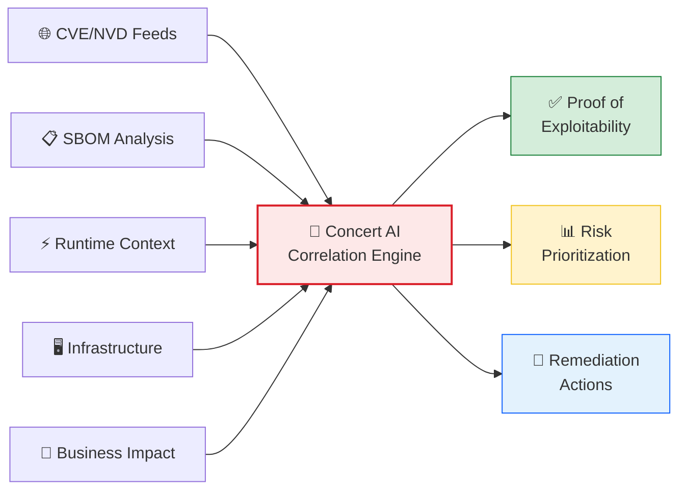

# Lab 2 — Concert Protect: Vulnerabilities, CVEs and SBOM

<div class="lab-badge lab-badge-red">Lab 2</div>
<div class="lab-badge lab-badge-blue">Concert Protect</div>
<div class="lab-badge lab-badge-teal">25 min</div>

---

## Lab Objectives

By the end of this lab you will be able to:

- [x] Navigate the **Concert Protect** module
- [x] View and filter CVE vulnerabilities by severity
- [x] Analyse a **Software Bill of Materials (SBOM)**
- [x] Understand IBM Concert's **Proof of Exploitability**
- [x] Manage the **SSL/TLS certificate lifecycle**
- [x] Configure and review **Compliance** policies
- [x] Prioritise and assign remediations

---

## Introduction to Concert Protect

<div class="concert-protect">

**Concert Protect** goes beyond traditional CVSS scores. It correlates code, application, infrastructure, runtime and business context to validate whether a vulnerability can be exploited in **your specific environment**.

</div>



---

## 1. Concert Protect Module — Overview

### 1.1 Accessing Concert Protect

In the **top navigation bar**, click on **"Protect"**.

<div class="screenshot-container" markdown="1">


<div class="screenshot-caption" markdown="1">
📸 Figure 1 — Concert Protect module main view with vulnerability summary
</div>
</div>

!!! info "Protect Panel"
    The Concert Protect main view shows:
    
    - **Total number of CVEs** categorised by severity
    - **Most exposed applications** (ordered by risk)
    - **Certificates about to expire** (timeline)
    - **Policy compliance summary**

### 1.2 Vulnerability Dashboard

The top summary shows counters by severity:

| Severity | Colour | Description |
|----------|--------|-------------|
| 🔴 **Critical** | Red | CVSS 9.0–10.0 — Immediate action |
| 🟠 **High** | Orange | CVSS 7.0–8.9 — Priority attention |
| 🟡 **Medium** | Yellow | CVSS 4.0–6.9 — Plan remediation |
| 🟢 **Low** | Green | CVSS 0.1–3.9 — Monitor |
| ⚫ **Info** | Grey | No known impact |

---

## 2. CVE Vulnerability Management

### 2.1 CVE List

Click on **"Vulnerabilities"** in the Protect menu.

<div class="screenshot-container" markdown="1">


<div class="screenshot-caption" markdown="1">
📸 Figure 2 — CVE vulnerability list with filters and severity sorting
</div>
</div>

### 2.2 Filtering Vulnerabilities

Concert allows filtering CVEs across multiple dimensions:

=== "By Severity"
    1. Click the **"Severity"** filter
    2. Select **"Critical"** to see only critical vulnerabilities
    3. The list updates showing only CVEs with CVSS ≥ 9.0

=== "By Application"
    1. Click the **"Application"** filter
    2. Select an application from the inventory (e.g.: "RobotShop")
    3. See only CVEs affecting that application

=== "By Status"
    1. Use the **"Status"** filter to filter by:
       - **Open**: Unresolved
       - **In Progress**: Remediation in progress
       - **Resolved**: Remediated
       - **Accepted Risk**: Risk accepted by the business

=== "By Date"
    1. Use the **"Published Date"** filter to see recent CVEs
    2. Select "Last 30 days" to see new vulnerabilities

### 2.3 CVE Detail

Click on any CVE in the list to see its full detail.

<div class="screenshot-container" markdown="1">


<div class="screenshot-caption" markdown="1">
📸 Figure 3 — CVE vulnerability detail view with proof of exploitability
</div>
</div>

**The detail view includes:**

| Section | Information |
|---------|-------------|
| **CVE ID** | Unique identifier (e.g.: CVE-2024-1234) |
| **CVSS Score** | Base severity score |
| **Description** | Technical description of the vulnerability |
| **Affected Components** | Affected packages/libraries |
| **Affected Applications** | Which applications have this CVE |
| **Proof of Exploitability** | Is it exploitable in YOUR environment? |
| **Remediation** | Fixed version available |
| **References** | Links to NVD, CVE.org, advisories |

### 2.4 Proof of Exploitability (PoE)

!!! tip "Concert's differentiating feature"
    **Proof of Exploitability** is one of Concert Protect's most powerful features.
    Unlike other tools that only show the CVSS score, Concert analyses:
    
    - Is the vulnerable package **actually in use** at runtime?
    - Is there an **attack vector** accessible from outside?
    - Are there **sensitive data** accessible through this vulnerability?
    - What is the **business impact** if exploited?

<div class="screenshot-container" markdown="1">


<div class="screenshot-caption" markdown="1">
📸 Figure 4 — Proof of Exploitability panel showing contextual exploitability analysis
</div>
</div>

Possible PoE states are:

- ✅ **Exploitable**: Confirmed exploitable in your environment
- ⚠️ **Potentially Exploitable**: Requires further investigation  
- ❌ **Not Exploitable**: Concert has verified it is NOT exploitable in your environment

---

## 3. Software Bill of Materials (SBOM)

### 3.1 What is an SBOM?

A **Software Bill of Materials (SBOM)** is a complete inventory of all software components in an application, including:

- Direct and indirect dependencies
- Exact versions of each package
- Software licences
- Known vulnerabilities per component

### 3.2 Viewing an Application's SBOM

1. Go to **Protect → Applications**
2. Select an application (e.g.: "RobotShop")
3. Click on the **"SBOM"** tab

<div class="screenshot-container" markdown="1">


<div class="screenshot-caption" markdown="1">
📸 Figure 5 — Application SBOM view with dependency tree
</div>
</div>

### 3.3 SBOM Analysis

The SBOM in Concert shows:

```
RobotShop Application
├── 📦 frontend (Node.js 18.12.0)
│   ├── express 4.18.2 ✅ no CVE
│   ├── axios 1.4.0 ⚠️ CVE-2023-45857 (Medium)
│   └── lodash 4.17.19 🔴 CVE-2021-23337 (High)
├── 📦 payment-service (Java 17)
│   ├── spring-boot 3.1.5 ✅ no CVE
│   └── log4j-core 2.17.1 ✅ patched
└── 📦 catalogue (Go 1.21.0)
    ├── gin 1.9.1 ✅ no CVE
    └── golang.org/x/crypto 0.14.0 🟡 CVE-2023-44487 (Medium)
```

### 3.4 Exporting the SBOM

Concert allows exporting the SBOM in standard formats:

1. Click **"Export"** or **"Download SBOM"**
2. Select the format:
   - **CycloneDX** (OWASP standard format)
   - **SPDX** (Linux Foundation standard format)
   - **CSV** (for manual analysis)

---

## 4. SSL/TLS Certificate Management

### 4.1 Accessing Certificate Management

In the Protect menu, select **"Certificates"**.

<div class="screenshot-container" markdown="1">


<div class="screenshot-caption" markdown="1">
📸 Figure 6 — SSL/TLS certificate management panel with expiry timeline
</div>
</div>

### 4.2 Certificate View

The certificate view shows:

| Column | Description |
|--------|-------------|
| **Certificate Name** | Certificate name/domain |
| **Expiry Date** | Expiration date |
| **Days Remaining** | Days until expiration |
| **Status** | Valid / Expiring Soon / Expired |
| **Associated Apps** | Applications using this certificate |
| **Issuer** | Certificate Authority (CA) |

### 4.3 Certificate Alerts

Concert automatically generates alerts when a certificate is about to expire:

- 🔴 **Expired** — Immediate action required
- 🟠 **Expires in < 14 days** — Urgent
- 🟡 **Expires in < 30 days** — Plan renewal
- 🟢 **Expires in > 30 days** — Normal status

---

## 5. Compliance and Policies

### 5.1 Accessing Compliance

In the Protect menu, select **"Compliance"** or **"Policies"**.

<div class="screenshot-container" markdown="1">


<div class="screenshot-caption" markdown="1">
📸 Figure 7 — Compliance view with policies and compliance status
</div>
</div>

### 5.2 Predefined Policies

Concert includes pre-configured compliance policies for standard frameworks:

=== "Security"
    - **CVE Critical Resolution**: Critical CVEs must be remediated in < 7 days
    - **High CVE Resolution**: High CVEs in < 30 days
    - **No Root Containers**: Containers must not run as root
    - **Image Signing**: All images must be signed

=== "Certificates"
    - **Certificate Expiry Warning**: Alert 30 days before expiration
    - **Certificate Min Key Length**: RSA keys ≥ 2048 bits
    - **TLS Version**: TLS 1.2 or higher only

=== "SBOM"
    - **SBOM Required**: All apps must have SBOM
    - **License Compliance**: No GPL licences in proprietary software
    - **Outdated Packages**: Packages more than 2 versions behind

### 5.3 Compliance Status

<div class="screenshot-container" markdown="1">


<div class="screenshot-caption" markdown="1">
📸 Figure 8 — Detailed compliance status by policy and application
</div>
</div>

---

## 6. Remediation Workflow

### 6.1 Assigning a Vulnerability

1. From the CVE list, select a critical CVE
2. Click **"Assign"** or **"Create Ticket"**
3. Fill in the assignment form:
   - **Assignee**: Responsible team
   - **Priority**: Critical/High/Medium/Low
   - **Due Date**: Remediation deadline
   - **Notes**: Additional comments

<div class="screenshot-container" markdown="1">


<div class="screenshot-caption" markdown="1">
📸 Figure 9 — Assignment form and remediation ticket creation
</div>
</div>

### 6.2 Integration with Ticketing Systems

Concert can automatically create tickets in:

- **Jira** — Create an issue in the corresponding project
- **ServiceNow** — Create an incident or change request
- **GitHub Issues** — For code vulnerabilities
- **PagerDuty** — For high-urgency alerts

!!! tip "Remediation automation"
    In **Lab 6** you will learn to create automated Workflows that create tickets 
    automatically in Jira/ServiceNow when a critical CVE is detected.

---

## 7. Practical Exercise

### 🎯 Exercise: Analyse Application Risk

Follow these steps in the Concert environment:

1. **Navigate** to Protect → Vulnerabilities
2. **Filter** by Severity: Critical
3. **Identify** the CVE with the highest CVSS score
4. **Open** the CVE detail
5. **Verify** if it has active Proof of Exploitability
6. **Identify** which applications are affected
7. **Check** the SBOM of the most affected application
8. **Document** your answers in the response table:

| Question | Your Answer |
|----------|-------------|
| How many critical CVEs are there in total? | |
| Which CVE has the highest CVSS score? | |
| Is it marked as "Exploitable" (PoE)? | |
| Which application has the most critical CVEs? | |
| How many certificates expire in < 30 days? | |

---

## Summary

!!! success "Lab 2 completed ✅"
    You have successfully explored the Concert Protect module:
    
    - ✅ Viewing and filtering CVEs by severity
    - ✅ Analysing Proof of Exploitability
    - ✅ Exploring the Software Bill of Materials (SBOM)
    - ✅ Managing the SSL/TLS certificate lifecycle
    - ✅ Reviewing compliance policies
    - ✅ Vulnerability assignment and remediation workflow
    
    **Next step**: [Lab 3 — Concert Observe: Observability →](../lab3/index.md)
