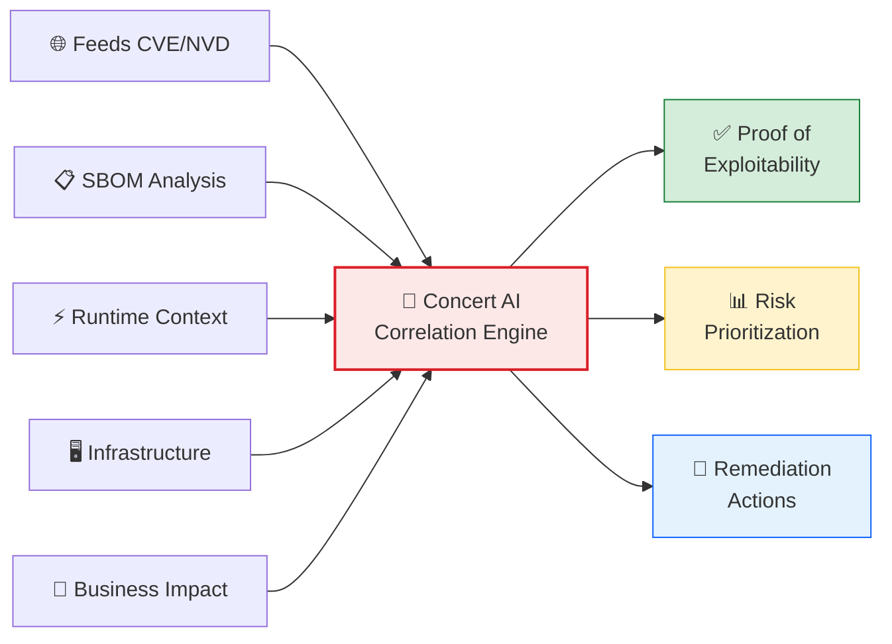
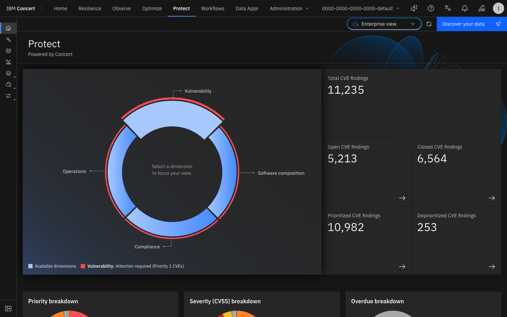
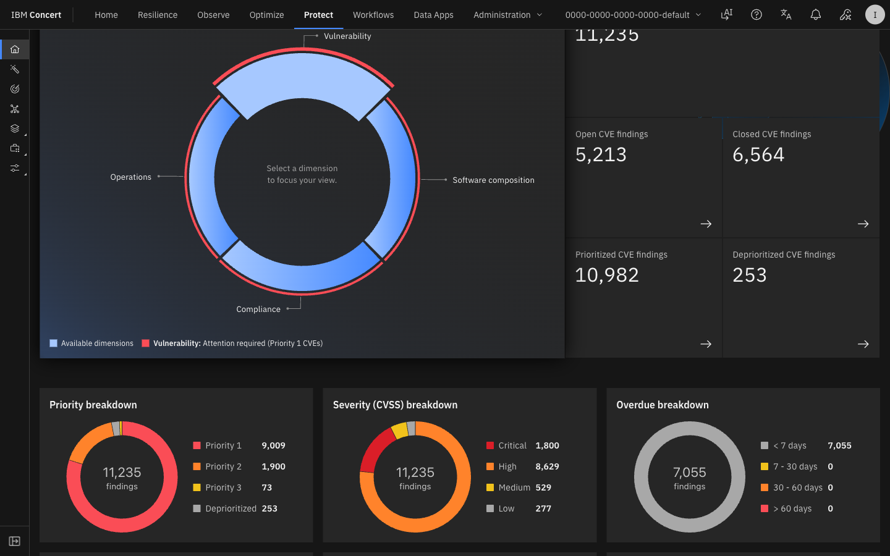
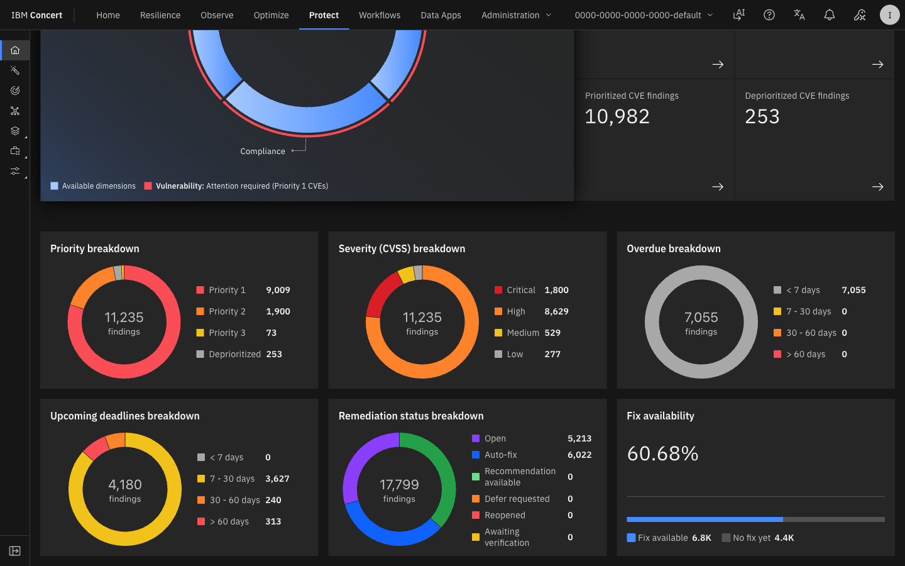
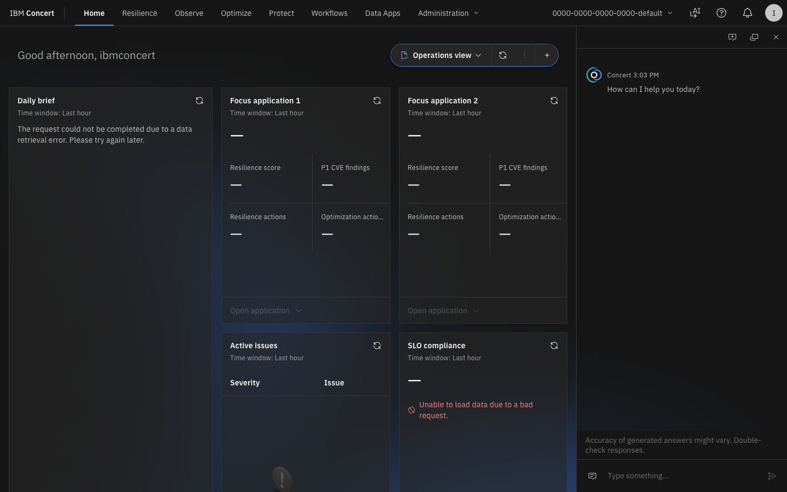
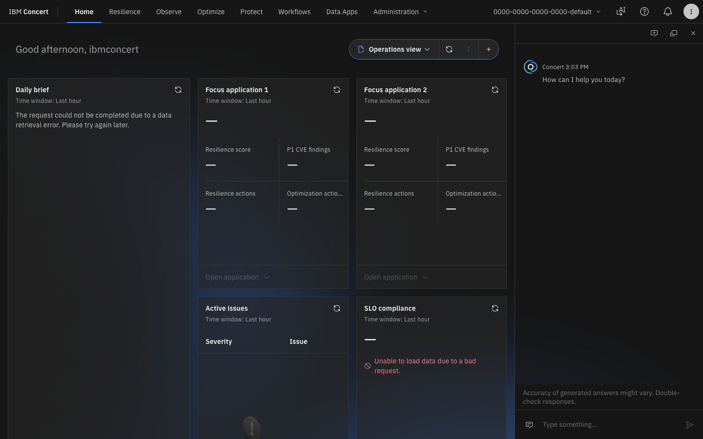
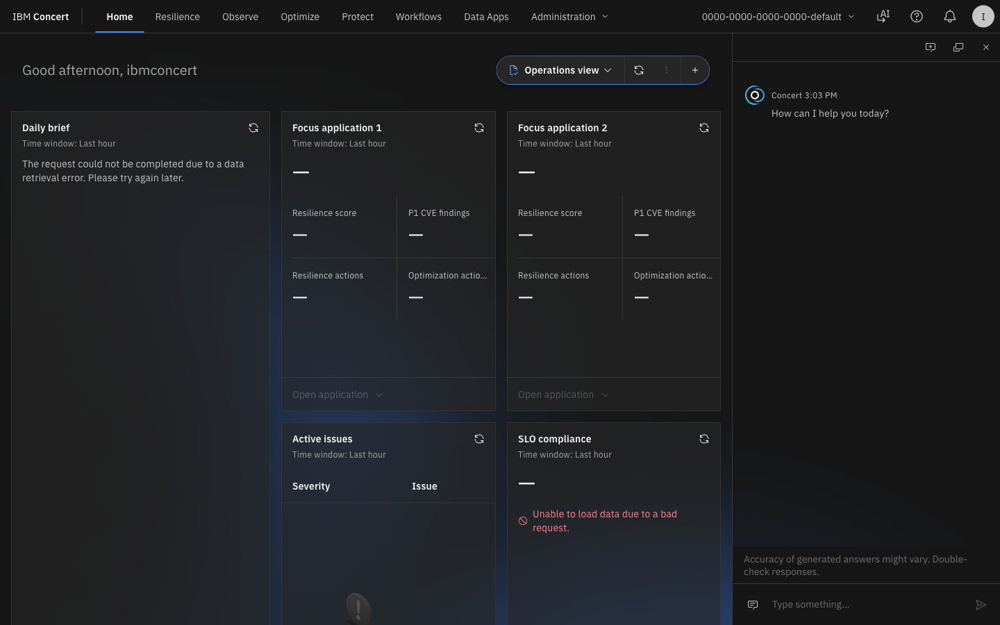
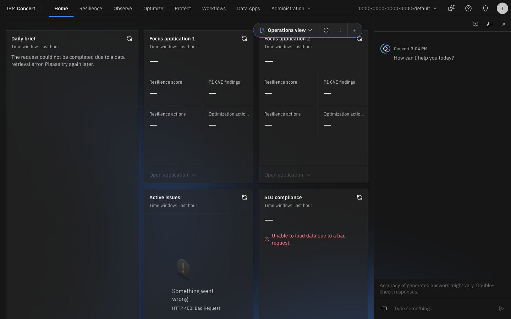

# Lab 2 — Concert Protect: Vulnerabilidades, CVEs y SBOM

<div class="lab-badge lab-badge-red">Lab 2</div>
<div class="lab-badge lab-badge-blue">Concert Protect</div>
<div class="lab-badge lab-badge-teal">25 min</div>

---

## Objetivos del laboratorio

Al finalizar este laboratorio serás capaz de:

- [x] Navegar por el módulo **Concert Protect**
- [x] Visualizar y filtrar vulnerabilidades CVE por severidad
- [x] Analizar un **Software Bill of Materials (SBOM)**
- [x] Comprender la **Proof of Exploitability** de IBM Concert
- [x] Gestionar el **ciclo de vida de certificados SSL/TLS**
- [x] Configurar y revisar políticas de **Compliance**
- [x] Priorizar y asignar remediaciones

---

## Introducción a Concert Protect

<div class="concert-protect">

**Concert Protect** va más allá de los scores CVSS tradicionales. Correlaciona contexto de código, aplicación, infraestructura, runtime y negocio para validar si una vulnerabilidad puede ser explotada en **tu entorno específico**.

</div>



---

## 1. Módulo Concert Protect — Vista General

### 1.1 Acceder a Concert Protect

En la **barra de navegación superior**, haz clic en **"Protect"**.

<div class="screenshot-container" markdown="1">


<div class="screenshot-caption" markdown="1">
📸 Figura 1 — Vista principal del módulo Concert Protect con resumen de vulnerabilidades
</div>
</div>

!!! info "Panel de Protect"
    La vista principal de Concert Protect muestra:
    
    - **Número total de CVEs** categorizados por severidad
    - **Aplicaciones más expuestas** (ordenadas por riesgo)
    - **Certificados próximos a expirar** (timeline)
    - **Resumen de cumplimiento de políticas**

### 1.2 Dashboard de Vulnerabilidades

El resumen superior muestra los contadores por severidad:

| Severidad | Color | Descripción |
|-----------|-------|-------------|
| 🔴 **Critical** | Rojo | CVSS 9.0–10.0 — Acción inmediata |
| 🟠 **High** | Naranja | CVSS 7.0–8.9 — Atención prioritaria |
| 🟡 **Medium** | Amarillo | CVSS 4.0–6.9 — Planificar remediación |
| 🟢 **Low** | Verde | CVSS 0.1–3.9 — Monitorizar |
| ⚫ **Info** | Gris | Sin impacto conocido |

---

## 2. Gestión de Vulnerabilidades CVE

### 2.1 Lista de CVEs

Haz clic en **"Vulnerabilities"** en el menú de Protect.

<div class="screenshot-container" markdown="1">



<div class="screenshot-caption" markdown="1">
📸 Figura 2 — Lista de vulnerabilidades CVE con filtros y ordenación por severidad
</div>
</div>

### 2.2 Filtrar Vulnerabilidades

Concert permite filtrar CVEs por múltiples dimensiones:

=== "Por Severidad"
    1. Haz clic en el filtro **"Severity"**
    2. Selecciona **"Critical"** para ver solo vulnerabilidades críticas
    3. La lista se actualiza mostrando solo CVEs con CVSS ≥ 9.0

=== "Por Aplicación"
    1. Haz clic en el filtro **"Application"**
    2. Selecciona una aplicación del inventario (ej: "RobotShop")
    3. Ver solo los CVEs que afectan a esa aplicación

=== "Por Estado"
    1. Usa el filtro **"Status"** para filtrar por:
       - **Open**: Sin remediar
       - **In Progress**: En proceso de remediación
       - **Resolved**: Remediados
       - **Accepted Risk**: Riesgo aceptado por el negocio

=== "Por Fecha"
    1. Usa el filtro **"Published Date"** para ver CVEs recientes
    2. Selecciona "Last 30 days" para ver vulnerabilidades nuevas

### 2.3 Detalle de un CVE

Haz clic sobre cualquier CVE de la lista para ver su detalle completo.

<div class="screenshot-container" markdown="1">



<div class="screenshot-caption" markdown="1">
📸 Figura 3 — Vista de detalle de una vulnerabilidad CVE con proof of exploitability
</div>
</div>

**La vista de detalle incluye:**

| Sección | Información |
|---------|-------------|
| **CVE ID** | Identificador único (ej: CVE-2024-1234) |
| **CVSS Score** | Puntuación base de severidad |
| **Description** | Descripción técnica de la vulnerabilidad |
| **Affected Components** | Paquetes/bibliotecas afectadas |
| **Affected Applications** | Qué aplicaciones tienen este CVE |
| **Proof of Exploitability** | ¿Es explotable en TU entorno? |
| **Remediation** | Versión corregida disponible |
| **References** | Links a NVD, CVE.org, advisories |

### 2.4 Proof of Exploitability (PoE)

!!! tip "Característica diferencial de Concert"
    La **Proof of Exploitability** es una de las funcionalidades más potentes de Concert Protect.
    A diferencia de otras herramientas que solo muestran el score CVSS, Concert analiza:
    
    - ¿El paquete vulnerable está **realmente en uso** en runtime?
    - ¿Existe un **vector de ataque** accesible desde el exterior?
    - ¿Hay **datos sensibles** accesibles a través de esta vulnerabilidad?
    - ¿Cuál es el **impacto en negocio** si se explota?

<div class="screenshot-container" markdown="1">



<div class="screenshot-caption" markdown="1">
📸 Figura 4 — Panel de Proof of Exploitability mostrando análisis de explotabilidad contextual
</div>
</div>

Los estados posibles de PoE son:

- ✅ **Exploitable**: Confirmado que es explotable en tu entorno
- ⚠️ **Potentially Exploitable**: Requiere investigación adicional  
- ❌ **Not Exploitable**: Concert ha verificado que NO es explotable en tu entorno

---

## 3. Software Bill of Materials (SBOM)

### 3.1 ¿Qué es un SBOM?

Un **Software Bill of Materials (SBOM)** es un inventario completo de todos los componentes de software de una aplicación, incluyendo:

- Dependencias directas e indirectas
- Versiones exactas de cada paquete
- Licencias de software
- Vulnerabilidades conocidas por componente

### 3.2 Ver el SBOM de una Aplicación

1. Ve a **Protect → Applications**
2. Selecciona una aplicación (ej: "RobotShop")
3. Haz clic en la pestaña **"SBOM"**

<div class="screenshot-container" markdown="1">



<div class="screenshot-caption" markdown="1">
📸 Figura 5 — Vista del SBOM de una aplicación con árbol de dependencias
</div>
</div>

### 3.3 Análisis del SBOM

El SBOM en Concert muestra:

```
RobotShop Application
├── 📦 frontend (Node.js 18.12.0)
│   ├── express 4.18.2 ✅ sin CVE
│   ├── axios 1.4.0 ⚠️ CVE-2023-45857 (Medium)
│   └── lodash 4.17.19 🔴 CVE-2021-23337 (High)
├── 📦 payment-service (Java 17)
│   ├── spring-boot 3.1.5 ✅ sin CVE
│   └── log4j-core 2.17.1 ✅ parchado
└── 📦 catalogue (Go 1.21.0)
    ├── gin 1.9.1 ✅ sin CVE
    └── golang.org/x/crypto 0.14.0 🟡 CVE-2023-44487 (Medium)
```

### 3.4 Exportar el SBOM

Concert permite exportar el SBOM en formatos estándar:

1. Haz clic en **"Export"** o **"Download SBOM"**
2. Selecciona el formato:
   - **CycloneDX** (formato estándar OWASP)
   - **SPDX** (formato estándar Linux Foundation)
   - **CSV** (para análisis manual)

---

## 4. Gestión de Certificados SSL/TLS

### 4.1 Acceder a Certificate Management

En el menú Protect, selecciona **"Certificates"**.

<div class="screenshot-container" markdown="1">



<div class="screenshot-caption" markdown="1">
📸 Figura 6 — Panel de gestión de certificados SSL/TLS con timeline de expiración
</div>
</div>

### 4.2 Vista de Certificados

La vista de certificados muestra:

| Columna | Descripción |
|---------|-------------|
| **Certificate Name** | Nombre/dominio del certificado |
| **Expiry Date** | Fecha de expiración |
| **Days Remaining** | Días hasta la expiración |
| **Status** | Valid / Expiring Soon / Expired |
| **Associated Apps** | Aplicaciones que usan este certificado |
| **Issuer** | Autoridad Certificadora (CA) |

### 4.3 Alertas de Certificados

Concert genera alertas automáticas cuando un certificado está próximo a expirar:

- 🔴 **Expirado** — Requiere acción inmediata
- 🟠 **Expira en < 14 días** — Urgente
- 🟡 **Expira en < 30 días** — Planificar renovación
- 🟢 **Expira en > 30 días** — Estado normal

---

## 5. Compliance y Políticas

### 5.1 Acceder a Compliance

En el menú Protect, selecciona **"Compliance"** o **"Policies"**.

<div class="screenshot-container" markdown="1">



<div class="screenshot-caption" markdown="1">
📸 Figura 7 — Vista de compliance con políticas y estado de cumplimiento
</div>
</div>

### 5.2 Políticas Predefinidas

Concert incluye políticas de compliance preconfiguradas para marcos estándar:

=== "Seguridad"
    - **CVE Critical Resolution**: Los CVEs críticos deben remediarse en < 7 días
    - **High CVE Resolution**: Los CVEs altos en < 30 días
    - **No Root Containers**: Los contenedores no deben ejecutarse como root
    - **Image Signing**: Todas las imágenes deben estar firmadas

=== "Certificados"
    - **Certificate Expiry Warning**: Alertar 30 días antes de expiración
    - **Certificate Min Key Length**: RSA keys ≥ 2048 bits
    - **TLS Version**: Solo TLS 1.2 o superior

=== "SBOM"
    - **SBOM Required**: Todas las apps deben tener SBOM
    - **License Compliance**: Sin licencias GPL en software propietario
    - **Outdated Packages**: Paquetes con más de 2 versiones de atraso

### 5.3 Estado de Cumplimiento

<div class="screenshot-container" markdown="1">


<div class="screenshot-caption" markdown="1">
📸 Figura 8 — Detalle del estado de cumplimiento por política y aplicación
</div>
</div>

---

## 6. Workflow de Remediación

### 6.1 Asignar una Vulnerabilidad

1. Desde la lista de CVEs, selecciona un CVE crítico
2. Haz clic en **"Assign"** o **"Create Ticket"**
3. Rellena el formulario de asignación:
   - **Assignee**: Equipo responsable
   - **Priority**: Critical/High/Medium/Low
   - **Due Date**: Fecha límite de remediación
   - **Notes**: Comentarios adicionales

<div class="screenshot-container" markdown="1">



<div class="screenshot-caption" markdown="1">
📸 Figura 9 — Formulario de asignación y creación de ticket de remediación
</div>
</div>

### 6.2 Integración con Sistemas de Tickets

Concert puede crear automáticamente tickets en:

- **Jira** — Crear issue en el proyecto correspondiente
- **ServiceNow** — Crear incident o change request
- **GitHub Issues** — Para vulnerabilidades en código
- **PagerDuty** — Para alertas de alta urgencia

!!! tip "Automatización de remediación"
    En el **Lab 6** aprenderás a crear Workflows automatizados que creen tickets 
    automáticamente en Jira/ServiceNow cuando se detecte un CVE crítico.

---

## 7. Ejercicio Práctico

### 🎯 Ejercicio: Analizar el Riesgo de una Aplicación

Sigue estos pasos en el entorno de Concert:

1. **Navega** a Protect → Vulnerabilities
2. **Filtra** por Severity: Critical
3. **Identifica** el CVE con mayor puntuación CVSS
4. **Abre** el detalle del CVE
5. **Verifica** si tiene Proof of Exploitability activa
6. **Identifica** qué aplicaciones están afectadas
7. **Consulta** el SBOM de la aplicación más afectada
8. **Documenta** en la tabla de respuestas:

| Pregunta | Tu Respuesta |
|----------|-------------|
| ¿Cuántos CVEs críticos hay en total? | |
| ¿Cuál es el CVE con mayor puntuación CVSS? | |
| ¿Está marcado como "Exploitable" (PoE)? | |
| ¿Qué aplicación tiene más CVEs críticos? | |
| ¿Cuántos certificados expiran en < 30 días? | |

---

## Resumen

!!! success "Lab 2 completado ✅"
    Has explorado exitosamente el módulo Concert Protect:
    
    - ✅ Visualización y filtrado de CVEs por severidad
    - ✅ Análisis de la Proof of Exploitability
    - ✅ Exploración del Software Bill of Materials (SBOM)
    - ✅ Gestión del ciclo de vida de certificados SSL/TLS
    - ✅ Revisión de políticas de compliance
    - ✅ Workflow de asignación y remediación de vulnerabilidades
    
    **Siguiente paso**: [Lab 3 — Concert Observe: Observabilidad →](../lab3/index.md)
