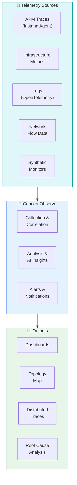
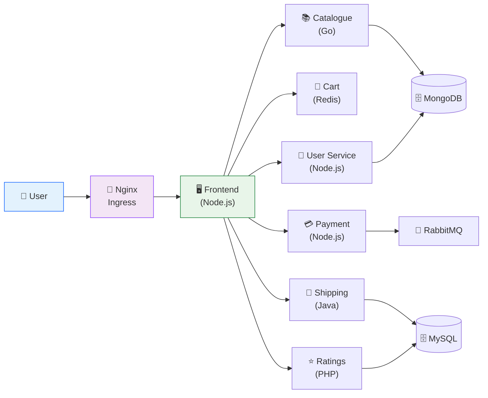
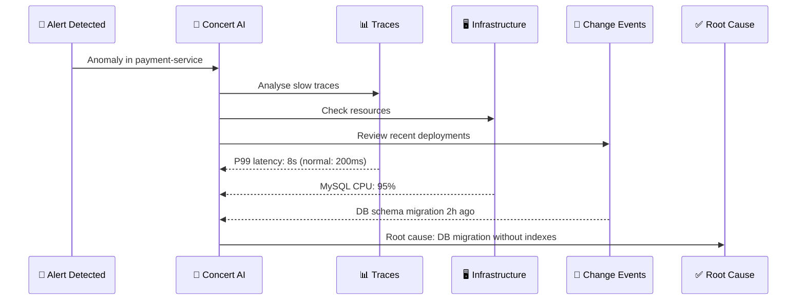

# Lab 3 — Concert Observe: Full-Stack Observability

<div class="lab-badge lab-badge-teal">Lab 3</div>
<div class="lab-badge lab-badge-blue">Concert Observe</div>
<div class="lab-badge lab-badge-green">20 min</div>

---

## Lab Objectives

By the end of this lab you will be able to:

- [x] Navigate the **Concert Observe** module (powered by Instana)
- [x] Explore **Application Performance Monitoring (APM)** full-stack
- [x] Analyse the **real-time dependency map**
- [x] Query **distributed traces** across microservices
- [x] Configure and review **performance alerts and thresholds**
- [x] Explore **infrastructure observability**
- [x] Identify the root cause of a performance issue

---

## Introduction to Concert Observe

<div class="concert-observe">

**Concert Observe** integrates application, infrastructure and network observability into a unified operational view. By correlating telemetry across domains and mapping dependencies in hybrid environments, teams can understand system behaviour, identify root causes, and assess business impact.

</div>



---

## 1. Concert Observe Overview

### 1.1 Accessing Concert Observe

In the **top navigation bar**, click on **"Observe"**.

<div class="screenshot-container" markdown="1">


<div class="screenshot-caption" markdown="1">
📸 Figure 1 — Concert Observe main dashboard with system health metrics
</div>
</div>

!!! info "Powered by IBM Instana"
    Concert Observe incorporates **IBM Instana** technology for full-stack APM, 
    with automatic application discovery and zero-config agents. If you already use Instana 
    in your organisation, Concert Observe is the natural evolution towards the unified platform.

### 1.2 Main Dashboard Metrics

| Metric | Description |
|--------|-------------|
| **Golden Signals** | Latency, traffic, errors and saturation |
| **SLO Compliance** | % compliance with Service Level Objectives |
| **Active Incidents** | Ongoing incidents affecting performance |
| **Change Events** | Recent deployments and changes correlated with metrics |

---

## 2. Application Performance Monitoring (APM)

### 2.1 Applications View

Navigate to **Observe → Applications** to see all monitored applications.

<div class="screenshot-container" markdown="1">


<div class="screenshot-caption" markdown="1">
📸 Figure 2 — List of monitored applications with real-time Golden Signals
</div>
</div>

Each application shows its **Golden Signals** in real time:

- **📈 Throughput**: Calls/requests per second
- **⏱️ Latency**: Response time (P50, P95, P99)
- **❌ Error Rate**: Percentage of errors
- **🔥 Saturation**: Resource usage

### 2.2 Exploring an Application — RobotShop

1. Click on the application **"RobotShop"** (or whichever is available in your environment)
2. The detailed application view will open

<div class="screenshot-container" markdown="1">


<div class="screenshot-caption" markdown="1">
📸 Figure 3 — Detailed APM view for the RobotShop application with metrics and calls
</div>
</div>

**The application detail view includes:**

=== "Overview"
    - Summary of Golden Signals (last 1h, 6h, 24h)
    - Number of active instances
    - Current SLO compliance
    - Latest events/incidents

=== "Services"
    - List of all microservices in the application
    - Health status per service
    - Individual metrics for each service

=== "Traces"
    - Distributed traces across services
    - Slow traces (>P95 latency)
    - Error traces

=== "Dependencies"
    - Service dependency map
    - Database calls
    - External API calls

=== "Infrastructure"
    - Hosts/containers running the app
    - CPU and memory usage per instance

---

## 3. Dependency Map (Topology)

### 3.1 Accessing the Topology Map

Within the application, click on **"Dependencies"** or **"Topology"**.

<div class="screenshot-container" markdown="1">


<div class="screenshot-caption" markdown="1">
📸 Figure 4 — Real-time dependency map showing calls between microservices
</div>
</div>

!!! tip "Navigating the Topology Map"
    - **Scroll** to zoom in/out
    - **Drag** to move the map
    - **Click** on a node to see its metrics
    - **Hover** over an edge to see call volume

### 3.2 Interpreting the Map

Each map element represents:

| Icon | Description |
|------|-------------|
| 🔵 Blue node | Microservice/application |
| 🟢 Green line | Healthy connection (normal latency) |
| 🟠 Orange line | Degraded connection (high latency) |
| 🔴 Red line | Connection with errors |
| 🗄️ Cylinder | Database |
| ☁️ Cloud | External/cloud service |

### 3.3 RobotShop Dependency Analysis



---

## 4. Distributed Traces

### 4.1 Accessing Distributed Tracing

In the application, click on **"Traces"** or navigate to **Observe → Traces**.

<div class="screenshot-container" markdown="1">


<div class="screenshot-caption" markdown="1">
📸 Figure 5 — Distributed traces view showing the flow of a request through services
</div>
</div>

### 4.2 Trace Filters

Use the available filters to find specific traces:

```
Available filters:
├── Application: [RobotShop ▼]
├── Service: [All Services ▼]
├── Status: [All ▼] [Success] [Error] [Slow]
├── Duration: [Min: ___ms] [Max: ___ms]
├── Time Range: [Last 1h ▼]
└── Tag: [key=value]
```

### 4.3 Analysing a Trace

1. In the trace list, **filter by "Errors"** to see error traces
2. Click on a trace to see its detail

<div class="screenshot-container" markdown="1">


<div class="screenshot-caption" markdown="1">
📸 Figure 6 — Distributed trace detail showing spans, latencies and errors per service
</div>
</div>

**The trace detail shows:**

- **Waterfall view**: Span cascade with exact timings
- **Service breakdown**: Time spent by each service
- **Error details**: Full error stack trace
- **Tags and metadata**: HTTP parameters, SQL queries, etc.

---

## 5. Infrastructure Observability

### 5.1 Accessing Infrastructure

Navigate to **Observe → Infrastructure** or **Observe → Hosts**.

<div class="screenshot-container" markdown="1">


<div class="screenshot-caption" markdown="1">
📸 Figure 7 — Infrastructure view showing hosts, containers and Kubernetes clusters
</div>
</div>

### 5.2 Kubernetes View

If the environment uses Kubernetes, Concert Observe shows:

```
Kubernetes Cluster: production-cluster
├── 📁 Namespace: robotshop
│   ├── 📦 Deployment: frontend (3/3 pods running)
│   ├── 📦 Deployment: catalogue (2/2 pods running)
│   ├── 📦 Deployment: payment (2/2 pods running) ⚠️ CPU: 85%
│   └── 📦 StatefulSet: mongodb (1/1 running)
├── 📁 Namespace: monitoring
│   └── 📦 Deployment: instana-agent (5/5 running)
└── 📁 Namespace: default
    └── (no user workloads)
```

### 5.3 Host Metrics

For each host/node, Concert shows:

| Metric | Normal Threshold |
|--------|-----------------|
| **CPU Usage** | < 70% |
| **Memory Usage** | < 80% |
| **Disk I/O** | < 80% |
| **Network Throughput** | Baseline ± 20% |
| **Open File Descriptors** | < 90% of limit |

---

## 6. Alerts and Smart Alerts

### 6.1 Concert Alert System

Concert uses **Smart Alerts** powered by AI that learn the normal behaviour of applications and alert on anomalies.

<div class="screenshot-container" markdown="1">


<div class="screenshot-caption" markdown="1">
📸 Figure 8 — Smart Alerts panel with active alerts and threshold configuration
</div>
</div>

### 6.2 Alert Types

=== "Threshold Alerts"
    Alerts based on fixed thresholds:
    
    ```yaml
    Alert: High CPU
    Condition: cpu.usage > 85%
    Duration: 5 minutes
    Severity: Warning
    Notify: slack-ops-channel
    ```

=== "Smart Alerts (AI)"
    Anomaly-based alerts detected by AI:
    
    - Concert learns the baseline of each metric
    - Detects statistical deviations (z-score, percentiles)
    - Self-adjust over time
    - Reduce false positives

=== "SLO Alerts"
    Alerts based on SLO error budgets:
    
    - Error budget: 100% - SLO target
    - Alert when X% of the error budget is consumed
    - Enables prioritisation based on SLO impact

### 6.3 Creating an Alert

1. Navigate to **Observe → Alerts → Create Alert**
2. Configure the trigger:
   - Select the application/service
   - Define the metric (latency, error rate, etc.)
   - Set the threshold and duration
3. Configure notifications:
   - Email, Slack, Teams, PagerDuty, etc.
4. Click **"Save"**

---

## 7. Root Cause Analysis (RCA)

### 7.1 How does RCA work in Concert?

Concert Observe uses AI to correlate events and suggest the root cause of problems:



### 7.2 Exercise: Investigate a Performance Issue

!!! example "Practical exercise"
    Follow these steps to investigate a simulated performance issue:
    
    1. In **Observe → Applications**, find a service with high latency (red/orange indicator)
    2. Open the service detail
    3. Check the **slow traces** (filter: Slow)
    4. Analyse the **waterfall** of the slowest trace
    5. Identify which span/service is the bottleneck
    6. Review that service's infrastructure
    7. Document your analysis:

| Question | Your Answer |
|----------|-------------|
| Which service has the highest latency? | |
| What is the P99 latency? | |
| Which span concentrates the most time? | |
| Are there any errors in the traces? | |
| What is your hypothesis about the root cause? | |

---

## 8. Integration with Concert Protect

Concert Observe and Concert Protect work together to contextualise risk:

<div class="screenshot-container" markdown="1">


<div class="screenshot-caption" markdown="1">
📸 Figure 9 — Integrated view showing vulnerabilities in the observability context
</div>
</div>

When a CVE is active in a high-traffic service, Concert:

1. 🔴 Elevates the CVE priority (higher real risk)
2. 📊 Shows the affected service traffic in the CVE context
3. ⚡ Generates an urgent remediation recommendation
4. 🔄 Can trigger an automated remediation Workflow

---

## Summary

!!! success "Lab 3 completed ✅"
    You have successfully explored the Concert Observe module:
    
    - ✅ APM dashboard with Golden Signals
    - ✅ Real-time dependency map (Topology)
    - ✅ Distributed traces and performance analysis
    - ✅ Infrastructure observability (hosts, K8s)
    - ✅ AI-powered Smart Alerts
    - ✅ Root Cause Analysis
    - ✅ Integration with Concert Protect
    
    **Next step**: [Lab 4 — Concert Resilience: Incident Management →](../lab4/index.md)
