# Lab 3 — Concert Observe: Observabilidad Full-Stack

<div class="lab-badge lab-badge-teal">Lab 3</div>
<div class="lab-badge lab-badge-blue">Concert Observe</div>
<div class="lab-badge lab-badge-green">20 min</div>

---

## Objetivos del laboratorio

Al finalizar este laboratorio serás capaz de:

- [x] Navegar por el módulo **Concert Observe** (basado en Instana)
- [x] Explorar el **Application Performance Monitoring (APM)** full-stack
- [x] Analizar el **mapa de dependencias** en tiempo real
- [x] Consultar **trazas distribuidas** entre microservicios
- [x] Configurar y revisar **alertas y umbrales** de rendimiento
- [x] Explorar la **observabilidad de infraestructura**
- [x] Identificar la causa raíz de un problema de rendimiento

---

## Introducción a Concert Observe

<div class="concert-observe">

**Concert Observe** integra observabilidad de aplicaciones, infraestructura y red en una vista operacional unificada. Correlacionando telemetría entre dominios y mapeando dependencias en entornos híbridos, los equipos pueden entender el comportamiento del sistema, identificar la causa raíz de problemas y evaluar el impacto en negocio.

</div>

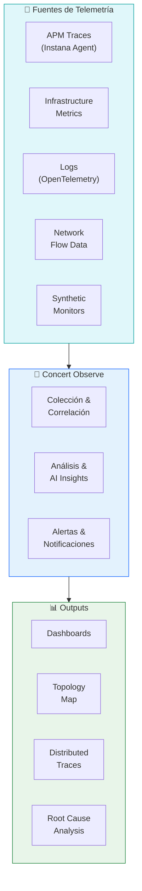

---

## 1. Vista General de Concert Observe

### 1.1 Acceder a Concert Observe

En la **barra de navegación superior**, haz clic en **"Observe"**.

<div class="screenshot-container" markdown="1">

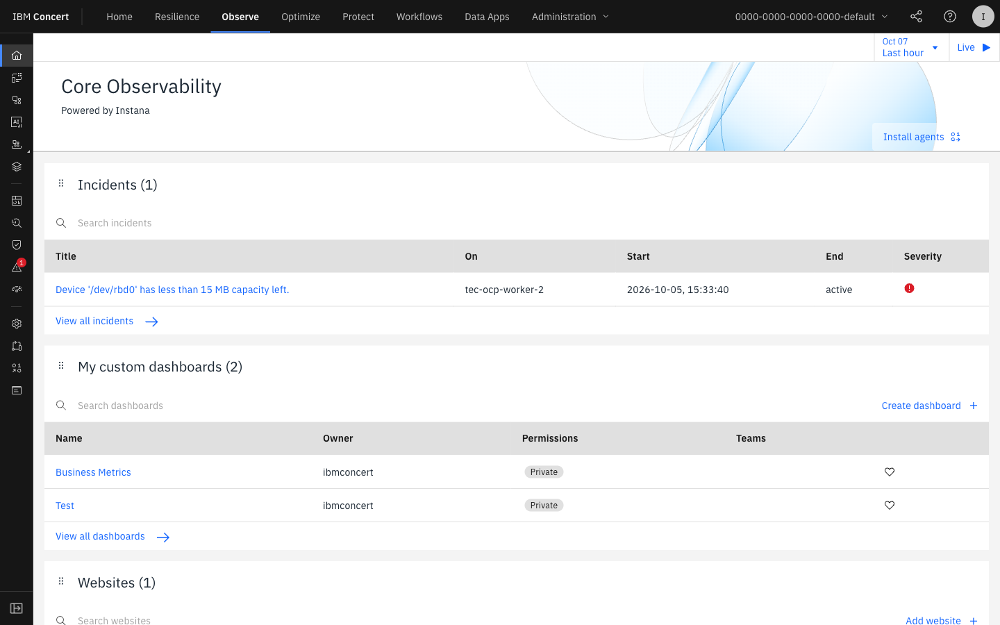

<div class="screenshot-caption" markdown="1">
📸 Figura 1 — Dashboard principal de Concert Observe con métricas de salud del sistema
</div>
</div>

!!! info "Basado en IBM Instana"
    Concert Observe incorpora la tecnología de **IBM Instana** para APM full-stack, 
    con detección automática de aplicaciones y agentes zero-config. Si ya usas Instana 
    en tu organización, Concert Observe es la evolución natural hacia la plataforma unificada.

### 1.2 Métricas Principales del Dashboard

| Métrica | Descripción |
|---------|-------------|
| **Golden Signals** | Latencia, tráfico, errores y saturación |
| **SLO Compliance** | % de cumplimiento de Service Level Objectives |
| **Active Incidents** | Incidentes en curso que afectan al rendimiento |
| **Change Events** | Despliegues y cambios recientes correlacionados con métricas |

---

## 2. Application Performance Monitoring (APM)

### 2.1 Vista de Aplicaciones

Navega a **Observe → Applications** para ver todas las aplicaciones monitorizadas.

<div class="screenshot-container" markdown="1">

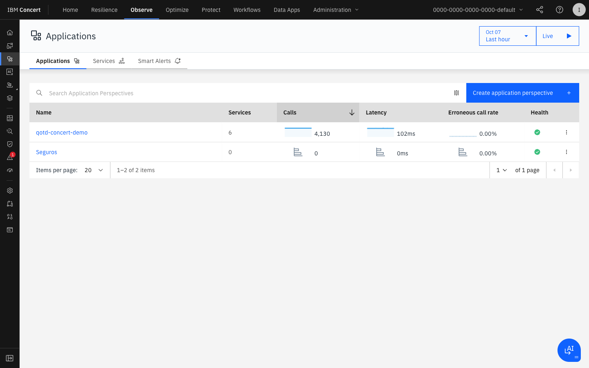

<div class="screenshot-caption" markdown="1">
📸 Figura 2 — Lista de aplicaciones monitorizadas con Golden Signals
</div>
</div>

Cada aplicación muestra sus **Golden Signals** en tiempo real:

- **📈 Throughput**: Llamadas/peticiones por segundo
- **⏱️ Latency**: Tiempo de respuesta (P50, P95, P99)
- **❌ Error Rate**: Porcentaje de errores
- **🔥 Saturation**: Uso de recursos

### 2.2 Explorar una Aplicación — RobotShop

1. Haz clic sobre la aplicación **"RobotShop"** (o la disponible en tu entorno)
2. Se abrirá la vista detallada de la aplicación

<div class="screenshot-container" markdown="1">

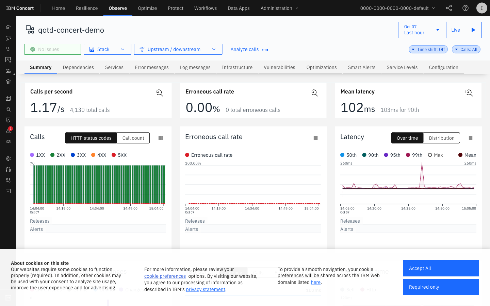

<div class="screenshot-caption" markdown="1">
📸 Figura 3 — Vista detallada de APM para la aplicación RobotShop con métricas y llamadas
</div>
</div>

**La vista de detalle de aplicación incluye:**

=== "Overview"
    - Resumen de Golden Signals (últimas 1h, 6h, 24h)
    - Número de instancias activas
    - SLO compliance actual
    - Últimos eventos/incidentes

=== "Services"
    - Lista de todos los microservicios de la aplicación
    - Estado de salud por servicio
    - Métricas individuales de cada servicio

=== "Traces"
    - Trazas distribuidas entre servicios
    - Trazas lentas (>P95 latency)
    - Trazas con errores

=== "Dependencies"
    - Mapa de dependencias del servicio
    - Llamadas a bases de datos
    - Llamadas a APIs externas

=== "Infrastructure"
    - Hosts/contenedores donde corre la app
    - Uso de CPU y memoria por instancia

---

## 3. Mapa de Dependencias (Topology)

### 3.1 Acceder al Topology Map

Dentro de la aplicación, haz clic en **"Dependencies"** o **"Topology"**.

<div class="screenshot-container" markdown="1">

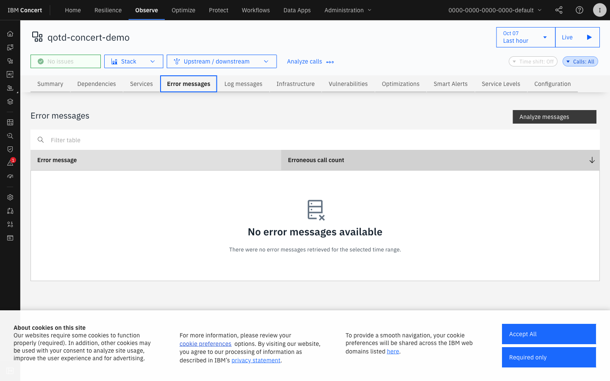

<div class="screenshot-caption" markdown="1">
📸 Figura 4 — Mapa de dependencias en tiempo real mostrando llamadas entre microservicios
</div>
</div>

!!! tip "Navegación en el Topology Map"
    - **Scroll** para hacer zoom in/out
    - **Drag** para mover el mapa
    - **Click** en un nodo para ver sus métricas
    - **Hover** sobre una arista para ver el volumen de llamadas

### 3.2 Interpretar el Mapa

Cada elemento del mapa representa:

| Icono | Descripción |
|-------|-------------|
| 🔵 Nodo azul | Microservicio/aplicación |
| 🟢 Línea verde | Conexión saludable (latencia normal) |
| 🟠 Línea naranja | Conexión degradada (latencia alta) |
| 🔴 Línea roja | Conexión con errores |
| 🗄️ Cilindro | Base de datos |
| ☁️ Nube | Servicio externo/cloud |

### 3.3 Análisis de Dependencias de RobotShop

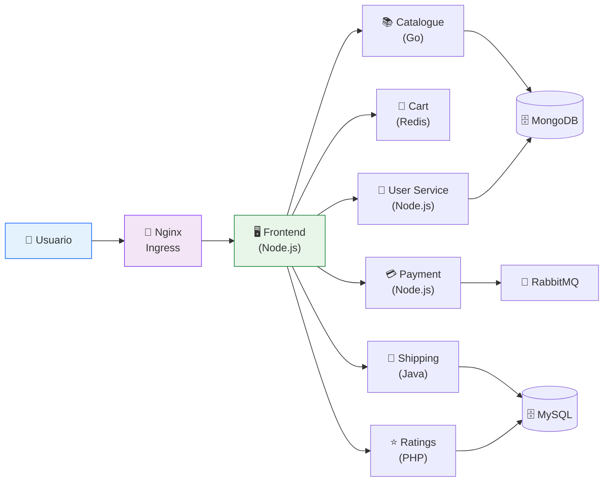

---

## 4. Trazas Distribuidas

### 4.1 Acceder a Distributed Tracing

En la aplicación, haz clic en **"Traces"** o navega a **Observe → Traces**.

<div class="screenshot-container" markdown="1">

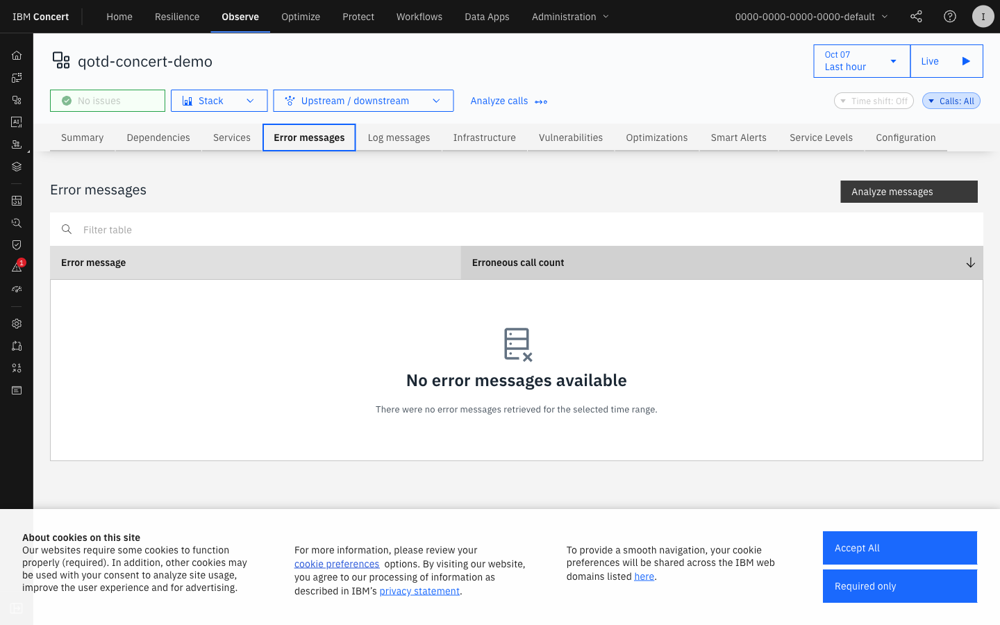

<div class="screenshot-caption" markdown="1">
📸 Figura 5 — Vista de trazas distribuidas mostrando el flujo de una petición a través de los servicios
</div>
</div>

### 4.2 Filtros de Trazas

Usa los filtros disponibles para encontrar trazas específicas:

```
Filtros disponibles:
├── Application: [RobotShop ▼]
├── Service: [All Services ▼]
├── Status: [All ▼] [Success] [Error] [Slow]
├── Duration: [Min: ___ms] [Max: ___ms]
├── Time Range: [Last 1h ▼]
└── Tag: [key=value]
```

### 4.3 Analizar una Traza

1. En la lista de trazas, **filtra por "Errors"** para ver trazas con errores
2. Haz clic en una traza para ver su detalle

<div class="screenshot-container" markdown="1">

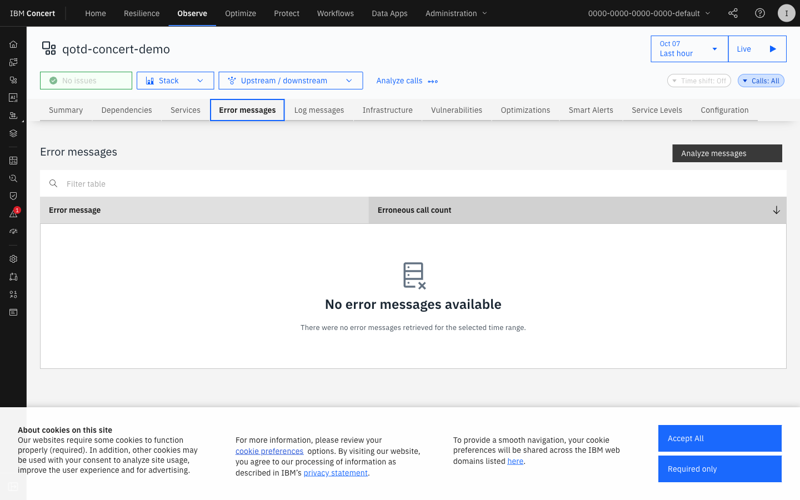

<div class="screenshot-caption" markdown="1">
📸 Figura 6 — Detalle de una traza distribuida mostrando spans, latencias y errores por servicio
</div>
</div>

**El detalle de traza muestra:**

- **Waterfall view**: Cascada de spans con tiempos exactos
- **Service breakdown**: Cuánto tiempo gastó cada servicio
- **Error details**: Stack trace completo del error
- **Tags y metadata**: Parámetros HTTP, SQL queries, etc.

---

## 5. Observabilidad de Infraestructura

### 5.1 Acceder a Infrastructure

Navega a **Observe → Infrastructure** o **Observe → Hosts**.

<div class="screenshot-container" markdown="1">

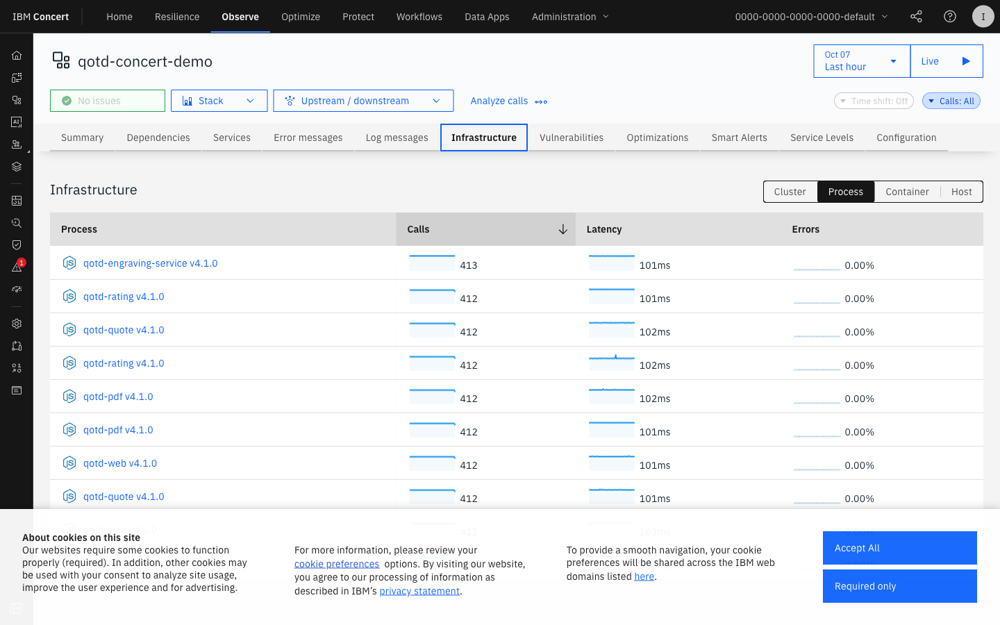

<div class="screenshot-caption" markdown="1">
📸 Figura 7 — Vista de infraestructura mostrando hosts, contenedores y clusters de Kubernetes
</div>
</div>

### 5.2 Vista de Kubernetes

Si el entorno usa Kubernetes, Concert Observe muestra:

```
Kubernetes Cluster: production-cluster
├── 📁 Namespace: robotshop
│   ├── 📦 Deployment: frontend (3/3 pods running)
│   ├── 📦 Deployment: catalogue (2/2 pods running)
│   ├── 📦 Deployment: payment (2/2 pods running) ⚠️ CPU: 85%
│   └── 📦 StatefulSet: mongodb (1/1 running)
├── 📁 Namespace: monitoring
│   └── 📦 Deployment: instana-agent (5/5 running)
└── 📁 Namespace: default
    └── (sin workloads de usuario)
```

### 5.3 Métricas de Host

Para cada host/nodo, Concert muestra:

| Métrica | Umbral Normal |
|---------|--------------|
| **CPU Usage** | < 70% |
| **Memory Usage** | < 80% |
| **Disk I/O** | < 80% |
| **Network Throughput** | Baseline ± 20% |
| **Open File Descriptors** | < 90% del límite |

---

## 6. Alertas y Smart Alerts

### 6.1 Sistema de Alertas de Concert

Concert utiliza **Smart Alerts** basadas en IA que aprenden el comportamiento normal de las aplicaciones y alertan sobre anomalías.

<div class="screenshot-container" markdown="1">

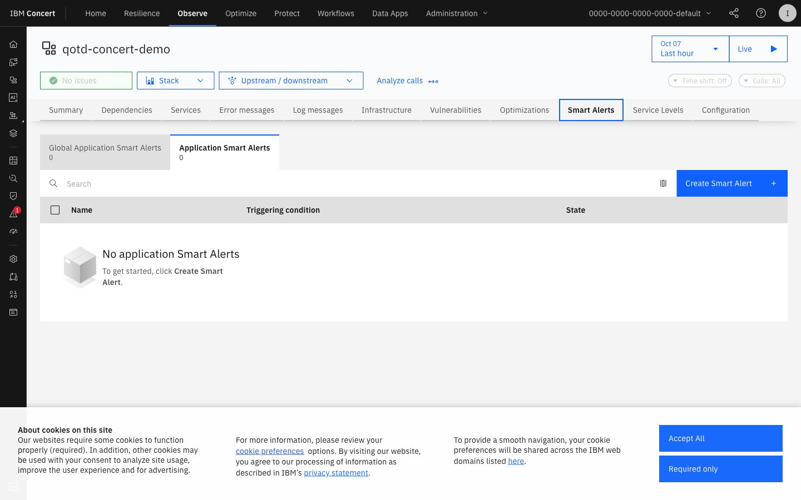

<div class="screenshot-caption" markdown="1">
📸 Figura 8 — Panel de Smart Alerts con alertas activas y configuración de umbrales
</div>
</div>

### 6.2 Tipos de Alertas

=== "Threshold Alerts"
    Alertas basadas en umbrales fijos:
    
    ```yaml
    Alerta: High CPU
    Condition: cpu.usage > 85%
    Duration: 5 minutes
    Severity: Warning
    Notify: slack-ops-channel
    ```

=== "Smart Alerts (IA)"
    Alertas basadas en anomalías detectadas por IA:
    
    - Concert aprende el baseline de cada métrica
    - Detecta desviaciones estadísticas (z-score, percentiles)
    - Se auto-ajustan con el tiempo
    - Reducen los falsos positivos

=== "SLO Alerts"
    Alertas basadas en error budgets de SLOs:
    
    - Error budget: 100% - SLO target
    - Alerta cuando se consume el X% del error budget
    - Permite priorización basada en impacto en SLO

### 6.3 Configurar una Alerta

1. Navega a **Observe → Alerts → Create Alert**
2. Configura el trigger:
   - Selecciona la aplicación/servicio
   - Define la métrica (latency, error rate, etc.)
   - Establece el umbral y duración
3. Configura las notificaciones:
   - Email, Slack, Teams, PagerDuty, etc.
4. Haz clic en **"Save"**

---

## 7. Root Cause Analysis (RCA)

### 7.1 ¿Cómo funciona el RCA en Concert?

Concert Observe usa IA para correlacionar eventos y sugerir la causa raíz de los problemas:

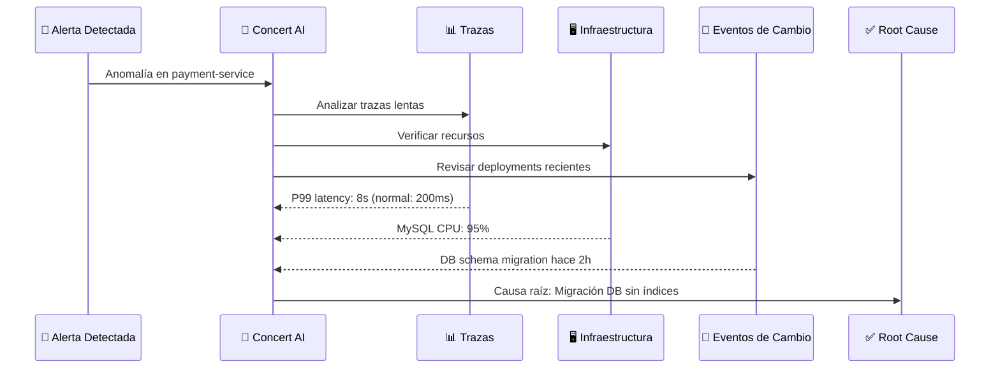

### 7.2 Ejercicio: Investigar un Problema de Rendimiento

!!! example "Ejercicio práctico"
    Sigue estos pasos para investigar un problema de rendimiento simulado:
    
    1. En **Observe → Applications**, busca un servicio con alta latencia (indicador rojo/naranja)
    2. Abre el detalle del servicio
    3. Consulta las **trazas lentas** (filter: Slow)
    4. Analiza el **waterfall** de la traza más lenta
    5. Identifica en qué span/servicio está el cuello de botella
    6. Revisa la infraestructura de ese servicio
    7. Documenta tu análisis:

| Pregunta | Tu Respuesta |
|----------|-------------|
| ¿Qué servicio tiene la latencia más alta? | |
| ¿Cuál es el P99 de latencia? | |
| ¿En qué span se concentra el tiempo? | |
| ¿Hay algún error en las trazas? | |
| ¿Qué hipótesis tienes sobre la causa raíz? | |

---

## 8. Integración con Concert Protect

Concert Observe y Concert Protect trabajan juntos para contextualizar el riesgo:

<div class="screenshot-container" markdown="1">

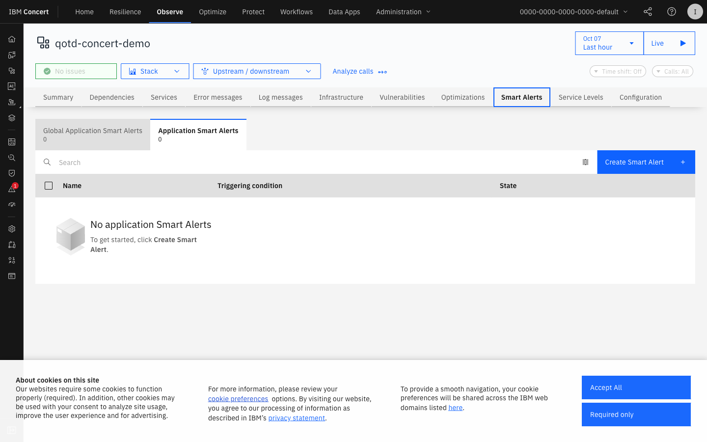

<div class="screenshot-caption" markdown="1">
📸 Figura 9 — Vista integrada mostrando vulnerabilidades en el contexto de observabilidad
</div>
</div>

Cuando un CVE está activo en un servicio con tráfico alto, Concert:

1. 🔴 Eleva la prioridad del CVE (mayor riesgo real)
2. 📊 Muestra el tráfico del servicio afectado en el contexto del CVE
3. ⚡ Genera una recomendación de remediación urgente
4. 🔄 Puede activar un Workflow automatizado de remediación

---

## Resumen

!!! success "Lab 3 completado ✅"
    Has explorado exitosamente el módulo Concert Observe:
    
    - ✅ Dashboard de APM con Golden Signals
    - ✅ Mapa de dependencias en tiempo real (Topology)
    - ✅ Trazas distribuidas y análisis de rendimiento
    - ✅ Observabilidad de infraestructura (hosts, K8s)
    - ✅ Smart Alerts basadas en IA
    - ✅ Root Cause Analysis
    - ✅ Integración con Concert Protect
    
    **Siguiente paso**: [Lab 4 — Concert Resilience: Gestión de Incidentes →](../lab4/index.md)
