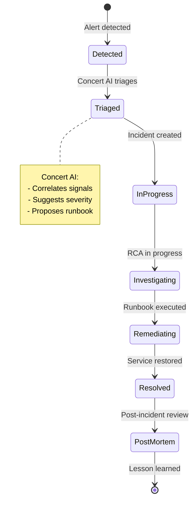

# Lab 4 — Concert Resilience: Incident Management and Response

<div class="lab-badge lab-badge-blue">Lab 4</div>
<div class="lab-badge lab-badge-teal">Concert Resilience</div>
<div class="lab-badge lab-badge-green">20 min</div>

---

## Lab Objectives

By the end of this lab you will be able to:

- [x] Navigate the **Concert Resilience** module
- [x] Create and manage **IT incidents**
- [x] Execute **automated Runbooks** for remediation
- [x] Manage the **Change Management** process
- [x] Use **Concert AI** to accelerate resolution

---

## Introduction to Concert Resilience

<div class="concert-operate">

**Concert Resilience** transforms incident response from a reactive, manual process into an AI-guided, coordinated system. It integrates alerts, context, runbooks and tools into a single orchestrated workflow.

</div>



---

## 1. Concert Resilience Overview

### 1.1 Accessing Concert Resilience

In the **top navigation bar**, click on **"Resilience"**.

<div class="screenshot-container" markdown="1">


<div class="screenshot-caption" markdown="1">
📸 Figure 1 — Concert Resilience main dashboard with active incidents and service health status
</div>
</div>

### 1.2 Resilience Control Panel

The Resilience dashboard shows:

| Panel | Description |
|-------|-------------|
| **Active Incidents** | Ongoing incidents classified by severity |
| **MTTR Trending** | Mean Time To Resolution trend |
| **On-Call Schedule** | Currently on-call teams |
| **Recent Changes** | Latest deployed changes |
| **Service Health Map** | Real-time status of all services |

---

## 2. Incident Management

### 2.1 Incident List

Navigate to **Resilience → Incidents** to see all incidents.

<div class="screenshot-container" markdown="1">


<div class="screenshot-caption" markdown="1">
📸 Figure 2 — Active incident list with severity, affected service and response time
</div>
</div>

### 2.2 Incident Severities

| Severity | Description | MTTR target |
|----------|-------------|-------------|
| 🔴 **SEV1** | Total service outage | < 1 hour |
| 🟠 **SEV2** | Significant degradation | < 4 hours |
| 🟡 **SEV3** | Partial or limited impact | < 24 hours |
| 🔵 **SEV4** | Minor or cosmetic issue | < 1 week |

### 2.3 Creating an Incident Manually

To create an incident:

1. Click **"+ New Incident"** or **"Create Incident"**
2. Fill in the form:

<div class="screenshot-container" markdown="1">


<div class="screenshot-caption" markdown="1">
📸 Figure 3 — Incident creation form with severity, service and description fields
</div>
</div>

```yaml
Title: "Payment service - High latency detected"
Severity: SEV2
Affected service: payment-service
Environment: Production
Description: |
  The payment service is responding with latencies exceeding 
  8 seconds (P99). Frontend timeout errors are being observed.
Assigned to: On-call Team
Tags: payment, latency, production
```

3. Click **"Create"**

### 2.4 Incident Detail View

When you open an incident, you will see the full management panel:

<div class="screenshot-container" markdown="1">


<div class="screenshot-caption" markdown="1">
📸 Figure 4 — Incident detail view with timeline, correlated signals and suggested runbooks
</div>
</div>

**The detail view includes:**

=== "Timeline"
    Chronological incident history:
    
    - When the first signal was detected
    - When the incident was created
    - Actions taken by the team
    - Status changes
    - Resolution

=== "Correlated Signals"
    Correlated signals from Concert Observe:
    
    - Related metric alerts
    - Error traces in the period
    - Relevant system logs
    - Infrastructure events

=== "AI Recommendations"
    Concert AI suggestions:
    
    - Most likely root cause analysis
    - Suggested runbooks for remediation
    - Similar historical incidents
    - Estimated business impact

=== "Runbooks"
    Available remediation procedures:
    
    - Manual runbooks (step-by-step)
    - Automated runbooks (execute directly)
    - Escalation playbooks

<div class="screenshot-container" markdown="1">


<div class="screenshot-caption" markdown="1">
📸 Figure 5 — Incident tabs: Timeline, Correlated Signals, AI Recommendations and Runbooks
</div>
</div>

---

## 3. Runbooks

### 3.1 What are Runbooks?

**Runbooks** are documented and automated procedures to respond to incidents. Concert allows:

- 📖 **Manual runbooks**: Step-by-step instructions for the team
- ⚡ **Automated runbooks**: Execute actions directly in systems

### 3.2 Exploring Available Runbooks

Navigate to **Resilience → Runbooks**.

<div class="screenshot-container" markdown="1">


<div class="screenshot-caption" markdown="1">
📸 Figure 6 — Runbook library with categories and automation status
</div>
</div>

### 3.3 Executing a Runbook

1. In the incident view, go to the **"Runbooks"** tab
2. Select the runbook suggested by Concert AI
3. Click **"Run"** or **"Execute"**
4. Review the steps that will be executed
5. Confirm execution

<div class="screenshot-container" markdown="1">


<div class="screenshot-caption" markdown="1">
📸 Figure 7 — Automated Runbook execution with real-time log of actions
</div>
</div>

---

## 4. Change Management

### 4.1 Change Management in Concert Resilience

Concert Resilience includes change management that automatically correlates:

- Recent deployments and releases
- Configuration changes
- Infrastructure activity
- With incidents and alerts in the same period

<div class="screenshot-container" markdown="1">


<div class="screenshot-caption" markdown="1">
📸 Figure 8 — Change Management view showing recent changes and their impact on services
</div>
</div>

### 4.2 Change-to-Incident Correlation

Concert Resilience automatically correlates changes with incidents:

```
📅 Event Timeline:
22:00 UTC — Deploy: payment-service v2.3.1
22:15 UTC — ⚠️ Alert: Latency increase in payment-service
22:17 UTC — 🔴 Incident created: SEV2
22:18 UTC — 🧠 Concert AI: "Related change detected (2 min prior)"
22:20 UTC — 🔄 Action: Rollback initiated
22:35 UTC — ✅ Incident resolved: Rollback successful
```

---

## 5. Concert AI for Operations

### 5.1 The AI Assistant in Concert Resilience

Concert includes a conversational AI assistant to help during incidents. Access it from the chat icon in the top bar.

<div class="screenshot-container" markdown="1">


<div class="screenshot-caption" markdown="1">
📸 Figure 9 — Concert AI assistant answering questions about the active incident
</div>
</div>

### 5.2 Queries to the AI Assistant

You can ask the assistant questions in natural language:

!!! example "Example AI queries"
    
    **"Which services are affected by the current incident?"**
    
    → Concert AI: "Incident INC-1234 affects 3 services: payment-service (root cause), 
    frontend (timeout symptom) and order-service (queued requests). 
    The most likely cause based on trace analysis is an unindexed SQL query 
    introduced in commit f8a3bc2 in the 22:00 UTC deployment."
    
    **"Which runbook should I run?"**
    
    → Concert AI: "I recommend running 'Database Query Optimization' as trace analysis 
    shows 8-12 second queries on the transactions table. 
    Alternatively, you can immediately rollback the latest deploy with the 
    'Emergency Rollback' runbook."

---

## 6. Practical Exercise

### 🎯 Exercise: Manage a Simulated Incident

=== "Scenario"
    The RobotShop payment service is experiencing high latency.
    Users report that transactions take more than 10 seconds.

=== "Steps"
    1. Navigate to **Resilience → Incidents**
    2. Observe the active incidents
    3. Click on the highest severity incident
    4. Review the incident's **Correlated Signals**
    5. Check the **AI Recommendations**
    6. Identify the **suggested Runbook**
    7. Review (without executing) the Runbook steps
    8. Check the incident **Timeline**

=== "Questions"

    | Question | Your Answer |
    |----------|-------------|
    | How many active incidents are there? | |
    | Which one has the highest severity? | |
    | Which service is affected? | |
    | Which runbook does Concert AI suggest? | |
    | What is the team's average MTTR? | |

<div class="screenshot-container" markdown="1">


<div class="screenshot-caption" markdown="1">
📸 Figure 10 — Resilience module during the incident management exercise
</div>
</div>

---

## Summary

!!! success "Lab 4 completed ✅"
    You have successfully explored the Concert Resilience module:
    
    - ✅ Resilience dashboard with active incidents
    - ✅ Creating and managing incident lifecycle
    - ✅ Library of manual and automated Runbooks
    - ✅ Change management and incident correlation
    - ✅ AI assistant for guided resolution
    
    **Next step**: [Lab 5 — Concert Optimize: Resources →](../lab5/index.md)
