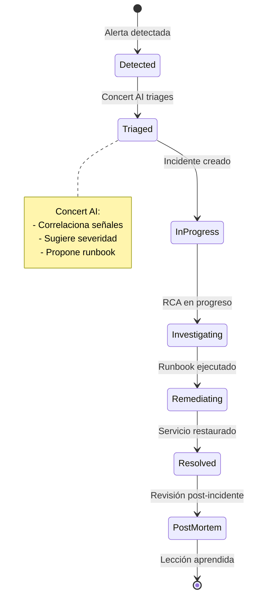
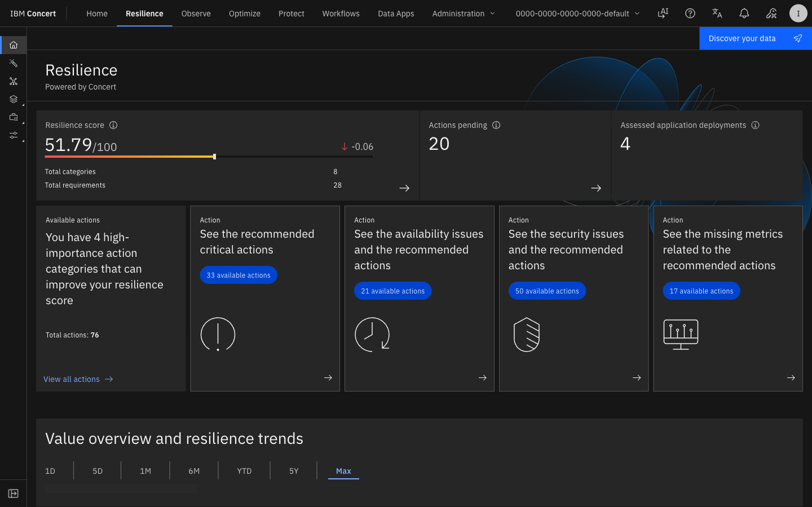
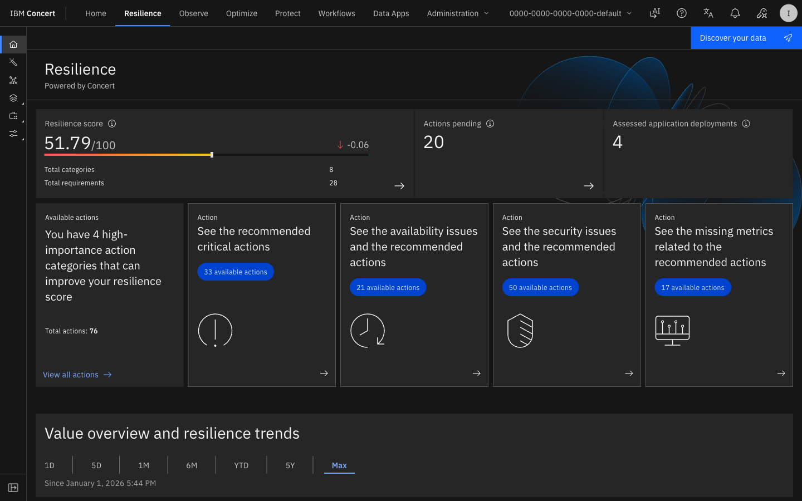
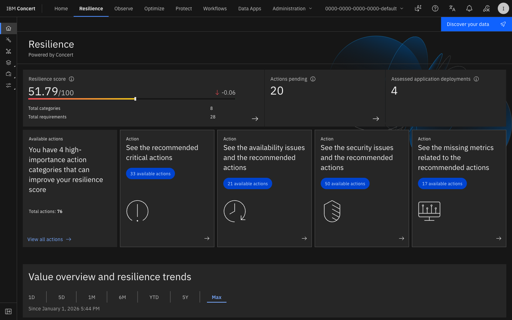
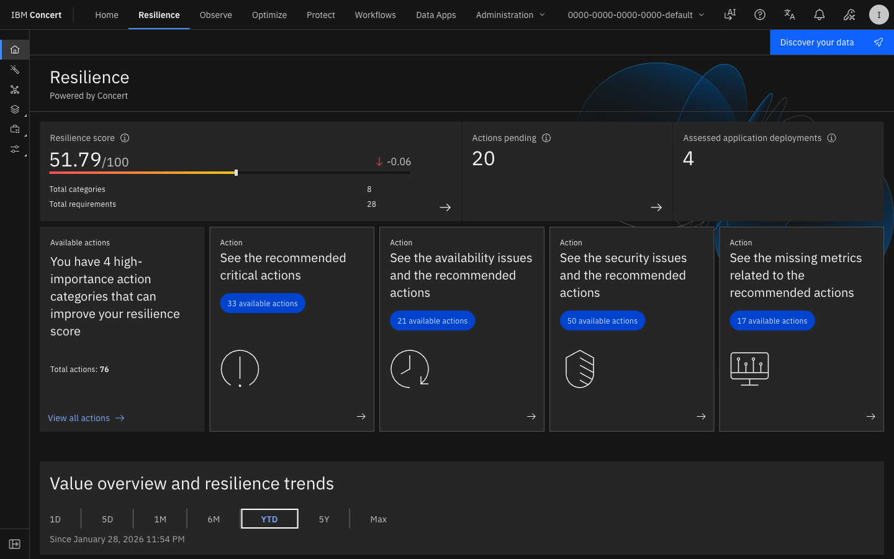
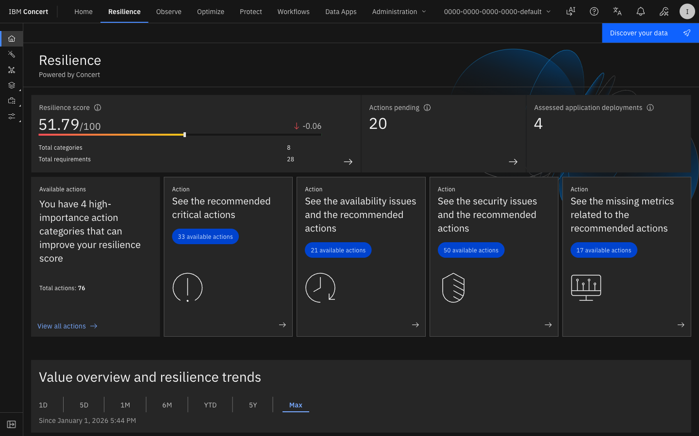
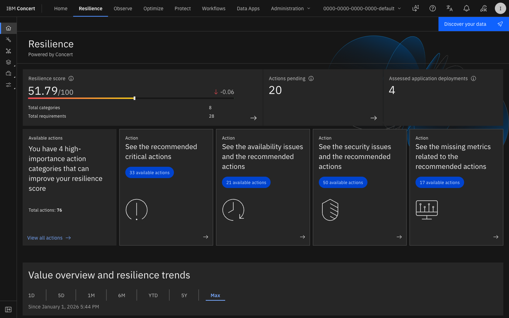
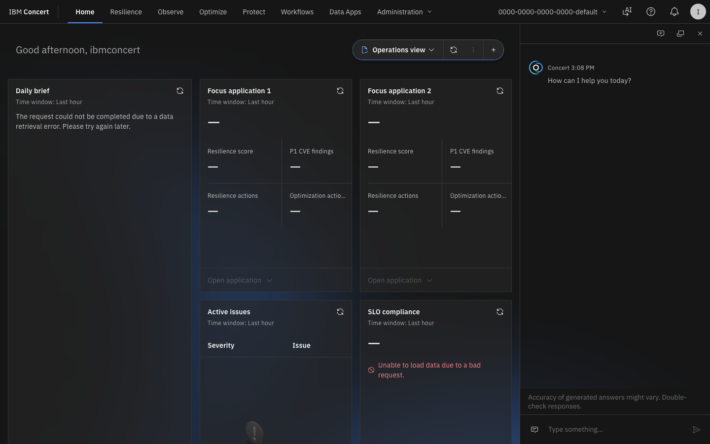
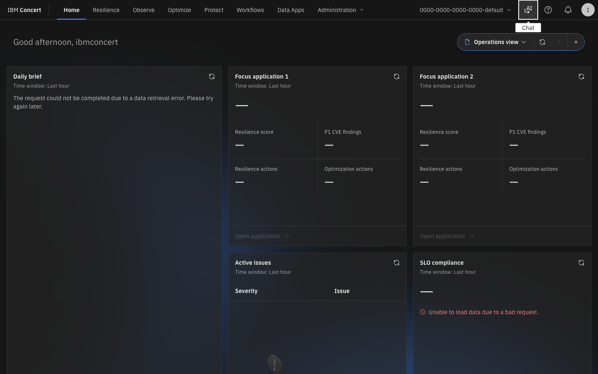

# Lab 4 — Concert Resilience: Gestión de Incidentes y Respuesta

<div class="lab-badge lab-badge-blue">Lab 4</div>
<div class="lab-badge lab-badge-teal">Concert Resilience</div>
<div class="lab-badge lab-badge-green">20 min</div>

---

## Objetivos del laboratorio

Al finalizar este laboratorio serás capaz de:

- [x] Navegar por el módulo **Concert Resilience**
- [x] Crear y gestionar **incidentes** de TI
- [x] Ejecutar **Runbooks** automatizados para remediación
- [x] Gestionar el proceso de **Change Management**
- [x] Usar la **IA de Concert** para acelerar la resolución

---

## Introducción a Concert Resilience

<div class="concert-operate">

**Concert Resilience** transforma la respuesta a incidentes de un proceso reactivo y manual a un sistema coordinado y guiado por IA. Integra alertas, contexto, runbooks y herramientas en un único flujo de trabajo orquestado.

</div>



---

## 1. Vista General de Concert Resilience

### 1.1 Acceder a Concert Resilience

En la **barra de navegación superior**, haz clic en **"Resilience"**.

<div class="screenshot-container" markdown="1">



<div class="screenshot-caption" markdown="1">
📸 Figura 1 — Dashboard principal de Concert Resilience con incidentes activos y estado de servicios
</div>
</div>

### 1.2 Panel de Control de Resiliencia

El dashboard de Resilience muestra:

| Panel | Descripción |
|-------|-------------|
| **Active Incidents** | Incidentes en curso clasificados por severidad |
| **MTTR Trending** | Evolución del Mean Time To Resolution |
| **On-Call Schedule** | Equipos en guardia actualmente |
| **Recent Changes** | Últimos cambios desplegados |
| **Service Health Map** | Estado de todos los servicios en tiempo real |

---

## 2. Gestión de Incidentes

### 2.1 Lista de Incidentes

Navega a **Resilience → Incidents** para ver todos los incidentes.

<div class="screenshot-container" markdown="1">



<div class="screenshot-caption" markdown="1">
📸 Figura 2 — Lista de incidentes activos con severidad, servicio afectado y tiempo de respuesta
</div>
</div>

### 2.2 Severidades de Incidentes

| Severidad | Descripción | MTTR objetivo |
|-----------|-------------|---------------|
| 🔴 **SEV1** | Interrupción total del servicio | < 1 hora |
| 🟠 **SEV2** | Degradación significativa | < 4 horas |
| 🟡 **SEV3** | Impacto parcial o limitado | < 24 horas |
| 🔵 **SEV4** | Problema menor o cosmético | < 1 semana |

### 2.3 Crear un Incidente Manualmente

Para crear un incidente:

1. Haz clic en **"+ New Incident"** o **"Create Incident"**
2. Rellena el formulario:

<div class="screenshot-container" markdown="1">



<div class="screenshot-caption" markdown="1">
📸 Figura 3 — Formulario de creación de incidente con campos de severidad, servicio y descripción
</div>
</div>

```yaml
Título: "Payment service - High latency detected"
Severidad: SEV2
Servicio afectado: payment-service
Ambiente: Production
Descripción: |
  El servicio de pagos está respondiendo con latencias superiores 
  a 8 segundos (P99). Se están viendo errores de timeout en el frontend.
Asignado a: On-call Team
Tags: payment, latency, production
```

3. Haz clic en **"Create"**

### 2.4 Vista de Detalle de Incidente

Al abrir un incidente, verás el panel completo de gestión:

<div class="screenshot-container" markdown="1">


<div class="screenshot-caption" markdown="1">
📸 Figura 4 — Vista de detalle de un incidente con timeline, señales correlacionadas y runbooks sugeridos
</div>
</div>

**La vista de detalle incluye:**

=== "Timeline"
    Historial cronológico del incidente:
    
    - Cuándo se detectó la primera señal
    - Cuándo se creó el incidente
    - Acciones tomadas por el equipo
    - Cambios de estado
    - Resolución

=== "Correlated Signals"
    Señales correlacionadas desde Concert Observe:
    
    - Alertas de métricas relacionadas
    - Trazas con errores en el período
    - Logs relevantes del sistema
    - Eventos de infraestructura

=== "AI Recommendations"
    Sugerencias de Concert AI:
    
    - Análisis de la causa raíz más probable
    - Runbooks sugeridos para remediación
    - Incidentes similares históricos
    - Impacto estimado en negocio

=== "Runbooks"
    Procedimientos de remediación disponibles:
    
    - Runbooks manuales (paso a paso)
    - Runbooks automatizados (ejecutar directamente)
    - Playbooks de escalación

<div class="screenshot-container" markdown="1">



<div class="screenshot-caption" markdown="1">
📸 Figura 5 — Pestañas del incidente: Timeline, Correlated Signals, AI Recommendations y Runbooks
</div>
</div>

---

## 3. Runbooks

### 3.1 ¿Qué son los Runbooks?

Los **Runbooks** son procedimientos documentados y automatizados para responder a incidentes. Concert permite:

- 📖 **Runbooks manuales**: Instrucciones paso a paso para el equipo
- ⚡ **Runbooks automatizados**: Ejecutan acciones directamente en los sistemas

### 3.2 Explorar Runbooks Disponibles

Navega a **Resilience → Runbooks**.

<div class="screenshot-container" markdown="1">



<div class="screenshot-caption" markdown="1">
📸 Figura 6 — Biblioteca de Runbooks con categorías y estado de automatización
</div>
</div>

### 3.3 Ejecutar un Runbook

1. En la vista del incidente, ve a la pestaña **"Runbooks"**
2. Selecciona el runbook sugerido por Concert AI
3. Haz clic en **"Run"** o **"Execute"**
4. Revisa los pasos que se ejecutarán
5. Confirma la ejecución

<div class="screenshot-container" markdown="1">



<div class="screenshot-caption" markdown="1">
📸 Figura 7 — Ejecución de un Runbook automatizado con log en tiempo real de las acciones
</div>
</div>

---

## 4. Change Management

### 4.1 Gestión de Cambios en Concert Resilience

Concert Resilience incluye gestión de cambios que correlaciona automáticamente:

- Despliegues y releases recientes
- Cambios de configuración
- Actividad de infraestructura
- Con incidentes y alertas en el mismo período

<div class="screenshot-container" markdown="1">



<div class="screenshot-caption" markdown="1">
📸 Figura 8 — Vista de Change Management mostrando cambios recientes y su impacto en los servicios
</div>
</div>

### 4.2 Correlación de Cambios con Incidentes

Concert Resilience correlaciona automáticamente los cambios con incidentes:

```
📅 Timeline de Eventos:
22:00 UTC — Deploy: payment-service v2.3.1
22:15 UTC — ⚠️ Alert: Latency increase in payment-service
22:17 UTC — 🔴 Incident created: SEV2
22:18 UTC — 🧠 Concert AI: "Cambio relacionado detectado (2 min previos)"
22:20 UTC — 🔄 Action: Rollback iniciado
22:35 UTC — ✅ Incident resolved: Rollback exitoso
```

---

## 5. Concert AI para Operaciones

### 5.1 El Asistente de IA en Concert Resilience

Concert incluye un asistente de IA conversacional para ayudar durante los incidentes. Accede desde el ícono del chat en la barra superior.

<div class="screenshot-container" markdown="1">


<div class="screenshot-caption" markdown="1">
📸 Figura 9 — Asistente de IA de Concert respondiendo preguntas sobre el incidente activo
</div>
</div>

### 5.2 Consultas al Asistente de IA

Puedes hacer preguntas en lenguaje natural al asistente:

!!! example "Ejemplos de consultas al AI"
    
    **"¿Qué servicios están afectados por el incidente actual?"**
    
    → Concert AI: "El incidente INC-1234 afecta a 3 servicios: payment-service (causa raíz), 
    frontend (síntoma de timeout) y order-service (requests en cola). 
    La causa más probable según el análisis de trazas es una consulta SQL sin índice 
    introducida en el commit f8a3bc2 del deploy de las 22:00 UTC."
    
    **"¿Qué runbook debo ejecutar?"**
    
    → Concert AI: "Recomiendo ejecutar 'Database Query Optimization' ya que el análisis 
    de trazas muestra queries de 8-12 segundos en la tabla transactions. 
    Alternativamente, puedes hacer rollback inmediato del último deploy con el runbook 
    'Emergency Rollback'."

---

## 6. Ejercicio Práctico

### 🎯 Ejercicio: Gestionar un Incidente Simulado

=== "Escenario"
    El servicio de pagos de RobotShop está experimentando alta latencia.
    Los usuarios reportan que las transacciones tardan más de 10 segundos.

=== "Pasos"
    1. Navega a **Resilience → Incidents**
    2. Observa los incidentes activos
    3. Haz clic en el incidente de mayor severidad
    4. Revisa las **Correlated Signals** del incidente
    5. Consulta las **AI Recommendations**
    6. Identifica el **Runbook sugerido**
    7. Revisa (sin ejecutar) los pasos del Runbook
    8. Consulta el **Timeline** del incidente

=== "Preguntas"

    | Pregunta | Tu Respuesta |
    |----------|-------------|
    | ¿Cuántos incidentes activos hay? | |
    | ¿Cuál es el de mayor severidad? | |
    | ¿Qué servicio es el afectado? | |
    | ¿Qué runbook sugiere Concert AI? | |
    | ¿Cuál es el MTTR promedio del equipo? | |

<div class="screenshot-container" markdown="1">



<div class="screenshot-caption" markdown="1">
📸 Figura 10 — Módulo Resilience durante el ejercicio de gestión de incidentes
</div>
</div>

---

## Resumen

!!! success "Lab 4 completado ✅"
    Has explorado exitosamente el módulo Concert Resilience:
    
    - ✅ Dashboard de resiliencia con incidentes activos
    - ✅ Creación y gestión del ciclo de vida de incidentes
    - ✅ Biblioteca de Runbooks manuales y automatizados
    - ✅ Gestión de cambios y correlación con incidentes
    - ✅ Asistente de IA para resolución guiada
    
    **Siguiente paso**: [Lab 5 — Concert Optimize: Recursos →](../lab5/index.md)
