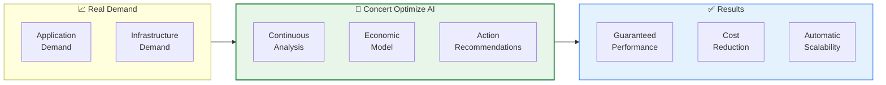
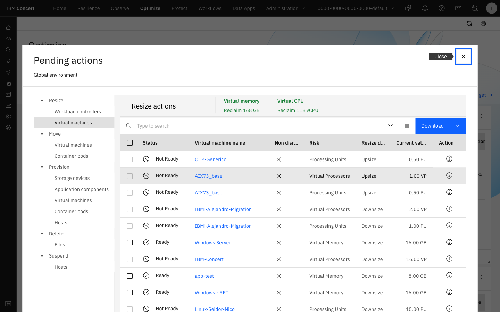
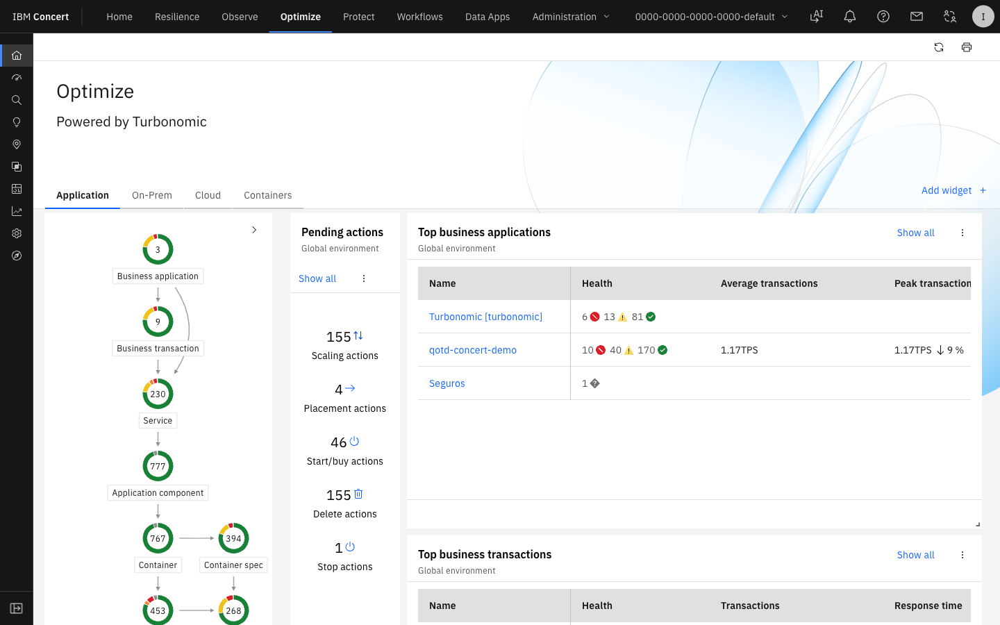
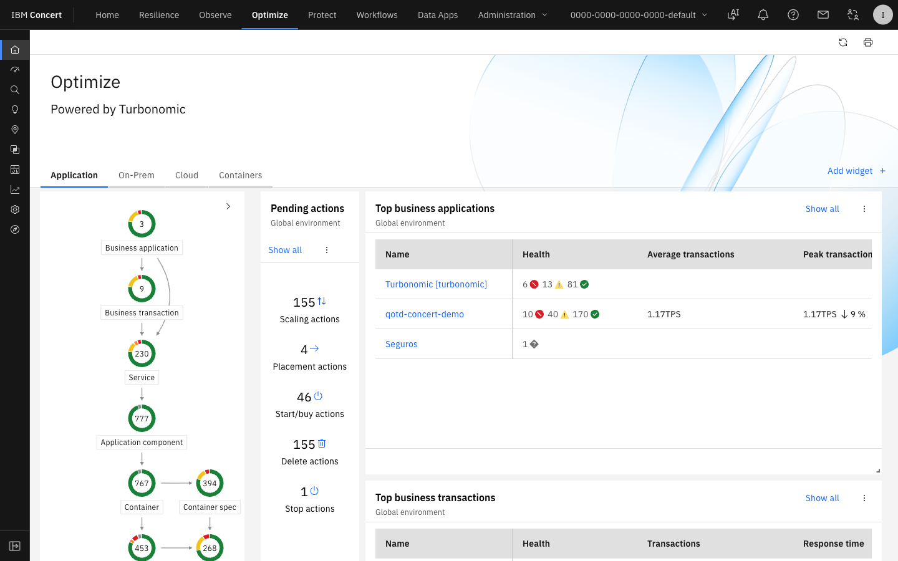
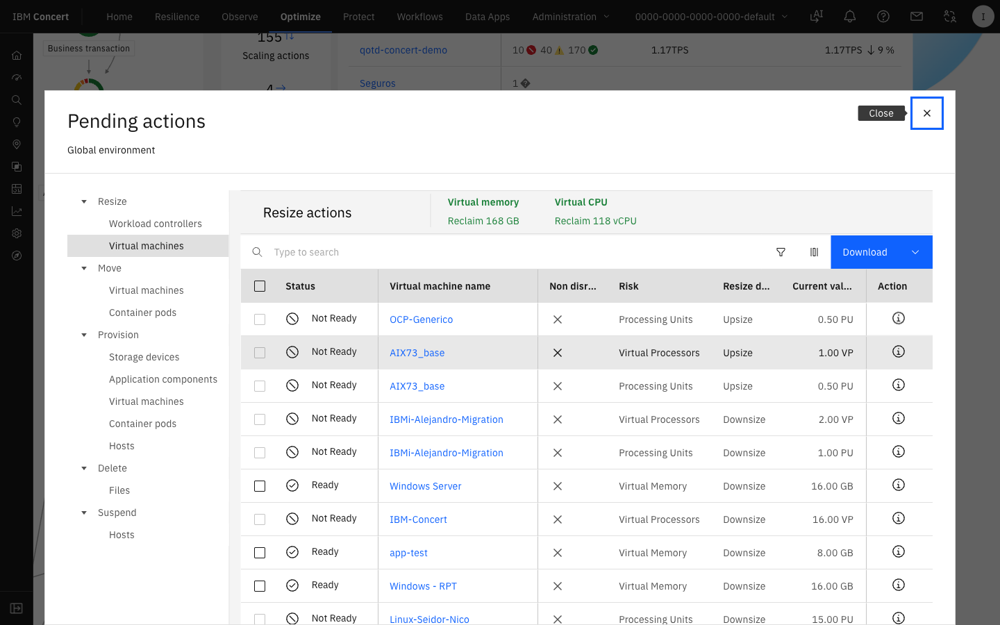
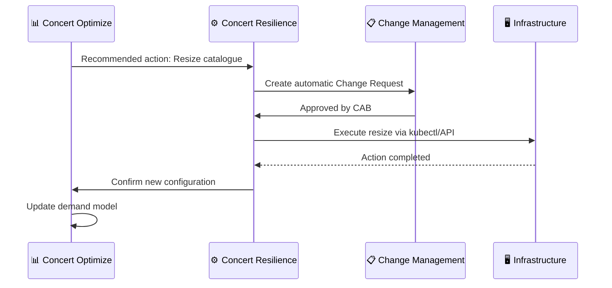

# Lab 5 — Concert Optimize: Resource and Cost Optimization

<div class="lab-badge lab-badge-green">Lab 5</div>
<div class="lab-badge lab-badge-teal">Concert Optimize</div>
<div class="lab-badge lab-badge-green">15 min</div>

---

## Lab Objectives

By the end of this lab you will be able to:

- [x] Navigate the **Concert Optimize** module (powered by Turbonomic)
- [x] Analyse **demand vs. capacity** in applications and containers
- [x] Identify **right-sizing** opportunities
- [x] Explore **cloud cost optimization** recommendations
- [x] Understand the impact of actions on **performance and cost**
- [x] Simulate optimization actions without affecting the environment

---

## Introduction to Concert Optimize

<div class="concert-optimize">

**Concert Optimize**, powered by **IBM Turbonomic** technology, continuously analyses real application demand and aligns infrastructure resources to ensure optimal performance at the most efficient cost.

</div>



---

## 1. Concert Optimize Overview

### 1.1 Accessing Concert Optimize

In the **top navigation bar**, click on **"Optimize"**.

<div class="screenshot-container" markdown="1">


<div class="screenshot-caption" markdown="1">
📸 Figure 1 — Concert Optimize main dashboard with potential savings summary and pending actions
</div>
</div>

### 1.2 Optimize Dashboard KPIs

| KPI | Description |
|-----|-------------|
| **Potential Savings** | Identified potential monthly savings |
| **Pending Actions** | Recommended optimization actions |
| **Over-provisioned** | Over-dimensioned resources |
| **Under-provisioned** | Under-dimensioned resources (performance risk) |
| **SLO Compliance** | % of SLOs currently met |

---

## 2. Right-Sizing Analysis

### 2.1 What is Right-Sizing?

**Right-Sizing** is the process of adjusting resources allocated to an application/container to match actual real demand:

```
Current problem:
┌─────────────────────┐
│  Allocated resources│  ←── 4 vCPU, 8 GB RAM
│  ████░░░░░░░░░░░░░  │  ←── Only uses 35% (1.4 vCPU, 2.8 GB)
└─────────────────────┘
         ↓ Right-sizing ↓
┌─────────────────────┐
│  Optimised resources│  ←── 2 vCPU, 4 GB RAM
│  ██████░░░░░░░░░░░  │  ←── Usage: 70% (much better)
└─────────────────────┘
💰 Savings: 50% of compute cost
```

### 2.2 Exploring Right-Sizing Recommendations

Navigate to **Optimize → Actions** or **Optimize → Pending Actions**.

<div class="screenshot-container" markdown="1">



<div class="screenshot-caption" markdown="1">
📸 Figure 2 — Right-sizing recommendations list with performance and cost impact
</div>
</div>

### 2.3 Optimization Action Types

Concert Optimize classifies actions into categories:

=== "Resize"
    **Container/VM size change**
    
    - Reduce over-provisioned CPU/memory
    - Increase under-provisioned CPU/memory
    - Change instance type (AWS, Azure, GCP)
    
    **Example action:**
    ```
    Action: Resize Deployment
    Service: catalogue
    Namespace: robotshop
    
    Current configuration:
      CPU Request: 500m  CPU Limit: 1000m
      Memory Request: 512Mi  Memory Limit: 1Gi
    
    Recommendation:
      CPU Request: 200m  CPU Limit: 400m     (-60%)
      Memory Request: 256Mi  Memory Limit: 512Mi  (-50%)
    
    Estimated savings: $12.50/month
    Performance impact: None (real demand < new limit)
    ```

=== "Scale"
    **Horizontal pod/instance scaling**
    
    - Scale up: Increase replicas under load
    - Scale down: Reduce replicas during off-peak hours
    - Adjust HPA (Horizontal Pod Autoscaler)
    
    **Example:**
    ```
    Action: Scale Down
    Service: frontend
    Schedule: 22:00 - 06:00 UTC (low demand)
    
    Current: 3 replicas 24/7
    Recommended: 3 replicas (06:00-22:00) / 1 replica (22:00-06:00)
    
    Estimated savings: $45/month
    ```

=== "Move"
    **Workload migration**
    
    - Move to more efficient nodes
    - Consolidate on fewer nodes (bin packing)
    - Migrate to cheaper compute tier

=== "Terminate"
    **Remove unused resources**
    
    - Evicted pods
    - Unattached volumes
    - Empty Load Balancers
    - Old snapshots

---

## 3. Cloud Cost Analysis

### 3.1 Cost View

Navigate to **Optimize → Cost Analysis** or **Optimize → Cloud Cost**.

<div class="screenshot-container" markdown="1">



<div class="screenshot-caption" markdown="1">
📸 Figure 3 — Cloud cost analysis dashboard with breakdown by service and resource type
</div>
</div>

### 3.2 Cost Breakdown

Concert Optimize breaks down costs by:

```
Total Monthly Cost: $12,450
├── Compute (VMs/Pods):         $7,800  (62.7%)
│   ├── Production:   $5,200
│   └── Non-Production: $2,600  ← Savings opportunity
├── Storage:                    $2,100  (16.9%)
│   ├── Persistent Volumes: $1,200
│   └── Snapshots (>90 days): $900  ← Candidates for deletion
├── Network (Egress):           $1,450  (11.7%)
│   └── Cross-region traffic: $900  ← Inefficient architecture
└── Other (LB, IPs, etc.):     $1,100  (8.8%)
```

### 3.3 Identified Savings Opportunities

| Opportunity | Potential Savings | Effort |
|-------------|-----------------|--------|
| Right-size over-provisioned pods | $1,200/month | Low |
| Terminate non-prod resources during off hours | $800/month | Low |
| Delete old snapshots (>90 days) | $400/month | Low |
| Migrate batch workloads to Spot instances | $600/month | Medium |
| Optimize cross-region traffic | $300/month | High |
| **Total potential** | **$3,300/month** | |

---

## 4. Kubernetes Optimization

### 4.1 Kubernetes View

Concert Optimize has a specific view for Kubernetes optimization:

Navigate to **Optimize → Kubernetes** or **Optimize → Containers**.

<div class="screenshot-container" markdown="1">



<div class="screenshot-caption" markdown="1">
📸 Figure 4 — Kubernetes optimization view with namespaces, deployments and recommendations
</div>
</div>

### 4.2 Analysis by Namespace

Concert groups recommendations by Kubernetes namespace:

```
Cluster: production-cluster
├── Namespace: robotshop
│   ├── 🔴 Under-provisioned: payment-service (CPU: 95%)
│   ├── 🟡 Over-provisioned: catalogue (CPU: 12%)
│   └── 🟢 Optimal: frontend (CPU: 65%)
├── Namespace: monitoring
│   └── 🟢 Optimal: instana-agent
└── Total savings namespace robotshop: $320/month
```

### 4.3 VPA vs HPA

Concert Optimize recommends the most appropriate strategy:

| Strategy | When to use | How Concert detects it |
|----------|-------------|------------------------|
| **VPA** (Vertical) | Inconsistent CPU/memory | High spikes without traffic correlation |
| **HPA** (Horizontal) | Demand varies over time | Spikes correlated with business metrics |
| **KEDA** (Event-driven) | Scale by queue events | Messages in RabbitMQ/Kafka correlated |
| **Manual resize** | Chronic over-provisioning | Stable but very low usage |

---

## 5. Action Simulation

### 5.1 Simulation Mode

Concert Optimize allows you to **simulate** the impact of actions before executing them:

!!! warning "Execution policy"
    In **production** environments, Concert requires approval before executing automatic actions. In the workshop environment, actions are in **"Recommend"** mode (recommendations only, no automatic execution).

<div class="screenshot-container" markdown="1">



<div class="screenshot-caption" markdown="1">
📸 Figure 5 — Simulation view showing projected impact of optimization actions
</div>
</div>

### 5.2 Simulation Process

1. Navigate to **Optimize → Actions**
2. Select a right-sizing action
3. Click **"Simulate"** or **"What-if"**
4. Concert projects:
   - New CPU and memory usage
   - New estimated cost
   - Risk of performance impact
   - SLO impact score

---

## 6. Integration with Concert Resilience

Concert Optimize integrates with Concert Resilience to:



---

## 7. Practical Exercise

### 🎯 Exercise: Identify Optimization Opportunities

1. Navigate to **Optimize → Pending Actions**
2. Filter by **"Risk: Low"** (only risk-free actions)
3. Sort by **"Savings"** from highest to lowest
4. Identify the action with the highest savings and low risk
5. Click on the action and review the detail
6. Check the impact simulation

| Question | Your Answer |
|----------|-------------|
| How many right-sizing actions are pending? | |
| What is the total potential monthly savings? | |
| Which service is the most over-provisioned? | |
| What is the actual CPU usage percentage of that service? | |
| What instance type/configuration does Concert recommend? | |

---

## Summary

!!! success "Lab 5 completed ✅"
    You have successfully explored the Concert Optimize module:
    
    - ✅ Optimization dashboard with cost and performance KPIs
    - ✅ Right-Sizing recommendations per service/container
    - ✅ Cloud cost analysis with detailed breakdown
    - ✅ Kubernetes cluster optimization
    - ✅ Risk-free action simulation
    - ✅ Integration with Change Management
    
    **Next step**: [Lab 6 — Concert Workflows: Automation →](../lab6/index.md)
