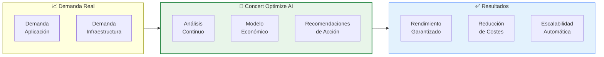
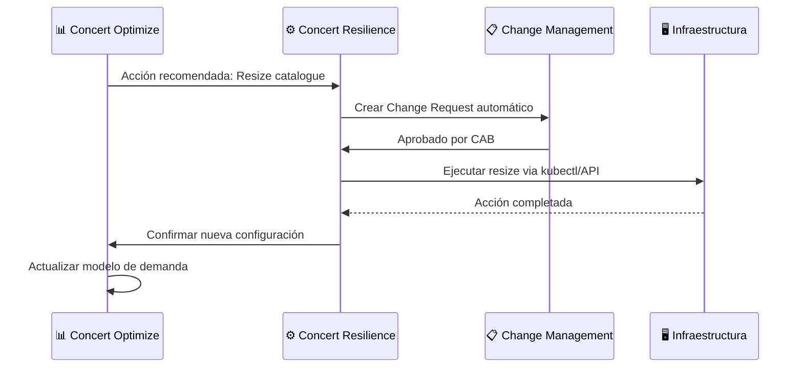

# Lab 5 — Concert Optimize: Optimización de Recursos y Costes

<div class="lab-badge lab-badge-green">Lab 5</div>
<div class="lab-badge lab-badge-teal">Concert Optimize</div>
<div class="lab-badge lab-badge-green">15 min</div>

---

## Objetivos del laboratorio

Al finalizar este laboratorio serás capaz de:

- [x] Navegar por el módulo **Concert Optimize** (basado en Turbonomic)
- [x] Analizar la **demanda vs. capacidad** en aplicaciones y contenedores
- [x] Identificar oportunidades de **right-sizing** de recursos
- [x] Explorar recomendaciones de **optimización de costes cloud**
- [x] Entender el impacto de las acciones en **rendimiento y coste**
- [x] Simular acciones de optimización sin afectar al entorno

---

## Introducción a Concert Optimize

<div class="concert-optimize">

**Concert Optimize**, basado en la tecnología de **IBM Turbonomic**, analiza continuamente la demanda real de aplicaciones y alinea los recursos de infraestructura para garantizar rendimiento óptimo al coste más eficiente.

</div>



---

## 1. Vista General de Concert Optimize

### 1.1 Acceder a Concert Optimize

En la **barra de navegación superior**, haz clic en **"Optimize"**.

<div class="screenshot-container" markdown="1">


<div class="screenshot-caption" markdown="1">
📸 Figura 1 — Dashboard principal de Concert Optimize con resumen de ahorros potenciales y acciones pendientes
</div>
</div>

### 1.2 KPIs del Dashboard de Optimize

| KPI | Descripción |
|-----|-------------|
| **Potential Savings** | Ahorro mensual potencial identificado |
| **Pending Actions** | Acciones de optimización recomendadas |
| **Over-provisioned** | Recursos sobredimensionados |
| **Under-provisioned** | Recursos subdimensionados (riesgo de rendimiento) |
| **SLO Compliance** | % de SLOs cumplidos actualmente |

---

## 2. Análisis de Right-Sizing

### 2.1 ¿Qué es el Right-Sizing?

El **Right-Sizing** es el proceso de ajustar los recursos asignados a una aplicación/contenedor para que coincidan exactamente con la demanda real:

```
Problema actual:
┌─────────────────────┐
│  Recursos asignados │  ←── 4 vCPU, 8 GB RAM
│  ████░░░░░░░░░░░░░  │  ←── Solo usa 35% (1.4 vCPU, 2.8 GB)
└─────────────────────┘
         ↓ Right-sizing ↓
┌─────────────────────┐
│  Recursos optimizados│  ←── 2 vCPU, 4 GB RAM
│  ██████░░░░░░░░░░░  │  ←── Uso: 70% (mucho mejor)
└─────────────────────┘
💰 Ahorro: 50% del coste de cómputo
```

### 2.2 Explorar Recomendaciones de Right-Sizing

Navega a **Optimize → Actions** o **Optimize → Pending Actions**.

<div class="screenshot-container" markdown="1">


<div class="screenshot-caption" markdown="1">
📸 Figura 2 — Lista de recomendaciones de right-sizing con impacto en rendimiento y coste
</div>
</div>

### 2.3 Tipos de Acciones de Optimización

Concert Optimize clasifica las acciones en categorías:

=== "Resize"
    **Cambio de tamaño de contenedores/VMs**
    
    - Reducir CPU/memoria sobredimensionada
    - Aumentar CPU/memoria subdimensionada
    - Cambiar el tipo de instancia (AWS, Azure, GCP)
    
    **Ejemplo de acción:**
    ```
    Acción: Resize Deployment
    Servicio: catalogue
    Namespace: robotshop
    
    Configuración actual:
      CPU Request: 500m  CPU Limit: 1000m
      Memory Request: 512Mi  Memory Limit: 1Gi
    
    Recomendación:
      CPU Request: 200m  CPU Limit: 400m     (-60%)
      Memory Request: 256Mi  Memory Limit: 512Mi  (-50%)
    
    Ahorro estimado: $12.50/mes
    Impacto en rendimiento: Ninguno (demanda real < límite nuevo)
    ```

=== "Scale"
    **Escalado horizontal de pods/instancias**
    
    - Scale up: Aumentar réplicas bajo carga
    - Scale down: Reducir réplicas en horario no-pico
    - Ajustar HPA (Horizontal Pod Autoscaler)
    
    **Ejemplo:**
    ```
    Acción: Scale Down
    Servicio: frontend
    Horario: 22:00 - 06:00 UTC (baja demanda)
    
    Actual: 3 réplicas 24/7
    Recomendado: 3 réplicas (06:00-22:00) / 1 réplica (22:00-06:00)
    
    Ahorro estimado: $45/mes
    ```

=== "Move"
    **Migración de workloads**
    
    - Mover a nodos más eficientes
    - Consolidar en menos nodos (bin packing)
    - Migrar a tier de cómputo más barato

=== "Terminate"
    **Eliminar recursos sin uso**
    
    - Pods en estado Evicted
    - Volúmenes no conectados
    - Load Balancers vacíos
    - Snapshots antiguas

---

## 3. Análisis de Coste Cloud

### 3.1 Vista de Coste

Navega a **Optimize → Cost Analysis** o **Optimize → Cloud Cost**.

<div class="screenshot-container" markdown="1">


<div class="screenshot-caption" markdown="1">
📸 Figura 3 — Dashboard de análisis de coste cloud con desglose por servicio y tipo de recurso
</div>
</div>

### 3.2 Desglose de Costes

Concert Optimize desglosa el coste por:

```
Coste Mensual Total: $12,450
├── Cómputo (VMs/Pods):         $7,800  (62.7%)
│   ├── Producción:   $5,200
│   └── No-Producción: $2,600  ← Oportunidad de ahorro
├── Almacenamiento:             $2,100  (16.9%)
│   ├── Persistent Volumes: $1,200
│   └── Snapshots (>90 días): $900  ← Candidatos a eliminar
├── Red (Egress):               $1,450  (11.7%)
│   └── Cross-region traffic: $900  ← Arquitectura ineficiente
└── Otros (LB, IPs, etc.):     $1,100  (8.8%)
```

### 3.3 Oportunidades de Ahorro Identificadas

| Oportunidad | Ahorro Potencial | Esfuerzo |
|-------------|-----------------|---------|
| Right-size over-provisioned pods | $1,200/mes | Bajo |
| Terminar recursos no-prod en horario no laboral | $800/mes | Bajo |
| Eliminar snapshots antiguas (>90 días) | $400/mes | Bajo |
| Migrar workloads batch a instancias Spot | $600/mes | Medio |
| Optimizar tráfico cross-region | $300/mes | Alto |
| **Total potencial** | **$3,300/mes** | |

---

## 4. Kubernetes Optimization

### 4.1 Vista de Kubernetes

Concert Optimize tiene una vista específica para optimización de Kubernetes:

Navega a **Optimize → Kubernetes** o **Optimize → Containers**.

<div class="screenshot-container" markdown="1">


<div class="screenshot-caption" markdown="1">
📸 Figura 4 — Vista de optimización de Kubernetes con namespaces, deployments y recomendaciones
</div>
</div>

### 4.2 Análisis por Namespace

Concert agrupa las recomendaciones por namespace de Kubernetes:

```
Cluster: production-cluster
├── Namespace: robotshop
│   ├── 🔴 Subdimensionado: payment-service (CPU: 95%)
│   ├── 🟡 Sobredimensionado: catalogue (CPU: 12%)
│   └── 🟢 Óptimo: frontend (CPU: 65%)
├── Namespace: monitoring
│   └── 🟢 Óptimo: instana-agent
└── Total ahorro namespace robotshop: $320/mes
```

### 4.3 VPA vs HPA

Concert Optimize recomienda la estrategia más adecuada:

| Estrategia | Cuándo usar | Cómo lo detecta Concert |
|------------|-------------|------------------------|
| **VPA** (Vertical) | CPU/memoria inconsistente | Picos altos sin correlación con tráfico |
| **HPA** (Horizontal) | Demanda varía con el tiempo | Picos correlacionados con métricas de negocio |
| **KEDA** (Event-driven) | Escalar por eventos de cola | Mensajes en RabbitMQ/Kafka correlacionados |
| **Manual resize** | Sobredimensionamiento crónico | Uso estable pero muy bajo |

---

## 5. Simulación de Acciones

### 5.1 Modo Simulación

Concert Optimize permite **simular** el impacto de las acciones antes de ejecutarlas:

!!! warning "Política de ejecución"
    En entornos de **producción**, Concert requiere aprobación antes de ejecutar acciones automáticas. En el entorno del workshop, las acciones están en modo **"Recommend"** (solo recomendaciones, sin ejecución automática).

<div class="screenshot-container" markdown="1">


<div class="screenshot-caption" markdown="1">
📸 Figura 5 — Vista de simulación mostrando el impacto proyectado de las acciones de optimización
</div>
</div>

### 5.2 Proceso de Simulación

1. Navega a **Optimize → Actions**
2. Selecciona una acción de right-sizing
3. Haz clic en **"Simulate"** o **"What-if"**
4. Concert proyecta:
   - Nuevo uso de CPU y memoria
   - Nuevo coste estimado
   - Riesgo de impacto en rendimiento
   - SLO impact score

---

## 6. Integración con Concert Resilience

Concert Optimize se integra con Concert Resilience para:



---

## 7. Ejercicio Práctico

### 🎯 Ejercicio: Identificar Oportunidades de Optimización

1. Navega a **Optimize → Pending Actions**
2. Filtra por **"Risk: Low"** (solo acciones sin riesgo de impacto)
3. Ordena por **"Savings"** de mayor a menor
4. Identifica la acción con mayor ahorro y bajo riesgo
5. Haz clic en la acción y revisa el detalle
6. Consulta la simulación del impacto

| Pregunta | Tu Respuesta |
|----------|-------------|
| ¿Cuántas acciones de right-sizing hay pendientes? | |
| ¿Cuál es el ahorro mensual potencial total? | |
| ¿Qué servicio está más sobredimensionado? | |
| ¿Cuál es el porcentaje real de uso de CPU de ese servicio? | |
| ¿Qué tipo de instancia/configuración recomienda Concert? | |

---

## Resumen

!!! success "Lab 5 completado ✅"
    Has explorado exitosamente el módulo Concert Optimize:
    
    - ✅ Dashboard de optimización con KPIs de coste y rendimiento
    - ✅ Recomendaciones de Right-Sizing por servicio/contenedor
    - ✅ Análisis de coste cloud con desglose detallado
    - ✅ Optimización de clusters Kubernetes
    - ✅ Simulación de acciones sin riesgo
    - ✅ Integración con Change Management
    
    **Siguiente paso**: [Lab 6 — Concert Workflows: Automatización →](../lab6/index.md)
