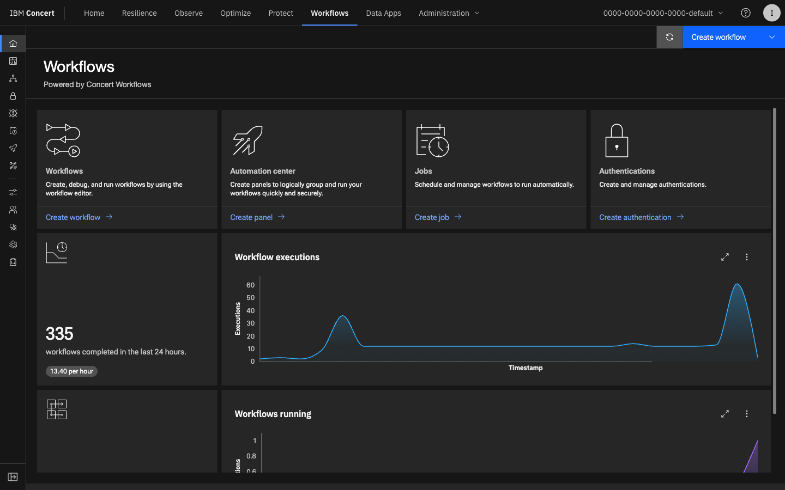
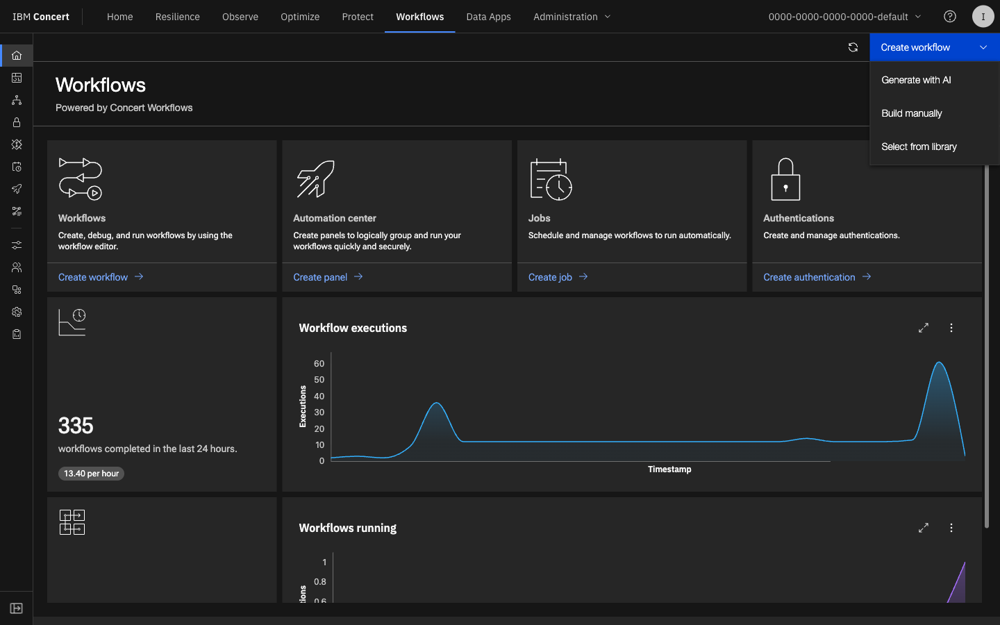
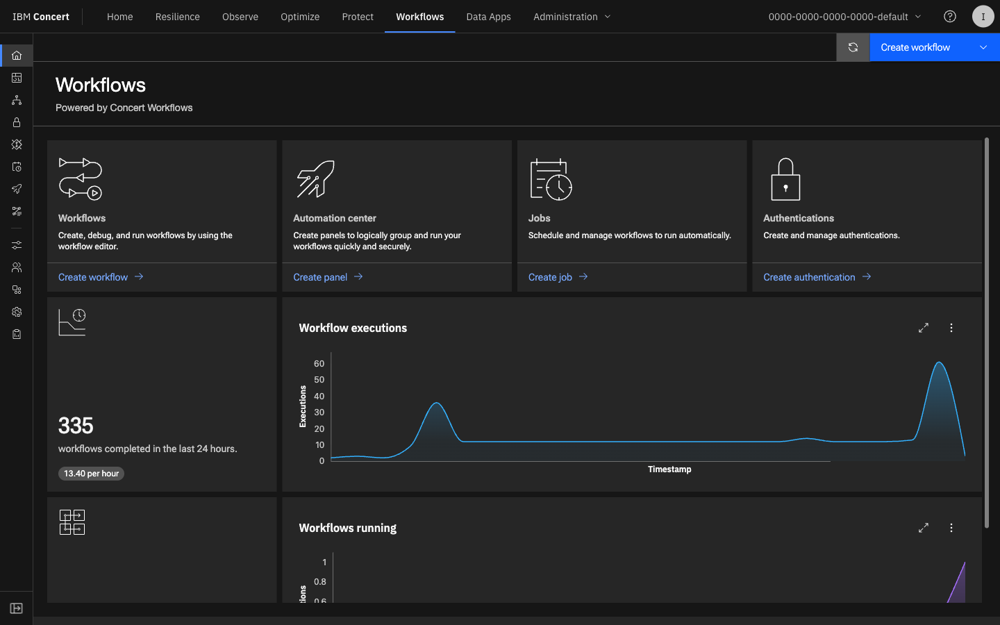
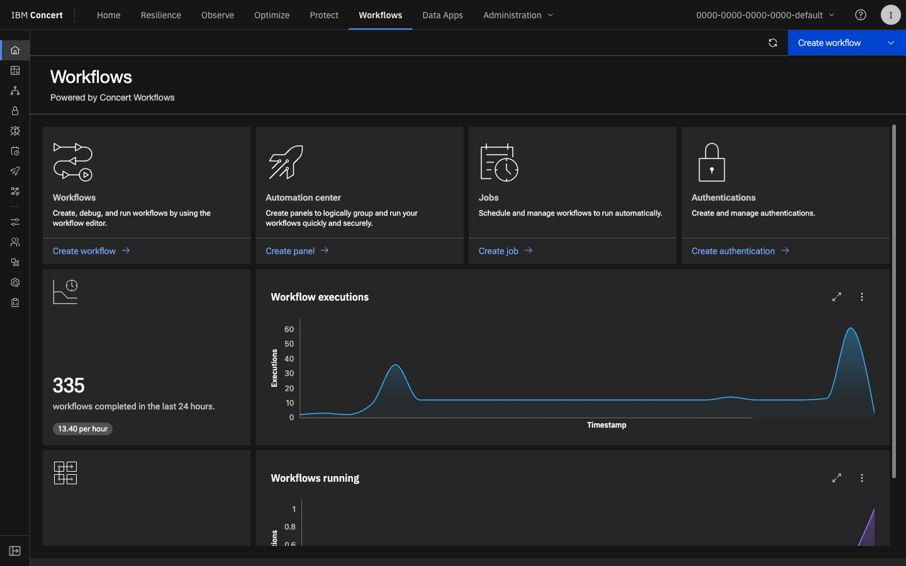
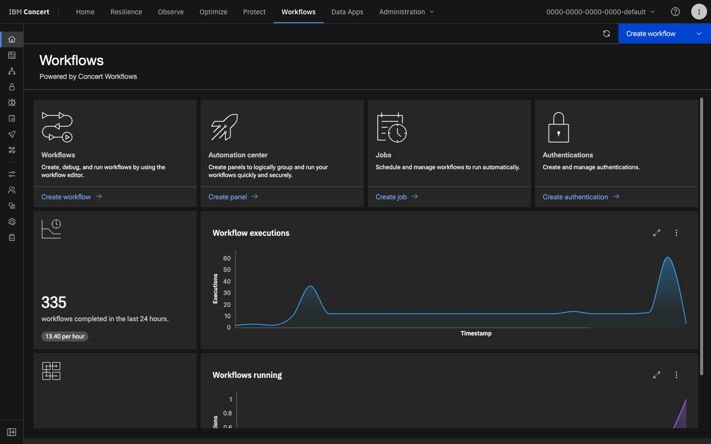
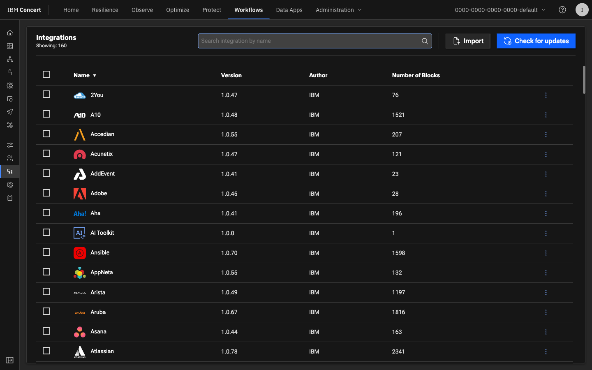

# Lab 6 — Concert Workflows: Low-Code Automation

<div class="lab-badge lab-badge-purple">Lab 6</div>
<div class="lab-badge lab-badge-blue">Concert Workflows</div>
<div class="lab-badge lab-badge-green">15 min</div>

---

## Lab Objectives

By the end of this lab you will be able to:

- [x] Navigate the **Concert Workflows** module
- [x] Understand the **visual workflow editor** (low-code)
- [x] Explore predefined **workflow templates**
- [x] Create a **CVE auto-remediation** workflow
- [x] Configure **integrations** with Jira, Slack and ServiceNow
- [x] Manage the **governance** of automated executions
- [x] Review the **execution history** and audit trail

---

## Introduction to Concert Workflows

<div class="concert-workflows">

**Concert Workflows** turns operational context into governed execution. It coordinates actions across existing tools and teams, replacing isolated automations and manual handoffs with workflows that keep execution controlled and auditable.

```mermaid
graph LR
    subgraph TRIGGERS["⚡ Triggers"]
        CVE_ALERT["🔴 Critical CVE<br/>detected"]
        CERT_ALERT["⏰ Certificate<br/>expiring"]
        INCIDENT["🚨 SEV1<br/>Incident"]
        MANUAL["👤 Manual<br/>execution"]
    end

    subgraph WORKFLOW["🔄 Concert Workflow Engine"]
        ENRICH["Enrich<br/>context"]
        DECIDE["Decision<br/>logic"]
        NOTIFY["Notifications"]
        EXECUTE["Execute<br/>actions"]
        APPROVE["Human<br/>approval"]
    end

    subgraph ACTIONS["✅ Actions"]
        JIRA["📋 Jira<br/>Ticket"]
        SLACK["💬 Slack<br/>Message"]
        PATCH["🔧 Patch<br/>Service"]
        SNOW["❄️ ServiceNow<br/>Incident"]
    end

    TRIGGERS --> WORKFLOW
    WORKFLOW --> ACTIONS

    style WORKFLOW fill:#f3e5f5,stroke:#8a3ffc,stroke-width:2px
```

</div>



---

## 1. Concert Workflows Overview

### 1.1 Accessing Concert Workflows

In the **top navigation bar**, click on **"Workflows"**.

<div class="screenshot-container" markdown="1">



<div class="screenshot-caption" markdown="1">
📸 Figure 1 — Concert Workflows main dashboard with active workflows and execution statistics
</div>
</div>

### 1.2 Workflows Control Panel

The dashboard shows:

| Panel | Description |
|-------|-------------|
| **Active Workflows** | Enabled and running workflows |
| **Executions Today** | Number of executions in the last 24h |
| **Success Rate** | Percentage of successful executions |
| **Pending Approvals** | Workflows waiting for human approval |
| **Recent Activity** | Latest executions with status |

---

## 2. The Visual Workflow Editor

### 2.1 Creating a New Workflow

1. Click **"+ New Workflow"** or **"Create Workflow"**
2. Select:
   - **"Start from template"**: Use a predefined template
   - **"Start from scratch"**: Build from the ground up
   - **"Import"**: Import an existing workflow (YAML/JSON)

<div class="screenshot-container" markdown="1">



<div class="screenshot-caption" markdown="1">
📸 Figure 2 — Concert Workflows visual drag-and-drop editor with component palette
</div>
</div>

### 2.2 Editor Components

The Concert Workflows visual editor contains:

```
Component palette:
├── ⚡ Triggers
│   ├── Concert Alert (Observe)
│   ├── CVE Detected (Protect)
│   ├── Certificate Expiry (Protect)
│   ├── Incident Created (Resilience)
│   ├── Schedule (cron)
│   └── Webhook (external)
├── 🔄 Actions
│   ├── Notify (Slack, Teams, Email)
│   ├── Create Ticket (Jira, ServiceNow)
│   ├── Execute Runbook (Resilience)
│   ├── Scale Resource (Optimize)
│   ├── HTTP Request (webhook)
│   └── Wait for Approval
├── 🧠 Logic
│   ├── Condition (if/else)
│   ├── Loop (for each)
│   ├── Parallel execution
│   └── Delay/Timer
└── 📊 Data
    ├── Transform data
    ├── Set variable
    └── Log/Audit
```

---

## 3. Predefined Workflow Templates

### 3.1 Exploring Templates

Navigate to **Workflows → Templates** to see predefined workflows.

<div class="screenshot-container" markdown="1">



<div class="screenshot-caption" markdown="1">
📸 Figure 3 — Workflow template library organised by category
</div>
</div>

### 3.2 Template Categories

=== "🛡️ Security"
    
    **CVE Critical Auto-Remediation**
    ```
    Trigger: CVE severity=Critical AND PoE=Exploitable
    Actions:
    1. Enrich with application context
    2. Create Jira ticket (priority: P1)
    3. Notify team via Slack
    4. Request approval for auto-patch
    5. If approved: Execute patching runbook
    6. Verify CVE is resolved
    7. Close Jira ticket
    ```
    
    **Certificate Expiry Alert**
    ```
    Trigger: Certificate expires_in < 30 days
    Actions:
    1. Notify certificate owner
    2. Create ServiceNow task
    3. If expires_in < 7 days: Escalate (SEV2)
    4. Send daily reminder until renewal
    ```

=== "⚙️ Operations"
    
    **Incident Auto-Triage**
    ```
    Trigger: Alert: Error rate > 5%
    Actions:
    1. Correlate with recent changes
    2. Search historical similar incidents
    3. Suggest most relevant runbook
    4. Create incident with pre-filled context
    5. Notify on-call team
    6. Attach relevant traces and metrics
    ```
    
    **Auto-Scaling on Load**
    ```
    Trigger: CPU > 80% during 5 minutes
    Actions:
    1. Verify if it is expected peak (schedule)
    2. If unexpected: Create alert
    3. Increase replicas (+2)
    4. Wait 120 seconds
    5. Verify latency improved
    6. Notify team of result
    ```

=== "📊 Optimization"
    
    **Weekly Cost Report**
    ```
    Trigger: Schedule (Monday 08:00 UTC)
    Actions:
    1. Generate weekly cost report
    2. List top 5 savings opportunities
    3. Create tickets for each opportunity
    4. Send executive summary by email
    ```
    
    **Non-Prod Shutdown**
    ```
    Trigger: Schedule (Friday 20:00 UTC)
    Actions:
    1. Identify non-production resources
    2. Verify no active jobs running
    3. Shut down non-prod resources
    4. Turn on Monday 07:00 UTC
    5. Notify via Slack
    ```

=== "🔁 Resilience"
    
    **Chaos Engineering Test**
    ```
    Trigger: Schedule (weekly, non-prod only)
    Actions:
    1. Verify no active incidents
    2. Introduce simulated failure (pod kill)
    3. Measure recovery time
    4. Verify alerts triggered
    5. Restore normal state
    6. Generate resilience report
    ```

---

## 4. Creating a Workflow: CVE Critical Alert

### 4.1 Exercise Goal

We will create a workflow that:
1. Activates when Concert detects a **Critical CVE with confirmed PoE**
2. Automatically creates a ticket in **Jira**
3. Notifies the security team in **Slack**
4. Requests **approval** before starting remediation

### 4.2 Step by Step

=== "Step 1: Create the Workflow"

    1. Navigate to **Workflows → + New Workflow**
    2. Select **"Start from template"**
    3. Choose the **"CVE Critical Auto-Remediation"** template
    4. Click **"Use this template"**
    5. Name it: `CVE-Critical-Response-Workshop`

=== "Step 2: Configure the Trigger"

    The trigger is already pre-configured. Review its settings:
    
    <div class="screenshot-container" markdown="1">
    
    
    
    <div class="screenshot-caption" markdown="1">
    📸 Figure 4 — CVE trigger configuration with severity and PoE filters
    </div>
    </div>
    
    ```yaml
    Trigger: CVE Detected
    Conditions:
      - severity: Critical
      - proof_of_exploitability: Confirmed
      - environment: production
    ```

=== "Step 3: Configure Jira"

    1. Click on the **"Create Jira Ticket"** node
    2. Configure the fields:
    
    ```yaml
    Project: SEC  # Security Project
    Issue Type: Bug
    Priority: P1 - Critical
    Summary: "[CVE] {{cve.id}} - {{application.name}}"
    Description: |
      ## CVE Detected
      **CVE ID**: {{cve.id}}
      **CVSS Score**: {{cve.cvss_score}}
      **Affected application**: {{application.name}}
      **Component**: {{component.name}}
      **PoE**: {{cve.poe_status}}
      
      ## Description
      {{cve.description}}
      
      ## Recommended remediation
      Update to version: {{cve.fix_version}}
    Labels: [security, cve, critical]
    Assignee: security-team
    ```

=== "Step 4: Configure Slack"

    1. Click on the **"Notify Slack"** node
    2. Configure the message:
    
    ```yaml
    Channel: #security-alerts
    Message: |
      🔴 *Critical CVE Detected - Action Required*
      
      *CVE:* {{cve.id}} (CVSS: {{cve.cvss_score}})
      *Application:* {{application.name}}
      *PoE:* Confirmed (EXPLOITABLE)
      *Ticket:* {{jira.ticket_url}}
      
      ⚠️ Remediation required in < 24 hours
    Mentions: ["@security-team", "@oncall"]
    ```

=== "Step 5: Configure Approval"

    1. Click on the **"Wait for Approval"** node
    2. Configure:
    
    ```yaml
    Approvers: [security-lead, app-owner]
    Approval type: Any (1 of N approvers)
    Timeout: 4 hours
    On timeout: Skip to notification
    Message: "Approve auto-patch for {{cve.id}}?"
    ```

=== "Step 6: Save and Activate"

    1. Click **"Save"**
    2. Review the complete workflow in the canvas view
    3. Click **"Activate"** or **"Enable"**
    4. Confirm the activation

---

## 5. Management and Governance

### 5.1 Execution History

Navigate to **Workflows → Executions** to see the full history.

<div class="screenshot-container" markdown="1">



<div class="screenshot-caption" markdown="1">
📸 Figure 5 — Execution history with status, duration and log for each step
</div>
</div>

### 5.2 Execution Detail

Click on any execution to see the step-by-step detail:

<div class="screenshot-container" markdown="1">



<div class="screenshot-caption" markdown="1">
📸 Figure 6 — Execution detail showing each step, status and processed data
</div>
</div>

Each execution shows:

| Field | Description |
|-------|-------------|
| **Execution ID** | Unique execution identifier |
| **Triggered By** | Trigger that started the workflow |
| **Start Time** | When it started |
| **Duration** | Total execution time |
| **Status** | Success / Failed / Pending Approval |
| **Steps** | Each step with its status and output |
| **Context** | Input and output data per step |

### 5.3 Governance Policies

Concert Workflows incorporates governance into every automation:

=== "Access Control"
    - Only users with the `workflow-admin` role can create workflows
    - Workflows require approval before being activated in production
    - Destructive actions always require human approval

=== "Audit"
    - Each execution is logged with:
      - User/trigger that started it
      - Each action executed and result
      - Approvals obtained
      - Timestamp of each step
    - Immutable logs for compliance (SOC2, PCI-DSS)

=== "Rate Limiting"
    - Execution limit per workflow per hour
    - Circuit breaker: Deactivates after X consecutive failures
    - Configurable cooldown period

---

## 6. Available Integrations

### 6.1 Concert Workflows Connectors

<div class="screenshot-container" markdown="1">



<div class="screenshot-caption" markdown="1">
📸 Figure 7 — Available integrations panel in Concert Workflows with configured connectors
</div>
</div>

### 6.2 Integration Catalogue

=== "🎫 Ticketing"
    | Tool | Available actions |
    |------|-------------------|
    | **Jira** | Create/Update/Close issue, Add comment, Transition status |
    | **ServiceNow** | Create incident/change, Update record, Close ticket |
    | **GitHub** | Create issue, Open PR, Add label, Comment |
    | **GitLab** | Create issue, Merge request, Pipeline trigger |
    | **Azure DevOps** | Create work item, Update, Close |

=== "💬 Communication"
    | Tool | Available actions |
    |------|-------------------|
    | **Slack** | Send message, Create channel, Mention user |
    | **Microsoft Teams** | Post message, Create meeting, Adaptive cards |
    | **Email** | Send email (SMTP), HTML templates |
    | **PagerDuty** | Create incident, Resolve, Escalate |
    | **OpsGenie** | Create alert, Acknowledge, Close |

=== "☁️ Cloud & Infra"
    | Tool | Available actions |
    |------|-------------------|
    | **Kubernetes** | Scale deployment, Restart pod, Apply manifest |
    | **AWS** | EC2 start/stop, EKS update, CloudFormation |
    | **Azure** | VM operations, AKS scale, ARM templates |
    | **GCP** | GKE operations, VM management |
    | **Ansible** | Run playbook, Execute role |

=== "🔐 Security"
    | Tool | Available actions |
    |------|-------------------|
    | **Vault** | Read/Write secret, Rotate credential |
    | **Qualys** | Scan trigger, Get results |
    | **Snyk** | Test project, Get vulnerabilities |
    | **SonarQube** | Run analysis, Get quality gate |

---

## 7. Final Exercise: End-to-End Workflow

### 🎯 Exercise: Review and Analyse an Existing Workflow

!!! info "Objective"
    In this exercise you will explore a predefined workflow in the Concert environment 
    and analyse its logic, integrations and execution history.

**Steps:**

1. Navigate to **Workflows → All Workflows**
2. Find a workflow related to **CVE** or **Incidents**
3. Click on it to see the visual canvas
4. Analyse the flow and identify:
   - The **trigger** that activates it
   - All the **actions** it performs
   - Whether it has **conditions** (if/else)
   - Whether it requires **human approval**
5. Go to **Executions** and review the history
6. Click on the most recent execution and review each step

**Complete the analysis table:**

| Element | Your Analysis |
|---------|--------------|
| Workflow name | |
| Trigger type | |
| How many actions does it have? | |
| Does it require approval? | |
| Which integration does it use? (Jira/Slack/etc.) | |
| How many total executions does it have? | |
| What was the result of the last execution? | |

---

## Workshop Summary

!!! success "Lab 6 completed ✅ — Workshop finished 🎉"
    You have completed all the IBM Concert workshop labs:
    
    - ✅ **Lab 0**: Environment access and verification
    - ✅ **Lab 1**: Concert navigation and structure
    - ✅ **Lab 2**: Concert Protect — CVEs, SBOM, Certificates and Compliance
    - ✅ **Lab 3**: Concert Observe — APM, Topology, Traces and Alerts
    - ✅ **Lab 4**: Concert Resilience — Incidents, Runbooks and Change Management
    - ✅ **Lab 5**: Concert Optimize — Right-Sizing and Cost Management
    - ✅ **Lab 6**: Concert Workflows — Low-Code Automation and Governance

---

## Additional Resources

| Resource | URL |
|----------|-----|
| IBM Concert official documentation | [ibm.com/docs/concert](https://www.ibm.com/docs/concert) |
| IBM Concert Product Page | [ibm.com/products/concert](https://www.ibm.com/products/concert) |
| IBM Concert Protect | [ibm.com/products/concert/protect](https://www.ibm.com/products/concert/protect) |
| IBM Concert Observe | [ibm.com/products/concert/observe](https://www.ibm.com/products/concert/observe) |
| Free trial | [Request trial](https://www.ibm.com/account/reg/signup?formid=urx-53025) |

---

## Workshop Feedback

!!! question "How was your experience?"
    Please share your feedback with the instructor:
    
    - Which Concert feature did you find most useful?
    - Which part of the workshop was hardest to follow?
    - Which additional lab would you like to see in the future?
    
    Your feedback helps us improve the workshop for future sessions. 🙏
