# Lab 6 — Concert Workflows: Automatización Low-Code

<div class="lab-badge lab-badge-purple">Lab 6</div>
<div class="lab-badge lab-badge-blue">Concert Workflows</div>
<div class="lab-badge lab-badge-green">15 min</div>

---

## Objetivos del laboratorio

Al finalizar este laboratorio serás capaz de:

- [x] Navegar por el módulo **Concert Workflows**
- [x] Entender el **editor visual de workflows** (low-code)
- [x] Explorar los **templates de workflow** predefinidos
- [x] Crear un workflow de **remediación automática de CVEs**
- [x] Configurar **integraciones** con Jira, Slack y ServiceNow
- [x] Gestionar la **gobernanza** de las ejecuciones automatizadas
- [x] Revisar el **historial de ejecuciones** y auditoría

---

## Introducción a Concert Workflows

<div class="concert-workflows">

**Concert Workflows** convierte el contexto operacional en ejecución gobernada. Coordina acciones a través de herramientas y equipos existentes, reemplazando automatizaciones aisladas y handoffs manuales con flujos de trabajo que mantienen la ejecución controlada y auditable.

```mermaid
graph LR
    subgraph TRIGGERS["⚡ Triggers"]
        CVE_ALERT["🔴 CVE Crítico<br/>detectado"]
        CERT_ALERT["⏰ Certificado<br/>expirando"]
        INCIDENT["🚨 Incidente<br/>SEV1"]
        MANUAL["👤 Ejecución<br/>manual"]
    end

    subgraph WORKFLOW["🔄 Concert Workflow Engine"]
        ENRICH["Enriquecer<br/>contexto"]
        DECIDE["Lógica de<br/>decisión"]
        NOTIFY["Notificaciones"]
        EXECUTE["Ejecutar<br/>acciones"]
        APPROVE["Aprobación<br/>humana"]
    end

    subgraph ACTIONS["✅ Acciones"]
        JIRA["📋 Jira<br/>Ticket"]
        SLACK["💬 Slack<br/>Message"]
        PATCH["🔧 Patch<br/>Service"]
        SNOW["❄️ ServiceNow<br/>Incident"]
    end

    TRIGGERS --> WORKFLOW
    WORKFLOW --> ACTIONS

    style WORKFLOW fill:#f3e5f5,stroke:#8a3ffc,stroke-width:2px
```

</div>



---

## 1. Vista General de Concert Workflows

### 1.1 Acceder a Concert Workflows

En la **barra de navegación superior**, haz clic en **"Workflows"**.

<div class="screenshot-container" markdown="1">


<div class="screenshot-caption" markdown="1">
📸 Figura 1 — Dashboard principal de Concert Workflows con workflows activos y estadísticas de ejecución
</div>
</div>

### 1.2 Panel de Control de Workflows

El dashboard muestra:

| Panel | Descripción |
|-------|-------------|
| **Active Workflows** | Workflows habilitados y en ejecución |
| **Executions Today** | Número de ejecuciones en las últimas 24h |
| **Success Rate** | Porcentaje de ejecuciones exitosas |
| **Pending Approvals** | Workflows esperando aprobación humana |
| **Recent Activity** | Últimas ejecuciones con estado |

---

## 2. El Editor Visual de Workflows

### 2.1 Crear un Nuevo Workflow

1. Haz clic en **"+ New Workflow"** o **"Create Workflow"**
2. Selecciona:
   - **"Start from template"**: Usar un template predefinido
   - **"Start from scratch"**: Crear desde cero
   - **"Import"**: Importar un workflow existente (YAML/JSON)

<div class="screenshot-container" markdown="1">


<div class="screenshot-caption" markdown="1">
📸 Figura 2 — Editor visual drag-and-drop de Concert Workflows con paleta de componentes
</div>
</div>

### 2.2 Componentes del Editor

El editor visual de Concert Workflows contiene:

```
Paleta de componentes:
├── ⚡ Triggers
│   ├── Concert Alert (Observe)
│   ├── CVE Detected (Protect)
│   ├── Certificate Expiry (Protect)
│   ├── Incident Created (Operate)
│   ├── Schedule (cron)
│   └── Webhook (externo)
├── 🔄 Actions
│   ├── Notify (Slack, Teams, Email)
│   ├── Create Ticket (Jira, ServiceNow)
│   ├── Execute Runbook (Operate)
│   ├── Scale Resource (Optimize)
│   ├── HTTP Request (webhook)
│   └── Wait for Approval
├── 🧠 Logic
│   ├── Condition (if/else)
│   ├── Loop (for each)
│   ├── Parallel execution
│   └── Delay/Timer
└── 📊 Data
    ├── Transform data
    ├── Set variable
    └── Log/Audit
```

---

## 3. Templates de Workflow Predefinidos

### 3.1 Explorar Templates

Navega a **Workflows → Templates** para ver los workflows predefinidos.

<div class="screenshot-container" markdown="1">


<div class="screenshot-caption" markdown="1">
📸 Figura 3 — Biblioteca de templates de workflows organizados por categoría
</div>
</div>

### 3.2 Categorías de Templates

=== "🛡️ Security"
    
    **CVE Critical Auto-Remediation**
    ```
    Trigger: CVE severity=Critical AND PoE=Exploitable
    Actions:
    1. Enriquecer con contexto de la aplicación
    2. Crear ticket en Jira (priority: P1)
    3. Notificar al equipo por Slack
    4. Solicitar aprobación para patch automático
    5. Si aprobado: Ejecutar runbook de patching
    6. Verificar que el CVE está resuelto
    7. Cerrar el ticket de Jira
    ```
    
    **Certificate Expiry Alert**
    ```
    Trigger: Certificate expires_in < 30 days
    Actions:
    1. Notificar al propietario del certificado
    2. Crear tarea en ServiceNow
    3. Si expires_in < 7 días: Escalar (SEV2)
    4. Enviar recordatorio diario hasta renovación
    ```

=== "⚙️ Operations"
    
    **Incident Auto-Triage**
    ```
    Trigger: Alert: Error rate > 5%
    Actions:
    1. Correlacionar con cambios recientes
    2. Buscar incidentes similares históricos
    3. Sugerir runbook más relevante
    4. Crear incidente con contexto pre-rellenado
    5. Notificar al on-call team
    6. Adjuntar trazas y métricas relevantes
    ```
    
    **Auto-Scaling on Load**
    ```
    Trigger: CPU > 80% during 5 minutes
    Actions:
    1. Verificar si es pico esperado (horario)
    2. Si inesperado: Crear alerta
    3. Incrementar réplicas (+2)
    4. Esperar 120 segundos
    5. Verificar que la latencia mejoró
    6. Notificar resultado al equipo
    ```

=== "📊 Optimization"
    
    **Weekly Cost Report**
    ```
    Trigger: Schedule (Monday 08:00 UTC)
    Actions:
    1. Generar informe de costes de la semana
    2. Listar top 5 oportunidades de ahorro
    3. Crear tickets para cada oportunidad
    4. Enviar resumen ejecutivo por email
    ```
    
    **Non-Prod Shutdown**
    ```
    Trigger: Schedule (Friday 20:00 UTC)
    Actions:
    1. Identificar recursos de no-producción
    2. Verificar que no hay trabajos activos
    3. Apagar recursos no-prod
    4. Encender el lunes 07:00 UTC
    5. Notificar por Slack
    ```

=== "🔁 Resilience"
    
    **Chaos Engineering Test**
    ```
    Trigger: Schedule (weekly, non-prod only)
    Actions:
    1. Verificar que no hay incidentes activos
    2. Introducir fallo simulado (pod kill)
    3. Medir tiempo de recuperación
    4. Verificar alertas disparadas
    5. Restaurar estado normal
    6. Generar informe de resiliencia
    ```

---

## 4. Crear un Workflow: CVE Critical Alert

### 4.1 Objetivo del Ejercicio

Vamos a crear un workflow que:
1. Se active cuando Concert detecte un **CVE Crítico con PoE confirmada**
2. Cree automáticamente un ticket en **Jira**
3. Notifique al equipo de seguridad en **Slack**
4. Solicite **aprobación** antes de iniciar la remediación

### 4.2 Paso a Paso

=== "Paso 1: Crear el Workflow"

    1. Navega a **Workflows → + New Workflow**
    2. Selecciona **"Start from template"**
    3. Elige el template **"CVE Critical Auto-Remediation"**
    4. Haz clic en **"Use this template"**
    5. Dale un nombre: `CVE-Critical-Response-Workshop`

=== "Paso 2: Configurar el Trigger"

    El trigger ya está preconfigurado. Revisa su configuración:
    
    <div class="screenshot-container" markdown="1">
    
    
    
    <div class="screenshot-caption" markdown="1">
    📸 Figura 4 — Configuración del trigger CVE con filtros de severidad y PoE
    </div>
    </div>
    
    ```yaml
    Trigger: CVE Detected
    Conditions:
      - severity: Critical
      - proof_of_exploitability: Confirmed
      - environment: production
    ```

=== "Paso 3: Configurar Jira"

    1. Haz clic en el nodo **"Create Jira Ticket"**
    2. Configura los campos:
    
    ```yaml
    Project: SEC  # Proyecto de Seguridad
    Issue Type: Bug
    Priority: P1 - Critical
    Summary: "[CVE] {{cve.id}} - {{application.name}}"
    Description: |
      ## CVE Detectado
      **CVE ID**: {{cve.id}}
      **CVSS Score**: {{cve.cvss_score}}
      **Aplicación afectada**: {{application.name}}
      **Componente**: {{component.name}}
      **PoE**: {{cve.poe_status}}
      
      ## Descripción
      {{cve.description}}
      
      ## Remediación recomendada
      Actualizar a versión: {{cve.fix_version}}
    Labels: [security, cve, critical]
    Assignee: security-team
    ```

=== "Paso 4: Configurar Slack"

    1. Haz clic en el nodo **"Notify Slack"**
    2. Configura el mensaje:
    
    ```yaml
    Channel: #security-alerts
    Message: |
      🔴 *CVE Crítico Detectado - Acción Requerida*
      
      *CVE:* {{cve.id}} (CVSS: {{cve.cvss_score}})
      *Aplicación:* {{application.name}}
      *PoE:* Confirmada (EXPLOTABLE)
      *Ticket:* {{jira.ticket_url}}
      
      ⚠️ Se requiere remediación en < 24 horas
    Mentions: ["@security-team", "@oncall"]
    ```

=== "Paso 5: Configurar Aprobación"

    1. Haz clic en el nodo **"Wait for Approval"**
    2. Configura:
    
    ```yaml
    Approvers: [security-lead, app-owner]
    Approval type: Any (1 de N aprobadores)
    Timeout: 4 hours
    On timeout: Skip to notification
    Message: "¿Aprobar patch automático para {{cve.id}}?"
    ```

=== "Paso 6: Guardar y Activar"

    1. Haz clic en **"Save"**
    2. Revisa el workflow completo en la vista canvas
    3. Haz clic en **"Activate"** o **"Enable"**
    4. Confirma la activación

---

## 5. Gestión y Gobernanza

### 5.1 Historial de Ejecuciones

Navega a **Workflows → Executions** para ver el historial completo.

<div class="screenshot-container" markdown="1">


<div class="screenshot-caption" markdown="1">
📸 Figura 5 — Historial de ejecuciones con estado, duración y log de cada paso
</div>
</div>

### 5.2 Detalle de una Ejecución

Haz clic en cualquier ejecución para ver el detalle paso a paso:

<div class="screenshot-container" markdown="1">


<div class="screenshot-caption" markdown="1">
📸 Figura 6 — Detalle de ejecución mostrando cada paso, estado y datos procesados
</div>
</div>

Cada ejecución muestra:

| Campo | Descripción |
|-------|-------------|
| **Execution ID** | Identificador único de la ejecución |
| **Triggered By** | Trigger que inició el workflow |
| **Start Time** | Cuándo comenzó |
| **Duration** | Tiempo total de ejecución |
| **Status** | Success / Failed / Pending Approval |
| **Steps** | Cada paso con su estado y salida |
| **Context** | Datos de entrada y salida por paso |

### 5.3 Políticas de Gobernanza

Concert Workflows incorpora gobernanza en cada automatización:

=== "Control de Acceso"
    - Solo usuarios con rol `workflow-admin` pueden crear workflows
    - Los workflows requieren aprobación antes de activarse en producción
    - Las acciones destructivas siempre requieren aprobación humana

=== "Auditoría"
    - Cada ejecución queda registrada con:
      - Usuario/trigger que la inició
      - Cada acción ejecutada y resultado
      - Aprobaciones obtenidas
      - Timestamp de cada paso
    - Logs inmutables para compliance (SOC2, PCI-DSS)

=== "Rate Limiting"
    - Límite de ejecuciones por workflow por hora
    - Circuit breaker: Se desactiva si hay X fallos consecutivos
    - Cooldown period configurable

---

## 6. Integraciones Disponibles

### 6.1 Conectores de Concert Workflows

<div class="screenshot-container" markdown="1">


<div class="screenshot-caption" markdown="1">
📸 Figura 7 — Panel de integraciones disponibles en Concert Workflows con conectores configurados
</div>
</div>

### 6.2 Catálogo de Integraciones

=== "🎫 Ticketing"
    | Herramienta | Acciones disponibles |
    |-------------|---------------------|
    | **Jira** | Create/Update/Close issue, Add comment, Transition status |
    | **ServiceNow** | Create incident/change, Update record, Close ticket |
    | **GitHub** | Create issue, Open PR, Add label, Comment |
    | **GitLab** | Create issue, Merge request, Pipeline trigger |
    | **Azure DevOps** | Create work item, Update, Close |

=== "💬 Comunicación"
    | Herramienta | Acciones disponibles |
    |-------------|---------------------|
    | **Slack** | Send message, Create channel, Mention user |
    | **Microsoft Teams** | Post message, Create meeting, Adaptive cards |
    | **Email** | Send email (SMTP), HTML templates |
    | **PagerDuty** | Create incident, Resolve, Escalate |
    | **OpsGenie** | Create alert, Acknowledge, Close |

=== "☁️ Cloud & Infra"
    | Herramienta | Acciones disponibles |
    |-------------|---------------------|
    | **Kubernetes** | Scale deployment, Restart pod, Apply manifest |
    | **AWS** | EC2 start/stop, EKS update, CloudFormation |
    | **Azure** | VM operations, AKS scale, ARM templates |
    | **GCP** | GKE operations, VM management |
    | **Ansible** | Run playbook, Execute role |

=== "🔐 Security"
    | Herramienta | Acciones disponibles |
    |-------------|---------------------|
    | **Vault** | Read/Write secret, Rotate credential |
    | **Qualys** | Scan trigger, Get results |
    | **Snyk** | Test project, Get vulnerabilities |
    | **SonarQube** | Run analysis, Get quality gate |

---

## 7. Ejercicio Final: Workflow End-to-End

### 🎯 Ejercicio: Revisar y Analizar un Workflow Existente

!!! info "Objetivo"
    En este ejercicio explorarás un workflow predefinido en el entorno de Concert 
    y analizarás su lógica, integraciones y historial de ejecuciones.

**Pasos:**

1. Navega a **Workflows → All Workflows**
2. Busca un workflow relacionado con **CVE** o **Incidents**
3. Haz clic sobre él para ver el canvas visual
4. Analiza el flujo e identifica:
   - El **trigger** que lo activa
   - Todas las **acciones** que realiza
   - Si tiene **condiciones** (if/else)
   - Si requiere **aprobación humana**
5. Ve a **Executions** y revisa el historial
6. Haz clic en la ejecución más reciente y revisa cada paso

**Completa la tabla de análisis:**

| Elemento | Tu Análisis |
|----------|------------|
| Nombre del workflow | |
| Tipo de trigger | |
| ¿Cuántas acciones tiene? | |
| ¿Requiere aprobación? | |
| ¿Qué integración usa? (Jira/Slack/etc.) | |
| ¿Cuántas ejecuciones tiene en total? | |
| ¿Cuál fue el resultado de la última ejecución? | |

---

## Resumen del Workshop

!!! success "Lab 6 completado ✅ — Workshop finalizado 🎉"
    Has completado todos los laboratorios del workshop de IBM Concert:
    
    - ✅ **Lab 0**: Acceso y verificación del entorno
    - ✅ **Lab 1**: Navegación y estructura de Concert
    - ✅ **Lab 2**: Concert Protect — CVEs, SBOM, Certificados y Compliance
    - ✅ **Lab 3**: Concert Observe — APM, Topology, Trazas y Alertas
    - ✅ **Lab 4**: Concert Resilience — Incidentes, Runbooks y Change Management
    - ✅ **Lab 5**: Concert Optimize — Right-Sizing y Cost Management
    - ✅ **Lab 6**: Concert Workflows — Automatización Low-Code y Gobernanza

---

## Recursos Adicionales

| Recurso | URL |
|---------|-----|
| Documentación oficial IBM Concert | [ibm.com/docs/concert](https://www.ibm.com/docs/concert) |
| IBM Concert Product Page | [ibm.com/products/concert](https://www.ibm.com/products/concert) |
| IBM Concert Protect | [ibm.com/products/concert/protect](https://www.ibm.com/products/concert/protect) |
| IBM Concert Observe | [ibm.com/products/concert/observe](https://www.ibm.com/products/concert/observe) |
| Trial gratuito | [Solicitar trial](https://www.ibm.com/account/reg/signup?formid=urx-53025) |

---

## Feedback del Workshop

!!! question "¿Cómo fue tu experiencia?"
    Por favor comparte tu feedback con el instructor:
    
    - ¿Qué funcionalidad de Concert te pareció más útil?
    - ¿Qué parte del workshop fue más difícil de seguir?
    - ¿Qué laboratorio adicional te gustaría ver en el futuro?
    
    Tu feedback nos ayuda a mejorar el workshop para futuras sesiones. 🙏
